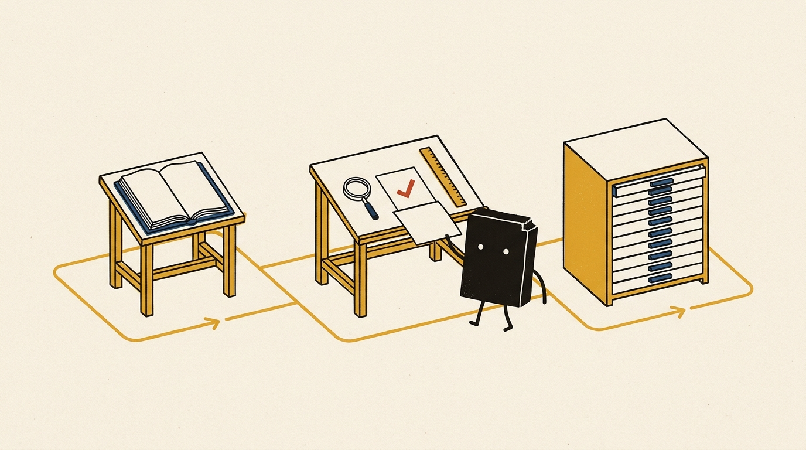
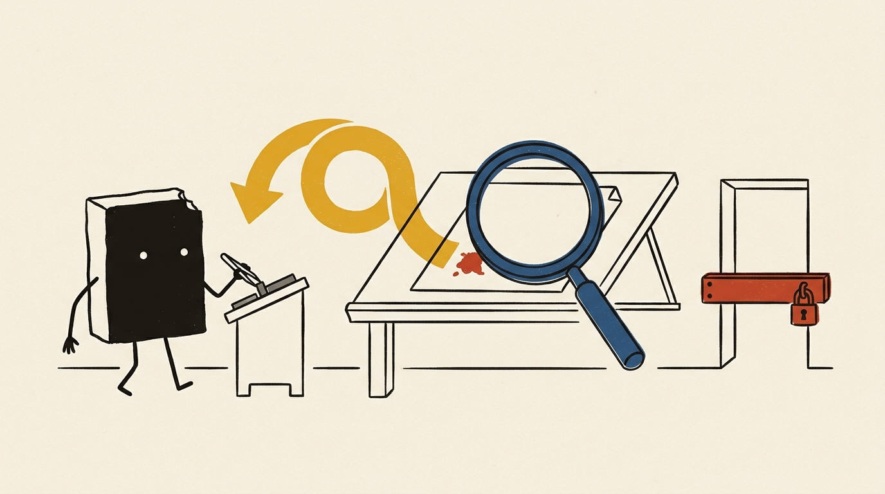

AIコーディングエージェントを使った中〜大規模な開発では、途中でモデルやエージェントを替えなければならない場面が必ず出てきます。

コストの見直し、新しいモデルの登場、利用できるプロバイダーの変更、レートリミット（利用上限）への到達、あるいは社内で使うツールの変更（Claude Code から Cursor や Cline への移行など）が典型的な理由です。

しかし、いざ開発の途中でモデルを切り替えると、現場ではしばしば手痛いトラブルが起きます。「さっきまでの一貫した設計方針が急に無視される」「すでに終わったタスクをもう一度書き始める」「エラー処理やテストの書き方が突然バラバラになる」——。私自身、モデルを切り替えた直後に、前のセッションで2時間かけて固めた設計前提をあっさり覆され、別方式でコードを上書きされて頭を抱えたことが何度もあります。

では、どうすれば途中交代による品質低下や手戻りを防げるのでしょうか？

この記事では、次の3つの問いに順番に答えていきます。

1. **途中で替えると、なぜ・何が起きるのか**
2. **品質と効率を保つには、事前に何を用意しておけばよいか**
3. **実際に替えるときは、どういう手順で進めればよいか**

先に結論を書くと、**判断と状態をモデルの頭の中ではなくリポジトリに残しておけば**（コンテキストに依存しない）、切り替えの影響は直後の数ターン程度で済みます。

---

## 1. 切り替えで何が起きるか

### 1.1 失われるもの

モデルやエージェントの切り替えで起きる問題は、そのほとんどが「**前のモデルの頭の中にしかなかったもの**」が失われることから生じます。

```
┌─────────────────────────────────────────────────────────────┐
│ 前のモデルの頭の中（会話コンテキスト・思考過程）             │
│  ・なぜこの設計にしたか（ボツにした案とその理由）            │
│  ・どこまで終わって、次に何をすべきか                        │
│  ・暗黙のコーディング慣習・命名の揃え方                      │
└──────────────────────────────┬──────────────────────────────┘
                               │ ✕ 切り替えで消失・断絶
                               ▼
┌─────────────────────────────────────────────────────────────┐
│ 新しいモデル（白紙状態からスタート）                         │
│  ・既存の設計意図が分からず、自分の好みで作り直してしまう    │
│  ・完了済みタスクの重複実装や、やりかけ作業の見落とし        │
│  ・命名、エラー処理、テストの作法が急にばらつく              │
└─────────────────────────────────────────────────────────────┘
```

| 失われるもの | 現場で起きる結果 |
|---|---|
| **設計判断の理由** | 新しいモデルが背景を知らず、既存の設計を別方式で作り直してしまう |
| **進捗**（どこまで終わったか） | 完了済みの部分を重複して実装する、途中の作業を見落とす |
| **書き方の慣習** | 命名規則、エラー処理、テストの書き方がモデルごとにばらつく |

このほかに、**モデル自体の能力差**（下位モデルや軽量モデルへ替えた場合、複雑な変更が破綻しやすい）と、**状況を把握し直すためのトークン消費や待ち時間**が発生します。

### 1.2 何を替えるかで影響の大きさが変わる

一口に「切り替え」といっても、同じエージェント内でモデルだけを替えるのか、エージェント（ハーネス）ごと替えるのかで引き継がれる範囲が変わります。

| 比較項目 | モデルだけ替える | エージェントごと替える |
|---|---|---|
| **規約ファイル・ツール・権限** | そのまま残る | エージェント固有のもの（フック、権限、規約ファイル名）は引き継がれない |
| **会話履歴** | テキストは残るが、思考過程（reasoning）は失われることが多い | 引き継がれない（新規セッション） |
| **書き方の癖・ツールの使い方** | 系統が同じモデル同士なら差は小さい | 差が大きい |
| **一時的なコスト** | プロンプトキャッシュが無効になり、切り替え直後にコストと待ち時間が増える | 状況の把握し直しが必要になる |
| **影響の大きさ** | **小さい** | **大きい** |

とはいえ、**どちらの場合も対策の考え方はまったく同じ**です。違いは、エージェントごと替える場合に「エージェント固有の設定を移し替える作業」が加わることだけです（具体的な移し替え手順は 3.2 節で解説します）。

---

## 2. 対策の原則：頭の中ではなく、リポジトリに残す



切り替えで失われるものを、特定のモデルに依存しない **3つの場所** に分けて残しておきます。

| 残すもの | 置き場所 | 役割 |
|---|---|---|
| **文脈**（方針・判断・進捗） | **ファイル** | 新しいモデルが「何を、なぜ」を知る |
| **品質の基準** | **ツール** | どのモデルが書いても同じ基準で判定する |
| **経緯**（何をいつ変えたか） | **git** | 作業の記録と、失敗したときの復旧手段 |

---

### 2.1 文脈をファイルに残す

チャットのやり取りだけで方針を決めるのをやめ、以下の3種類のファイルとしてリポジトリに永続化します。

| ファイル | 記録する内容 |
|---|---|
| `AGENTS.md`（規約） | 技術スタック、フォルダ構成、命名規則、禁止事項、完了の条件、セッション開始時の手順 |
| **ADR**（設計判断の記録） | 何を、なぜ決めたか。**採用しなかった案とその理由** |
| `PROGRESS.md`（進捗） | 完了・作業中・未着手のタスク、次の作業、既知の問題 |

特に効くのが ADR（Architecture Decision Record）の「**なぜその案を採用しなかったか**」の記録です。これがないと、交代した新しいモデルが「こっちの書き方のほうが一般的ですよ」と、過去に検討してボツにした方式へ勝手にリファクタリングしてしまう事故が頻発します。

#### 運用のポイント
- **規約の本体は `AGENTS.md` に一元化する**：エージェント固有のファイル（`CLAUDE.md` や `.cursorrules` など）には本体を書かず、`AGENTS.md` を参照する設定だけを書きます。こうしておけば、エージェントを替えても規約を二重管理せずに済みます。
- **明示的で構造化された書き方にする**：特定のモデルの「行間を読む力」に頼った曖昧な指示は避け、手順と条件を箇条書きで明確に定義します。

```markdown
<!-- AGENTS.md（抜粋） -->
## セッション開始時に必ず行うこと
1. `git status` で未コミットの変更がないか確認する
2. `git log --oneline -20` で直近の作業の流れを把握する
3. `PROGRESS.md` と ADR を読む
4. 把握した内容と作業計画を要約し、確認を得てから着手する

## 完了の条件
- `make check` がエラーなしで通ること
- `# noqa`・`# type: ignore` の追加、テストの skip、`git commit --no-verify` は禁止
- 既存の設計を大きく変える場合は、先に理由を報告する
```

---

### 2.2 品質をツールで強制する



#### なぜツールなのか
規約ファイルに書いた自然言語の指示は、あくまでモデルに対する「**お願い**」です。上位モデルなら丁寧に守ってくれても、モデルを替えた途端に守られ方がばらつきます。
一方、ツールによる機械的なチェックは「**強制**」です。どのモデルが書いたコードに対しても、毎回寸分違わず同じ基準を当てることができます。

#### 何を使うか（Python の例）

| ツール | 防ぐもの |
|---|---|
| **Formatter**（`ruff format`） | 書式のばらつき。自動で直す |
| **Linter**（`ruff`） | 規約違反、バグになりやすい書き方 |
| **型チェック**（`mypy`） | 引数や戻り値の取り違え |
| **テスト**（`pytest`） | 既存機能の破壊 |
| **pre-commit、CI** | チェックの実行漏れ、すり抜け |

#### 運用のポイント
- **コマンドを `make fmt` と `make check` の2つに集約する**：フック・pre-commit・CI のどこからでもこの2つだけを呼ぶようにします。こうすると、ツールの細かいオプション設定がエージェントから隠蔽され、エージェントに依存しなくなります。

```makefile
fmt:
	ruff format . && ruff check --fix .
check:
	ruff format --check . && ruff check . && mypy src/ && pytest -q
```

- **自己修正のループを回す**：`make check` の結果をエージェントに返し、エラーがなくなるまで自分で直させます。エージェントにフック機能（Post-tool-use hook 等）があれば、ファイル編集のたびに自動で `make fmt` を実行させます。
- 「**エラー消しの抜け道**」を **CI で塞ぐ**：ここが実務上の急所です。モデルはエラーがなかなか消えないとき、チェックを通すために **`# noqa` を付ける、テストを `skip` する、設定ファイルを緩める**といった「ズル」を働くことがあります。これは規約で禁止したうえで、CI でも差分で機械的に検出して落とします。

```bash
# 設定ファイルの無断変更を検出
git diff --name-only origin/main | grep -E 'pyproject.toml|pre-commit|workflows' && exit 1

# noqa / type: ignore / skip の追加を検出
git diff origin/main | grep -E '^\+.*(# noqa|# type: ignore|pytest.mark.skip)' && exit 1
```

- **重要なテストは人が見る**：テストコード自体もモデルに書かせると、自分の実装に合わせた「甘いテスト（緩いアサーション）」になりがちです。重要な仕様のテストは必ず人間がレビューします。

---

### 2.3 経緯を git に残す

#### なぜ git なのか
git の履歴が整っていれば、新しいモデルは「何を、いつ、なぜ変えたか」を自分で辿ることができます。作業が失敗したときに安全に戻すこともでき、pre-commit や CI での差分チェックも git が前提になります。

#### 運用のポイント
- 履歴の有無よりも「**コミットの質**」がすべて：`fix` や `WIP` だけの雑なコミットが並んでいても、新しいモデルは文脈を読み解けません。**1タスクを1コミット**にし、コミットメッセージ本文に「理由」と「未対応事項」を書かせます。

```text
feat(alert): アラートの台帳照合を追加

- アラートIDとメッセージ本文の両方で照合する（IDだけでは機器ごとに重複するため）
- 未対応：別製品のアラート形式（次のタスク）
```

- **履歴を調べる手順を `AGENTS.md` に明記する**：観察していると分かりますが、エージェントは「今の状態」（`git status` や直近のコミット一覧）は自分から見に行くものの、「変更の理由」を `git log -p` や `git blame` で深掘りすることは自発的にはあまりしません。そのため、セッション開始時の確認手順として `AGENTS.md` に組み込んでおくのが確実です（2.1 節の例を参照）。
- **読み取り系の git コマンドは承認なしで許可する**：`status`、`log`、`diff`、`blame`、`show` などの読み取りコマンドに毎回人間の承認が必要だと、エージェントは確認を面倒がって省くようになります。これらは自動実行を許可しておきます。
- **git に残らないものはファイルと役割分担する**：git に残るのは「コミットしたコードの変更」だけです。まだ着手していない計画は `PROGRESS.md` に、採用しなかった案は ADR に残します。

---

## 3. 実践：切り替えの具体的な手順

実際に開発途中でモデルやエージェントを切り替える際は、「切り替え前・切り替え時・切り替え後」の3段階で進めます。

```
[1. 切り替え前]               [2. 切り替え時]               [3. 切り替え後]
・タスクの区切りを確認         ・規約参照・フック・権限の     ・状況と計画を要約させ人が確認
・未コミット変更の解消           移し替え（エージェント交代時）・小タスクで自己修正ループ検証
・PROGRESS.md / メモ更新      ・新セッションで開始          ・最初の数タスクを重点レビュー
・make check 通過 + git tag
```

### 3.1 切り替え前

1. **作業がタスクの区切りに達していることを確認する**：ファイル編集やツール呼び出しの真っ最中には絶対に替えません。
2. **未コミットの変更を解消する**：コミットするか、不要なら破棄してワーキングツリーをクリーンにします。
3. **前のモデルに `PROGRESS.md` と引き継ぎメモを更新させる**：現在の状態、決めたこととその理由、次の作業を書き出させます。
4. **`make check` が通る状態でタグを付ける**（例：`git tag before-switch`）：切り替え後にエラーが出た際、「前から壊れていたのか、新しいモデルが壊したのか」を即座に切り分けられるようにするためです。

### 3.2 切り替え時（エージェントごと替える場合だけ）

エージェントごと乗り換える場合は、エージェント固有の設定を新しい環境へ移し替えます。

| 項目 | 移し替え作業 |
|---|---|
| **規約ファイル** | 新しいエージェントが読むファイル名（`CLAUDE.md`、`.cursorrules` 等）を確認し、`AGENTS.md` を参照させる |
| **フック** | 編集後に `make fmt` を実行するよう設定する。フック機能がなければ規約で指示し、pre-commit で強制する |
| **権限** | 読み取り系の git コマンドを許可し、`--no-verify`、`push --force`、設定ファイルの編集を禁止する |

モデルだけを替える場合は、この作業は不要です。なお、これまでの会話履歴が長くなっている場合は、そのまま古い履歴を引き継ぐよりも、**新しいセッションを開いて `AGENTS.md` と `PROGRESS.md` を読ませて始めるほうが、コンテキストの汚染がなく安定しやすくなります**。

### 3.3 切り替え後

1. **状況と作業計画を要約させ、人が確認する**：いきなりコードを書かせず、まず `AGENTS.md`、`PROGRESS.md`、ADR、git 履歴を読ませ、現状認識とこれからの作業計画を要約させます。ズレがあればここで修正します。
2. **小さな確認用タスク**で「**自己修正のループ**」を試す：最初から大きな変更を任せず、小さなタスクで「エラーを抜け道（`noqa` 等）で消さずに、正面から直せるか」を確かめます。
3. **最初の数タスクを重点レビューする**：軌道に乗るまでの数タスクは、設定ファイルの変更、`noqa`・`skip` の増加、テストのアサーションが弱められていないかを人間が重点的にチェックします。

---

## 4. まとめ

モデルやエージェントの切り替えで失われるのは、「**前のモデルの頭の中にしかなかったもの**」です。それを次の3か所に残しておけば、途中でモデルやエージェントを替えても品質は大きく崩れません。

- **文脈はファイルに**：`AGENTS.md`、ADR、`PROGRESS.md`
- **品質の基準はツールに**：`make check` を完了の条件にし、pre-commit と CI で強制する
- **経緯は git に**：1タスク1コミットにし、変更の理由を書く

そのうえで、タスクの区切りで替え、替えた直後は人間が要約と差分を確認する。特定のモデルに依存しないこの進め方は、モデル交代への備えになるだけでなく、日々のAI駆動開発の品質そのものを支える強固な土台になります。

皆さんの現場では、モデルやエージェントを切り替える際にどんな工夫をしていますか？ぜひコメント欄で知見を共有してください！
