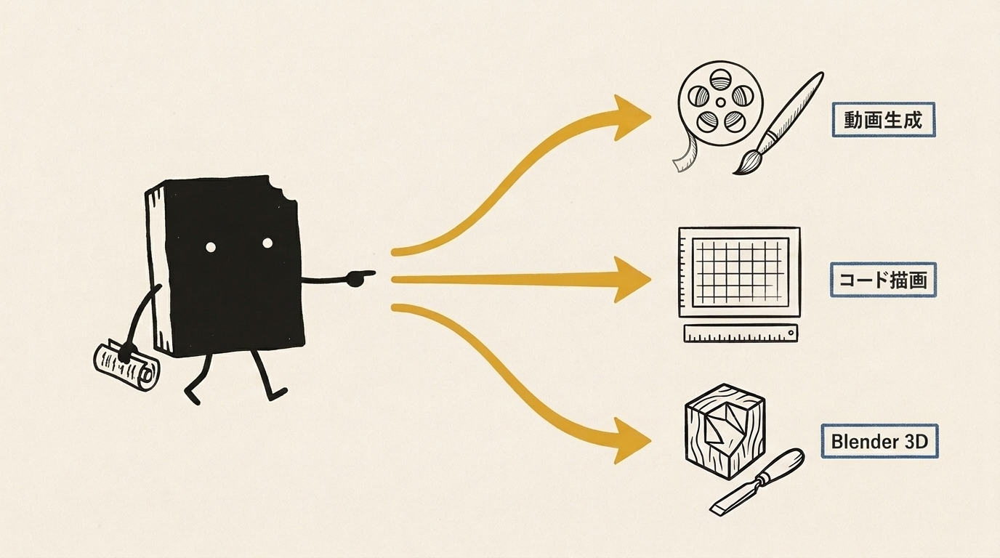
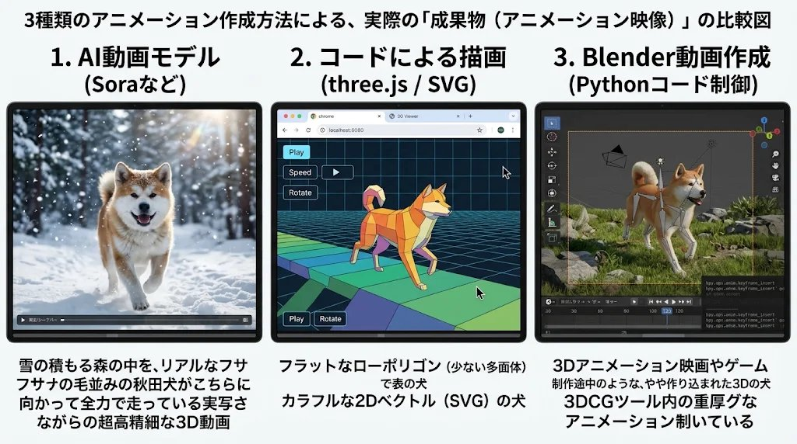
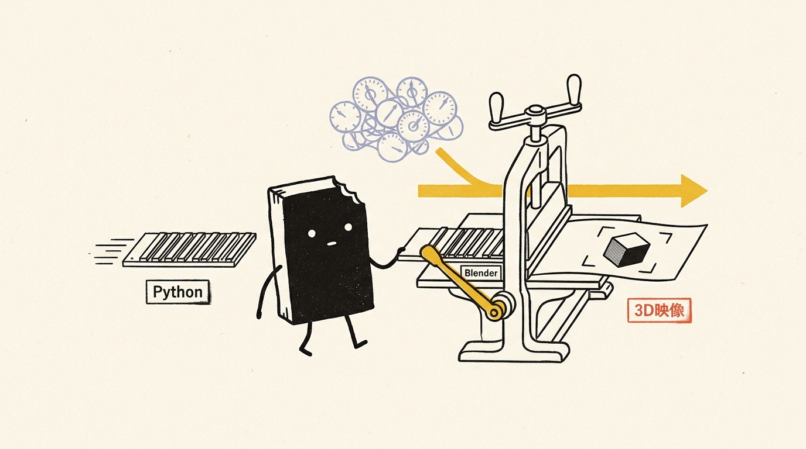
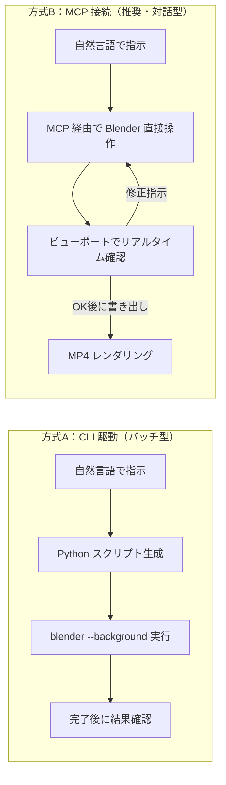

動画生成モデルではなく、**言語モデル** がコードを書いて3Dアニメーション動画を作り上げてしまう。Claude Opus 5.5 の登場あたりから一気に火がついたこの「コードでアニメーションを作る」流れは、続く Claude Fable 5.2 などの最新モデルによって映画のワンシーン級の表現にまで広がり、SNSや動画プラットフォームで大きな話題になっています。

「AIで動画を作る＝SoraやSeedanceのような動画生成モデルにプロンプトを投げること」と思い込んでいると、この動きは少し不思議に見えるかもしれません。けれど実際の制作現場では、**動画生成モデル一択の時代はすでに終わりつつあります**。用途に応じて「ピクセルを直接生成する」「ブラウザ向けのコードで描画する」「プロ仕様の3Dソフトをエージェントに操作させる」の3ルートを使い分けるのが現実解になってきました。

実は私自身も動画作成のスキルを自作し、それを使って [TikTok（@lumichy1）](https://www.tiktok.com/@lumichy1) で動画を投稿しています。自作スキルの具体的な設計や運用ノウハウについては別の機会に改めて紹介したいと考えていますが、今回はまず土台となる全体像として、**AIエージェントで動画を作成する3種類の方法** とそれぞれの使い分け、そして話題の Blender × エージェント連携の実践手順を整理します。

この記事を読み終えるころには、自分の作りたい動画に対してどのルートを選ぶべきか、さらにトークンやレンダリング時間を無駄にせず回すための急所まで一通り掴めるはずです。

---

## 1. クイックリファレンス：AIエージェントで動画を作る3つのルート比較

最初に全体像を1枚の表にまとめておきます。AIエージェントを軸に動画を作る場合、技術ルートは大きく次の **3種類** に分かれます。

| 比較項目                 | 方法①：AI動画生成モデル                | 方法②：フロントエンドコード駆動          | 方法③：Blender × AIエージェント                  |
| ------------------------ | -------------------------------------- | ---------------------------------------- | ------------------------------------------------ |
| **代表的な技術**         | Seedance、MiniMax H3 など              | Three.js、HTML / CSS / SVG / Canvas      | Blender + Python API（`bpy`） / MCP              |
| **生成の仕組み**         | 拡散モデル等で映像ピクセルを直接生成   | コードをブラウザで描画しフレーム結合     | Python や MCP で3Dシーンを構築・レンダリング     |
| **文字・構造の正確さ**   | 崩れやすい（文字化け・形状変化あり）   | 極めて高い（座標・テキストを厳密制御）   | 極めて高い（3D空間の配置・構造を厳密制御）       |
| **ビジュアル質感・表現** | 実写調・映画的カメラワーク・人物に強い | パーティクル・データ可視化・UI系に強い   | 精密モデリング・リアルな材質・ライティングに強い |
| **レンダリング速度**     | 速い（数秒〜数分で出稿可能）           | 速い（リアルタイム描画に近い）           | 遅い（高画質設定ほど時間がかかる）               |
| **主な弱点**             | 細部やカメラ回転時の一貫性制御が難しい | 複雑な3D造形やフォトリアル質感に限界     | レンダリング待ちとトークン消費が重い             |
| **向いている用途**       | クリエイティブ重視、人物、SNS短尺映像  | 科学・技術デモ、3Dデータ可視化、高速量産 | 製品分解図、機械・建築解説、高品質3Dアニメ       |

同じ「走る犬」をテーマにしても、3つのルートでは出力される映像の質感や制御の方向性がここまで変わります。



要するに、**何を絶対に崩したくないか** で選び方が決まります。見た目の勢いと速さなら①、コードによる厳密さと軽快さなら②、構造の正確さとプロ級の3D質感を両立したいなら③です。

---

## 2. 3つのアプローチを深掘り：何が違い、どこで選ぶか

### 方法①：AI動画生成モデル（ピクセル直接生成ルート）

Seedance や MiniMax H3 のような動画生成モデルを使い、映像そのものをピクセル単位で直接出力させるアプローチです。AIエージェントと組み合わせる場合は、エージェントが「企画立案 → シーン分割 → 各カットのプロンプト生成 → 動画生成APIやローカル推論の呼び出し → 音声・字幕との結合」といったディレクター役を担います。

最大の武器は、**視覚的なインパクトと制作スピード** です。人物の自然な所作、映画的なカメラワーク、派手なVFX演出を短時間で出せるのは、やはり動画生成モデルの独壇場といえます。SNS向けのショート動画や、まず空気感で視聴者の目を止めたい導入カットでは圧倒的に便利です。

一方で、実際に何度も回してみると必ずぶつかる壁があります。それが **文字の正確さ** と **空間構造の一貫性** です。画面内のラベル文字が微妙に潰れたり、カメラが裏側へ回り込んだ瞬間に機械のパーツ配置がいつの間にか別物に変わっていたりする現象は、2026年時点のモデルでもゼロにはなっていません。図解や製品構造のように「1ミリのズレも誤解を生む」映像には不向きです。

### 方法②：フロントエンドコード駆動（Three.js / HTML・SVG ルート）

言語モデルが HTML / CSS / SVG や **Three.js** のコードを書き、ブラウザ（あるいはヘッドレスブラウザ）で描画したフレームを繋いで動画にするアプローチです。私自身も日々の動画制作のなかで痛感していますが、コードベースに切り替えた瞬間に「文字化け」と「意図しないレイアウト崩れ」のストレスから一気に解放されます。

特に **Three.js** を使うと、3D空間をコード駆動でそのまま扱えます。

* テック感のあるパーティクル演出
* 数値データと連動した3Dデータ可視化
* アルゴリズムやネットワーク通信の手続き的な解説デモ

こうした用途では、Blender を立ち上げるよりも Three.js のほうがずっと直感的で、何より **レンダリングが圧倒的に速い** のが強みです。試行錯誤の回転数を上げたい解説系チャンネルや、Web上でそのままインタラクティブに見せたい教材とは抜群に相性が合います。

ただし弱点もはっきりしています。複雑な形状の3Dモデリングや、金属・ガラス・布といったリアルな材質表現、物理ベースの凝ったライティングまで求め始めると、ブラウザ描画だけでは表現力に天井が見えてきます。

### 方法③：Blender × AIエージェント（Python API / MCP 駆動ルート）

そこで Opus 5.5 以降一気にホットになり、Fable 5.2 などの最新モデルでさらに注目度が高まっているのが、**Blender** をAIエージェントに操作させる第3のルートです。



[Blender](https://www.blender.org/) は1994年に誕生した無料・オープンソースの3D制作ソフトです。モデリング、マテリアル設定、ライティング、アニメーション、VFX、最終的な動画レンダリングまで、3D映像制作の全工程がソフト1本で完結します。短編アニメはもちろん、商業広告や映画の特撮でも現場投入されている本格的なツールです。

これまで Blender の最大のハードルは「操作が難しすぎる」ことでした。画面に並ぶ膨大なパネルとショートカットを人間が覚えるだけで数か月かかります。

ところが、Blender には **AIエージェントと噛み合う決定的な設計** がありました。それは、マウスでクリックして行う操作のほぼすべてが、内蔵の **Python API** （`bpy`）でそのまま書けるという点です。

* 立方体を1つ配置する → Python 1行
* 色や材質を割り当てる → Python 1行
* アニメーションのキーフレームを打つ → Python 1行

つまり、人間が複雑なGUIを必死に覚える必要はありません。作りたい映像を自然言語でAIエージェントに伝え、エージェントが Python コードを書いて Blender に渡すだけで、プロ仕様の3Dパイプラインが動き出します。

参考動画でも、このルートで実際に作られた4つの表現ジャンルが紹介されていました。

1. **テック製品の高質感レンダリング** — 半導体チップの分解アニメーション（エクスプロードビュー）や、GPU・回路内部のデータフロー解説。動画投稿者自身も Codex + Blender でGPUの動作原理解説を作成していました。
2. **3Dカートゥーンアニメーション** — Claude Code や DeepSeek をモチーフにした3Dキャラクターのショートアニメ。
3. **映画級CG・ゲームプロモーション映像** — 実写と見紛うライティングと質感を乗せたシネマティック表現。
4. **建築・インフラの工学解説アニメ** — 超高層ビルが1階ずつ組み上がっていく建築プロセスや、光ファイバー通信・クラウドAIの動作解説。

### 3つのルートは「択一」ではなく組み合わせられる

ここまでの整理を一言でまとめるなら、判断基準は次の3行に尽きます。

* **視覚的なクリエイティブとスピード最優先** → AI動画生成モデル
* **コードによる厳密制御と高速レンダリング** → Three.js などのフロントエンドコード
* **精密な3D造形とプロ級の質感・ライティング** → Blender × AIエージェント

とはいえ、現場で本当に効くのは「どれか1つに縛られない」設計です。たとえば冒頭の3秒だけAI動画生成モデルで目を引くカットを作り、本編の仕組み解説は Three.js や Blender で正確に見せる。実際の制作では、こうしたハイブリッド構成がいちばん歩留まりが良くなります。

---

## 3. 実践クイックスタート：AIエージェントから Blender を動かす2つの方法

ここからは、3つ目のルートである **Blender × AIエージェント** を実際に手元で試す手順を整理します。

まず共通の事前準備はたった1つ。[Blender 公式サイト](https://www.blender.org/) から Blender をダウンロードしてインストールしておくだけです。インストールが終われば、細かいUI操作を覚える前にエージェント側へ主導権を渡して構いません。

エージェントから Blender を動かす接続方式は、大きく **CLI 駆動** と **MCP 接続** の2種類があります。



### 方式A：CLI 駆動（ヘッドレスバッチ実行）

Claude Code、Codex、DeepSeek Harness といったコーディングエージェントに Python スクリプトを書かせ、コマンドラインから Blender をバックグラウンド実行（`--background`）してそのまま動画を書き出す方式です。

最小構成の Python スクリプト（`render_scene.py`）は次のような骨格になります。

```python
import bpy

# 既存オブジェクトを初期化して新規シーンを構築
bpy.ops.wm.read_factory_settings(use_empty=True)

# 1. 立方体・カメラ・ライトを配置
bpy.ops.mesh.primitive_cube_add(size=2, location=(0, 0, 0))
cube = bpy.context.active_object

bpy.ops.object.camera_add(location=(5, -5, 4), rotation=(1.1, 0, 0.78))
bpy.context.scene.camera = bpy.context.active_object

bpy.ops.object.light_add(type='AREA', location=(4, -2, 6))
bpy.context.active_object.data.energy = 300

# 2. 回転アニメーションのキーフレームを設定
scene = bpy.context.scene
scene.frame_start = 1
scene.frame_end = 72
scene.render.fps = 24

cube.rotation_euler = (0, 0, 0)
cube.keyframe_insert(data_path="rotation_euler", frame=1)
cube.rotation_euler = (0, 0, 6.283185)  # 360度回転
cube.keyframe_insert(data_path="rotation_euler", frame=72)

# 3. 出力解像度と MP4（H.264）設定
scene.render.resolution_x = 1280
scene.render.resolution_y = 720
scene.render.image_settings.file_format = 'FFMPEG'
scene.render.ffmpeg.format = 'MPEG4'
scene.render.ffmpeg.codec = 'H264'
scene.render.filepath = '//demo_cube.mp4'

# まずは .blend 保存だけで止め、確認後にアニメーションを書き出すのが安全
bpy.ops.wm.save_as_mainfile(filepath='demo_cube.blend')
# bpy.ops.render.render(animation=True)  # プレビュー確認後にコメントを外す
```

ターミナルからは以下のコマンドで実行できます（環境に合わせて Blender 実行ファイルのパスを調整してください）。

```bash
# Windows（PowerShell）の例
& "C:\Program Files\Blender Foundation\Blender 4.x\blender.exe" --background --python render_scene.py

# macOS の例
/Applications/Blender.app/Contents/MacOS/Blender --background --python render_scene.py

# Linux の例
blender --background --python render_scene.py
```

CLI 方式はバッチ処理や定型テンプレートの大量生成には強い反面、実行が終わるまで途中の見た目を確認しづらいのが難点です。

### 方式B：MCP 接続（推奨・リアルタイム対話型）

普段の制作で特におすすめなのが、オープンソースの **[MCP for Blender](https://github.com/ahujasid/mcp-for-blender)** （旧称 `blender-mcp`）を使う方式です。

MCP（Model Context Protocol）経由で接続しておくと、エージェントが起動中の Blender を直接操作しつつ、現在のシーン構造やビューポートの描画結果を確認しながらリアルタイムに修正を回せます。参考動画でも、実用面ではこの MCP 方式が推奨されていました。

導入は次の2ステップで完了します（`uv` が入っている環境を前提にしています）。

1. **Blender 側アドオンの有効化**
   [ahujasid/mcp-for-blender](https://github.com/ahujasid/mcp-for-blender) から `addon.py` を取得し、Blender の `Edit > Preferences > Add-ons` からインストール・有効化します。3Dビューポート上で `N` キーを押してサイドバーを開き、`MCP for Blender` タブからサーバーを起動しておきます。
2. **エージェント側への登録** （MCPクライアント設定）
   自動セットアップコマンドを使うか、利用中のクライアントへ登録します。

```bash
# 自動検出して設定する場合
uvx mcp-for-blender setup

# Claude Code CLI へ直接登録する場合
claude mcp add blender uvx mcp-for-blender --scope user
```

Claude Desktop や Cursor などで JSON を手動設定する場合は以下を追記します（旧パッケージ名 `blender-mcp` も互換ラッパーとして動作しますが、新規導入では `mcp-for-blender` を使うのが確実です）。

```json
{
  "mcpServers": {
    "blender": {
      "command": "uvx",
      "args": ["mcp-for-blender"]
    }
  }
}
```

Windows 環境で `uvx` のパス解決がうまく通らない場合は、`"command": "cmd"`、`"args": ["/c", "uvx", "mcp-for-blender"]` の形式にすると安定します。

---

## 4. トークンと時間を溶かさないための実践ノウハウ4選

Blender × AIエージェントは見た目が派手なぶん、正面からぶつかると **トークン消費** と **レンダリング待ち時間** で簡単に消耗します。参考動画で紹介されていた現場の工夫と、私自身が動画制作フローを回すなかで痛感している防衛策を4点に絞って共有します。


### ① いきなりモデリングしない。「先に静止画 → 次に3D化」

最初からエージェントに「サイバー風のGPU解説アニメを Blender で作って」と投げると、かなりの確率で想像と違うテイストの3Dシーンが出てきます。そこから「もっと光を暖かく」「カメラをもう少し引いて」とチャットで直していくと、Blender 向けの複雑なコード生成を何度もやり直す羽目になり、トークンが一気に溶けます。

これを防ぐ一番効く手順が、**先に画像生成AIで1枚のキービジュアルを固める** ことです。静止画の生成は速く、コストも軽いので、構図・配色・質感の方向性を画像生成側で納得いくまで詰めます。その1枚をリファレンス画像としてエージェントに渡し、「この画像の雰囲気と配色に合わせて Blender でモデリングしてほしい」と指示すれば、一発目の的中率が段違いに上がります。

### ② いきなり MP4 を書き出させない（プロンプトで明示的に止める）

エージェントに何も制約を付けずに動画制作を頼むと、気を利かせて最初から高解像度の MP4 レンダリングまで一気に走らせようとします。ところが Blender の動画レンダリングはマシン負荷が高く、長尺だと数十分単位で時間がかかります。書き出し終わってから「あ、カメラが被写体にめり込んでいた」と気づくと目も当てられません。

プロンプトには、最初から次の一文を必ず入れておくのが鉄則です。

:::note info
**レンダリング暴走を防ぐプロンプト定型文**
「まずは MP4 の動画レンダリングは実行しないでください。Blender 内で私がプレビュー確認できる状態（`.blend` 保存およびビューポート確認）まで構築し、私がOKを出してからレンダリングを実行してください。」
:::

この1行を足すだけで、確認前の無駄な待ち時間をほぼゼロにできます。

### ③ エージェントとモデルの選び方には明確な差が出る

2026年11月時点では、どのモデルでも同じ品質の3Dコードが書けるわけではありません。空間幾何の把握、カメラ座標の整合性、長い `bpy` スクリプトを破綻なく組み立てる力には、まだはっきりした実力差があります。

動画内での実測感としても、現時点の優先順位はかなり明確でした。

* **最有力** — **Claude + Opus 5.5 / Fable 5.2** （Desktop / Claude Code）。コードによるアニメーション制作が一気に広まった Opus 5.5 をはじめ、最新世代の Fable 5.2 では複雑な3D構図やライティングの破綻が最も少なく、Blender MCP との対話修正も安定しています。
* **次点** — **Codex** （GPT-6 Astra / GPT-6.1 Sol）。GPU解説などのテック系3Dシーンでも十分に実用レベルの結果が出ます。
* **その他のエージェント** — DeepSeek Harness や Qoder などの最新モデルでも単純なシーンは動かせますが、オブジェクト数が増えた複雑な3Dアニメーションになると造形が抽象的になりやすく、現状はまだ試行錯誤が必要な段階です。

複雑な3D動画に挑戦するなら、まずは空間理解と長文コード生成に強い上位モデルでベースを組み、細かい定型作業だけ軽いモデルへ逃がすのが現実的です。

### ④ 長時間レンダリングと「承認待ち停止」への運用対策

Blender での最終レンダリングや複数カットの連続構築はどうしても時間がかかります。席を離れて食事や外出をしている間に回しておきたいところですが、エージェント運用でよくあるのが「帰宅したら最初の10分でコマンド実行の承認ダイアログが出て止まっていた」という事故です。

外出先からでもデスクトップ画面ごと確認して承認やプレビュー操作ができるよう、リモートデスクトップ環境を併用しておくと、PCの前に張り付かずに非同期で動画制作を進められます。

---

## 5. まとめ

AIエージェントで動画を作成する手法は、いま大きく **3つのルート** に整理できます。

1. **AI動画生成モデル** — ビジュアルの勢い・人物・映画的カメラワーク・スピード重視のときに選ぶ
2. **Three.js などのフロントエンドコード** — 文字や構造の正確さと、高速なレンダリング・データ可視化が欲しいときに選ぶ
3. **Blender × AIエージェント** — 構造の厳密さに加えて、精密な3Dモデリングやリアルな質感・ライティングまで欲しいときに選ぶ

この3つはどれか1つを選んだら他を捨てるものではなく、シーンごとに組み合わせてこそ本領を発揮します。特に Blender ルートは「先に静止画で方向確定 → MCP 経由でプレビュー確認 → 最後に MP4 書き出し」という順番を守るだけで、トークン浪費と手戻りをぐっと減らせます。

冒頭でも少し触れましたが、私自身もこうした動画制作パイプラインをエージェントスキルとして自作し、[TikTok（@lumichy1）](https://www.tiktok.com/@lumichy1) で実際に動画を投稿しています。その自作スキルの裏側や、試行錯誤して見えてきた運用のコツについては、また別の記事で詳しくまとめる予定です。

皆さんはAIで動画を作るとき、動画生成モデル派でしょうか、それともコード・Blender派でしょうか。実際に試してハマったポイントやおすすめの組み合わせがあれば、ぜひコメントで教えてください。
