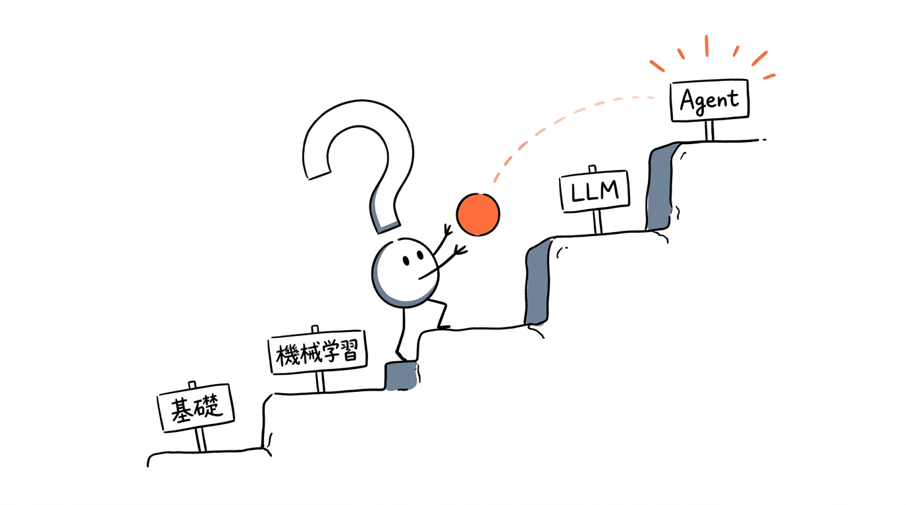
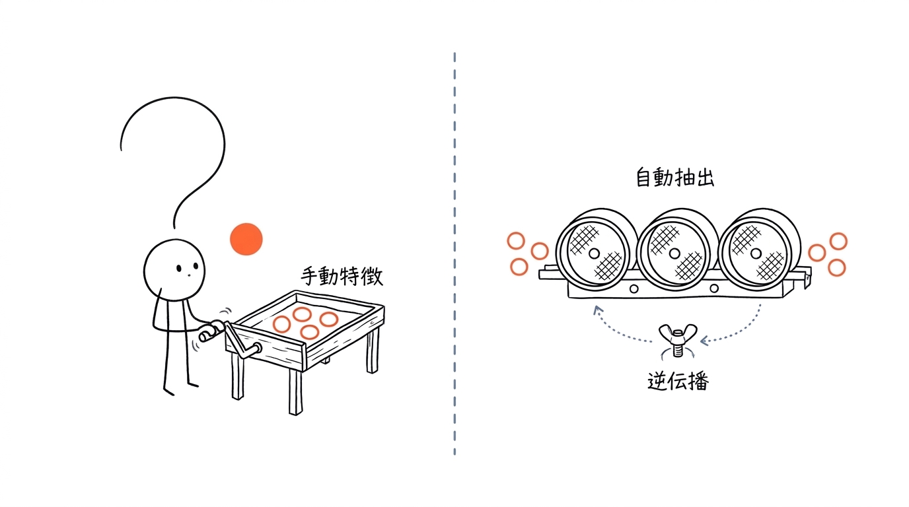
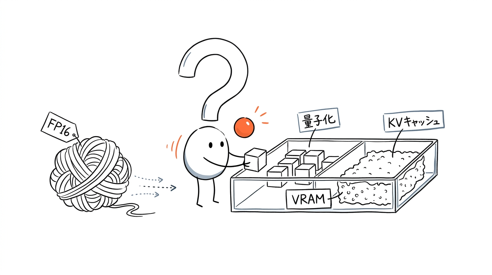

本記事は、これからAIを学ぶ皆さんの少しでもお役に立てばと思い、筆者自身がこれまでのモデル検証やローカルLLM運用、AIエージェント開発を通じて試行錯誤してきた経験をもとに、「この順番で積み上げれば迷わない」と実感できた道筋を一つのロードマップとして整理したものです。

AI技術を学び始めると、誰もが一度は同じ分岐路で立ち止まります。「いきなり最新のAIエージェントやLLMのAPIから触るべきか、それとも高校・大学数学やPythonの基礎から順番に積み上げるべきか」という悩みです。

自分自身の学び直しや周囲の開発支援を通じて痛感するのは、 **極端なボトムアップも極端なトップダウンも途中で失速しやすい** という事実です。線形代数の厳密な証明を1冊終える前に燃え尽きる人もいれば、仕組みを知らないままエージェント基盤を組んでコンテキスト崩壊やデータリークの原因が追えなくなる人も少なくありません。

必要なのは完璧主義ではなく、「今の自分がどの層を学んでいて、それが上の層でどう使われるか」を見渡せる地図です。2026年現在の最新エコシステム（GPT-6・Claude 5・Gemini 4世代のクローズドモデル、DeepSeek V4・Qwen 3.8・Kimi・GLM・MiniMax・Llama 4などのオープンウェイトモデル、画像・動画・音楽・Jev等の非LLMモデル、MCP・Skills・A2Aを軸にしたエージェント開発）までを射程に入れ、以下の **8つの段階** に分けてまとめました。

:::note info
**この記事の使い方と評価基準**
各章は **1. 概念説明・勉強テキスト**、**2. 学習リソースと正直な評価**、および最初の1教材・最小の成果物・終了条件をまとめた **3. 実践の急所と進め方** の3部構成です。
リソース評価の目安は、★5＝この章の最初に軸にすべき定番教材、★4＝用途・英語可否・深さに応じて選ぶ有力教材、★3＝補助解説や特定の専門領域向けとしています。すでに実務経験がある方は第3章や第5章から拾い読みしても構いません。
:::

| 章 | テーマ | 到達ゴール（これができれば合格） |
|---|---|---|
| 第1章 | 基礎基盤：Pythonと数理基礎 | NumPy・Pandas・Matplotlibでデータを加工可視化し、線形代数・微分・確率を直感で説明できる |
| 第2章 | 機械学習：アルゴリズムとデータ分析 | scikit-learnで教師あり・なし学習を組み、リークを防いで評価指標を選べる |
| 第3章 | ディープラーニング：基礎とTransformer・訓練 | 誤差逆伝播とSelf-Attentionの仕組みを追い、事前学習・事後学習・蒸留・LoRAの違いがわかる |
| 第4章 | 現代LLMの基礎・代表的なLLM | 主要クローズド／オープンウェイトLLMの特徴とライセンス・コスト差から適切なモデルを選べる |
| 第5章 | ローカルLLMについて | 量子化とVRAM予算を計算し、Hugging Faceから取得してOllama・llama.cpp・vLLMやクラウドGPUで動かせる |
| 第6章 | LLM以外の特化型・マルチモーダルモデル | 画像・動画・音楽・音声・判断特化Jev・Embedding・空間/3Dモデルを適材適所で組み合わせられる |
| 第7章 | AIエージェント及びフレームワーク | Tool Calling・MCP・Skills・A2Aの役割を区別し、適切なフレームワークで自律処理を組める |
| 第8章 | AI活用方法 | コンテキスト設計と検証ループを業務・開発フローに組み込み、安全に生産性を引き上げられる |

---

## 1. 基礎基盤：Pythonと数理基礎

最初に固めるべき土台は、データ処理のためのプログラミング言語 **Python** と、AIの動作原理を翻訳するための **3大数学** の2つです。ここで大切なのは、Webアプリ開発向けの網羅的なPython文法や、数学科レベルの厳密な定理証明に寄り道しすぎないことです。

### 1-1. 概念説明・勉強テキスト

#### Pythonとデータ処理ライブラリ（3種の神器）

Pythonの基本文法（変数・リスト・辞書・関数・ループ・クラスの基本）を一通り動かしたら、Python本体に同梱される標準ライブラリとは別に、データ処理で最初に覚えるべき **3つの定番外部ライブラリ** へ進みます。

1. **NumPy** — 数値計算・多次元配列 `ndarray`
   素のPythonのリストは要素ごとに型情報を持つため、数百万個の数値計算を `for` ループで回すと極端に遅くなります。NumPyは同じ型の数値を連続したメモリ領域に並べ、C言語レベルで一括計算（ **ベクトル化** ）します。異なる配列サイズを自動で揃えて計算する **ブロードキャスティング** や行列積 `@` は、そのまま第3章のPyTorchテンソル操作へ引き継がれます。
2. **Pandas** — 表形式データの加工 `DataFrame`
   実務のデータはCSVやSQLから取得する「行と列を持つテーブルデータ」が大半です。Pandasを使えば、条件抽出、欠損値の確認、グループ集計、テーブル結合を数行で記述できます。モデルに渡す前のデータの9割はPandasで掃除することになります。
3. **Matplotlib** — データの可視化
   統計量（平均など）だけを見てモデルを組むと、外れ値や偏りを見落として失敗します。ヒストグラムで分布を確かめ、散布図で変数同士の関係を眺める習慣をここで身につけてください。

NumPyとPandasの基本感覚をつかむ最小コードを見てみましょう。AIの内部で起きている「重み付き和」と「データ確認」の原点がここにあります。

```python
import numpy as np
import pandas as pd

# 1. NumPy：特徴量ベクトルと重みの内積（予測スコアの原型）
x = np.array([1.2, 0.5, 3.0])      # 入力データ（3特徴量）
w = np.array([0.8, -0.4, 0.2])     # 重みパラメータ
b = 0.1                            # バイアス
score = x @ w + b                  # @ 演算子で一発の行列・ベクトル積
print(f"線形スコア: {score:.3f}")  # -> 1.460

# 2. Pandas：表データの欠損確認とグループ集計
df = pd.DataFrame({
    "segment": ["A", "B", "A", "B"],
    "spend": [1200, np.nan, 1800, 950],
})
df["spend"] = df["spend"].fillna(df["spend"].median())
print(df.groupby("segment")["spend"].mean())
```

#### AIに必要な3大数学（直感的理解のコツ）

「数式を見ただけで頭が止まる」という人ほど、 **式を読む前に図形のイメージを先に掴む** と一気に楽になります。AIで押さえるべき数学は次の3領域です。

* **線形代数** — ベクトルと行列計算
  ベクトルは「数値の並び」であると同時に「空間上の矢印（点）」です。行列は「空間そのものを回転・伸縮・剪断させて別の座標へ移す変換装置」と捉えてください。2つのベクトルの内積 $a \cdot b = \|a\|\|b\|\cos\theta$ は向きの一致度と各ベクトルの大きさ（長さ）の両方に依存します。あらかじめ各ベクトルの長さを 1 に **正規化** しておくと純粋な方向の近さ（コサイン類似度）だけを取り出せるようになり、そのまま検索・RAG・Attention機構の類似度計算の土台になります。
* **微分** — 勾配降下法と最適化
  AIの学習とは、ひと言でいえば「間違い（損失関数 $L$ ）が一番小さくなるパラメータ $\theta$ の山谷を探す作業」です。微分はその山の現在地で「どちらへ傾いているか」を教える傾きセンサーに過ぎません。多変数になった場合は各変数ごとに傾きを測る **偏微分** を並べたベクトル（勾配 $\nabla L$ ）を使い、傾きと逆向きに少しずつ下山します。

$$\theta_{t+1} = \theta_t - \eta \nabla L(\theta_t)$$

この更新式における $\eta$ が **学習率** （一歩の大きさ）です。歩幅が大きすぎれば谷を飛び越えて発散し、小さすぎればいつまでも谷底に辿り着けません。また、入れ子になった関数の微分をつなぐ **連鎖律** 、いわゆるChain Ruleを頭に入れておくと、第3章の誤差逆伝播法が驚くほど素直に理解できます。

* **確率・統計** — 平均・分散・ベイズの考え方
  現実のデータには必ずノイズが乗ります。データの中心を見る **平均** と散らばり具合を測る **分散・標準偏差** でデータの素性を把握したうえで、 **ベイズの定理** の思考法を押さえましょう。ベイズとは「最初の予想（事前確率）に、新しく観測した証拠（尤度）を掛け合わせて、予想の確信度（事後確率）を更新し続けるルール」です。スパムフィルタから確率的生成モデル、さらには「データが少なければ事前知識が効き、データが増えれば証拠が勝つ」という機械学習の哲学まで一本に繋がります。

### 1-2. 学習リソースと評価

| リソース名 | 形式・費用 | 言語 | 対象レベル | 正直な評価・使いどころ | おすすめ度 |
|---|---|---|---|---|---|
| [Pythonチュートリアル 公式](https://docs.python.org/ja/3/tutorial/) | Web記事・無料 | 日本語 | 入門 | 文法の一次情報として正確です。ただし最初から通読するより、リスト・辞書・関数・クラスの章だけを辞書代わりに拾い読みするのが効率的です。 | ★★★★☆ |
| [Python Data Science Handbook](https://jakevdp.github.io/PythonDataScienceHandbook/)（[GitHub](https://github.com/jakevdp/PythonDataScienceHandbook)） | Web書籍・無料 | 英語 | 入門〜中級 | Jake VanderPlasによる無料公開テキスト。NumPy・Pandas・Matplotlib・Scikit-Learnまでを一通り繋いでノートブック上で動かせます。 | ★★★★☆ |
| [NumPy Quickstart](https://numpy.org/doc/stable/user/quickstart.html) / [10 minutes to Pandas](https://pandas.pydata.org/docs/user_guide/10min.html) / [Matplotlib Tutorials](https://matplotlib.org/stable/tutorials/index.html) | 公式ドキュメント・無料 | 英語 | 入門〜実務 | 分厚い入門書に入る前に公式の短いコードでAPIの作法を確認するのに向きます。リファレンス起点の学習者向けです。 | ★★★★☆ |
| [Kaggle Learn（Python等）](https://www.kaggle.com/learn) | 演習付き講座・無料 | 英語 | 入門 | ブラウザ上でそのままコードを書いて即時採点されるため環境構築不要。1コース数時間で終えられる短い区切りで、最初の着手先に向いています。 | ★★★★★ |
| [3Blue1Brown Essence of Linear Algebra](https://www.youtube.com/playlist?list=PLZHQObOWTQDPD3MizzM2xVFitgF8hE_ab) | 動画・無料 | 英語（日本語字幕/日本語版チャンネルあり） | 全レベル | 行列積・行列式・固有値の意味がアニメーションで視覚的に整理される定番シリーズ。数式暗記で線形代数が苦手に感じた人ほど最初に見る価値があります。 | ★★★★★ |
| ヨビノリ [線形代数 YouTube再生リスト](https://www.youtube.com/playlist?list=PLDJfzGjtVLHnc1vTpBaCNKMUl6HauQv1a)（[公式講義一覧](https://yobinori.jp/video/linear-algebra.html) / [東京図書](https://www.tokyo-tosho.co.jp/)） | 動画（無料）/ 書籍 | 日本語 | 入門 | 計算手順やつまずきやすい定義の翻訳が丁寧。3Blue1Brownで直感を掴んだ後、手を動かして計算手順を確認する用途に向きます。 | ★★★★☆ |
| [AIcia Solid Project YouTube](https://www.youtube.com/@AIcia_Solid)（[線形代数基礎リスト](https://www.youtube.com/playlist?list=PLhDAH9aTfnxKfmufxF59vaZECZJD5j6rd)） /『[妥協しないデータ分析のための 微積分+線形代数入門](https://www.socym.co.jp/book/1480)』（ソシム） | 動画（無料）/ 書籍 | 日本語 | 入門〜中級 | 「なぜデータ分析やAIでこの数式が登場するのか」という接続が明確。大学数学をAI文脈に引き寄せて学び直したい人向けです。 | ★★★★☆ |
| 『[プログラミングのための線形代数](https://www.ohmsha.co.jp/book/9784274065781.html)』（平岡・堀 著、オーム社） | 書籍 | 日本語 | 中級 | ベクトル空間や写像をプログラミング視点で解説したロングセラー。1冊目としては硬めなため、必要に応じて参照する位置づけです。 | ★★★☆☆ |
| DeepLearning.AI『[Mathematics for Machine Learning and Data Science](https://www.coursera.org/specializations/mathematics-for-machine-learning-and-data-science)』（Coursera） | 動画＋Python演習・聴講無料あり | 英語 | 入門〜中級 | Luis Serranoによる図解とPythonラボを組み合わせたコース。勾配降下法やベイズ統計をコードと一緒に復習したい場合に適しています。 | ★★★★☆ |

### 1-3. その他必要な内容（落とし穴・次章への目安）

第1章で最も避けたい失敗は、基礎を完璧にするまで次の章へ進まないことです。固有値分解や重積分の難問が解けなくても、第2章の機械学習や第3章のニューラルネットワークは十分に理解できます。

まずはブラウザだけで無料で動く [Google Colab](https://colab.research.google.com/) を開き、面倒なローカル環境構築に詰まる前にPythonとNumPyを触り始めてください（[Kaggle Notebooks](https://www.kaggle.com/code) や各種クラウド実験環境の比較は第5章末尾の「実験環境の選び方：機械学習やローカルLLMを試す場所」でも詳しく整理しています）。ローカル開発に進む際は、依存関係の解決が速く環境を壊しにくいパッケージマネージャ [uv](https://docs.astral.sh/uv/) を最初から使うと運用が楽になります。

:::note info
**第1章の進め方**
* **最初の1教材**: [Kaggle Learn](https://www.kaggle.com/learn)（Python・Pandas）＋ [3Blue1Brown 線形代数](https://www.youtube.com/playlist?list=PLZHQObOWTQDPD3MizzM2xVFitgF8hE_ab)
* **最小の成果物**: 公開CSVを1つ読み込み、欠損処理・集計・ヒストグラム可視化を行ったノートブック1本
* **終了条件**: NumPy配列で内積やベクトル化演算を `for` ループなしで書け、「行列積＝変換」「勾配降下法＝傾きの逆向きへ下山」「内積の正規化＝方向の類似度」を自分の言葉で説明できれば次章へ進みます
:::

---

## 2. 機械学習：アルゴリズムとデータ分析

第1章でデータを料理する包丁（Python）とレシピの文法（数理）を手に入れたら、第2章ではいよいよデータから規則性を学習して未知のデータを予測する古典的機械学習を動かします。

### 2-1. 概念説明・勉強テキスト

2026年の今はChatGPTやClaudeのような巨大LLMばかりが脚光を浴びますが、実務の売上予測・離脱予測・不正検知・スコアリングといった **表形式データ** の世界では、ディープラーニングよりもこの章で学ぶ古典的機械学習やその発展形（勾配ブースティング木など）のほうが低コストかつ高精度に機能する場面が山ほどあります。何より、 **正しい実験・評価設計の規律** はLLMやエージェント評価にもそのまま適用される一生モノのスキルです。

#### 代表的アルゴリズムの実装（scikit-learnの統一世界）

Pythonの機械学習ライブラリ **scikit-learn** が素晴らしいのは、線形モデルでも決定木でもクラスタリングでも、ほとんどすべてのアルゴリズムが `fit()`（学習）・`predict()`（予測）・`transform()`（変換）という共通作法で動かせる点にあります。

##### 教師あり学習（正解ラベルあり）

* **線形回帰**
  入力特徴量に重みを掛けて足し算し、数値（家賃・売上など）を直接予測する最基本モデルです。実データでは過学習を防ぐ正則化付き変種（Ridge回帰・Lasso回帰）がよく使われます。
* **ロジスティック回帰**
  名前に「回帰」と付いていますが実態は **分類モデル** です。線形結合の結果をシグモイド関数に通して「0〜1の確率」に変換し、境界線を引きます。出力の解釈がしやすく、分類タスク最初のベースラインとして最優秀です。
* **決定木**
  「年齢が30歳未満か？」「利用回数が月5回以上か？」といった `if-then` の条件分岐をデータから自動で学び取る木構造モデルです。人間が判断理由をそのまま追える反面、1本の木だけで深く成長させると訓練データのノイズまで丸暗記する（ **過学習** ）弱点があります。
* **ランダムフォレスト**
  決定木の過学習を抑える代表例が **アンサンブル学習** です。データの一部と特徴量の一部をランダムにサンプリングして何百本もの異なる決定木を作り、最後に多数決・平均を取ることで驚くほど安定した汎用性能を出します。実務でテーブルデータにさらに精度を求める場合は、弱い木を順番に繋いで誤差を修正していく勾配ブースティング決定木（LightGBMやXGBoost）へステップアップします。

##### 教師なし学習（正解ラベルなし）

* **k-means** — クラスタリング
  正解ラベルが存在しないデータを、特徴量空間上の距離が近いグループ（クラスタ）に自動で分割します。最初にグループ数 $k$ を人間が指定し、「重心に近いデータでグループ分け → 重心を再計算」を繰り返して収束させます。顧客セグメンテーションなどの探索分析で定番です。
* **PCA** — 主成分分析・次元削減
  数十〜数千ある特徴量の情報量をできるだけ失わないように「ばらつきが最も大きい向き」へ座標軸を回転させ、2〜3次元などの少ない特徴量へ圧縮します。高次元データの可視化や多重共線性の緩和に力を発揮します。

#### データ前処理と評価設計（プロと初学者の分かれ道）

アルゴリズムを `import` して呼び出すのは3行で終わりますが、実務で明暗を分けるのは **前処理と検証設計の厳密さ** です。

1. **データ分割とリーク防止**
   手元データを **訓練データ** と **テストデータ** 、あるいは交差検証用の検証データへ分割する目的は、「見たことのない未来のデータに対する実力（ **汎化性能** ）」を正しく測るためです。
   初学者がほぼ確実に一度は踏む罠が **データリーク** です。例えばデータの尺度を揃える **標準化** すなわち平均0・分散1へ揃える処理をデータ分割 *前* に全体へかけてしまうと、テストデータの平均や分散という「未来のカンニング情報」が訓練側に漏れ出します。これを構造的に防ぐのが scikit-learn の `Pipeline` です。
2. **欠損値処理とエンコーディング**
   欠損値は `SimpleImputer` で中央値・最頻値補完や「欠損していた事実自体のフラグ化」を行い、文字列のカテゴリ列は `OneHotEncoder` 等で数値化します。
3. **目的に合った評価指標**
   * **Accuracyの罠** — 例えば決済の1%だけが不正取引という不均衡データでは、「すべて正常と答える」だけのダメなモデルでもAccuracyは99%になってしまいます。不均衡データや見落としコストが重いタスクでは、陽性と予測したうち本当に陽性だった割合 **Precision**、実際の陽性のうちどれだけ拾えたか **Recall**、両者の調和平均 **F1スコア**、あるいは確率閾値に依存しない **PR-AUC / ROC-AUC** で評価します。
   * **回帰指標の選び方** — 外れ値に引きずられず「平均何円ズレたか」を素直に見たいときは平均絶対誤差の **MAE** を、大きな外れ値のミスを厳しく罰したいときは二乗平均平方根誤差の **RMSE** を選びます。

実際のリークしない `scikit-learn` の書き方を1つだけ見ておきましょう。この `Pipeline` の型を自分の手癖にしておけば、後工程で酷い事故を起こさずに済みます。

```python
from sklearn.datasets import load_breast_cancer
from sklearn.model_selection import train_test_split
from sklearn.pipeline import Pipeline
from sklearn.impute import SimpleImputer
from sklearn.preprocessing import StandardScaler
from sklearn.ensemble import RandomForestClassifier
from sklearn.metrics import classification_report

X, y = load_breast_cancer(return_X_y=True)

# 1. 何より先に層化分割（テストデータは一切の前処理から隔離）
X_train, X_test, y_train, y_test = train_test_split(
    X, y, test_size=0.2, random_state=42, stratify=y
)

# 2. 前処理とモデルをPipelineに閉じ込める（fitはtrain統計量のみで実行される）
pipe = Pipeline([
    ("imputer", SimpleImputer(strategy="median")),
    ("scaler", StandardScaler()),
    ("clf", RandomForestClassifier(n_estimators=200, random_state=42)),
])

pipe.fit(X_train, y_train)
y_pred = pipe.predict(X_test)
print(classification_report(y_test, y_pred))
```

### 2-2. 学習リソースと評価

| リソース名 | 形式・費用 | 言語 | 対象レベル | 正直な評価・使いどころ | おすすめ度 |
|---|---|---|---|---|---|
| [scikit-learn 公式 User Guide](https://scikit-learn.org/stable/user_guide.html) & [ML Map](https://scikit-learn.org/stable/tutorial/machine_learning_map/index.html) | 公式ドキュメント・無料 | 英語 | 入門〜実務 | APIリファレンスだけでなく「どの手法をどんなときに選ぶか」「なぜその前処理が必要か」の解説密度が高く、手を動かしながら何度も立ち戻る一次資料です。 | ★★★★★ |
| [Kaggle Learn](https://www.kaggle.com/learn)（Intro / Intermediate Machine Learning） | 演習講座・無料 | 英語 | 入門 | 交差検証、データリーク、`Pipeline`、XGBoostの入口まで手が動く短時間講座。最初に機械学習の骨格を一周するのに向いています。 | ★★★★★ |
| 『[Pythonではじめる機械学習](https://www.oreilly.co.jp/books/9784873117980/)』（Andreas C. Müller他 著、オライリー・ジャパン、2017年） | 書籍 | 日本語 | 入門〜中級 | scikit-learnコア開発者による解説書。パラメータ変更で決定境界がどう変わるか・実務でどう前処理するかの直感が身につきます（古典MLの基礎軸は今も有効）。 | ★★★☆☆ |
| *[Hands-On Machine Learning with Scikit-Learn and PyTorch](https://www.oreilly.com/library/view/hands-on-machine-learning/9798341607972/)*（Aurélien Géron 著、O'Reilly、2025年末〜2026年刊） | 書籍（洋書） | 英語 | 初級〜上級 | 通称「ヤモリ本」の最新PyTorch刷新版。前半scikit-learn、後半PyTorch・Transformer・LLM微調整まで一気通貫で学べます。英語で腰を据えて読む場合の筆頭です。 | ★★★★☆ |
| 『[Python機械学習プログラミング PyTorch＆scikit-learn編](https://book.impress.co.jp/books/1122101013)』（Sebastian Raschka他 著、インプレス、2022年） | 書籍 | 日本語 | 中級〜上級 | 理論的背景とスクラッチ実装・ライブラリ実践のバランスが濃い大著。日本語でscikit-learnとPyTorchを体系的に深掘りしたい場合の有力候補です。 | ★★★★☆ |

### 2-3. その他必要な内容（なぜ古典MLの次にディープラーニングへ向かうのか）

古典的な機械学習は表形式の数値データには依然として強い一方、 **画像・音声波形・自然言語** のような高次元かつ文脈依存の非構造データでは大きな壁にぶつかります。写真から「猫か犬か」を当てるために、人間が手作業で「耳の三角形の特徴量」などを切り出すのは限界があるからです。



上の図のように、左の古典的機械学習では人間が特徴量を作る重労働を背負います。それに対して、生データの入力から何段もの表現変換（特徴抽出）までもデータから丸ごと学習し、出力とのズレを後ろから逆向きに配り直して全パラメータを同時最適化するアプローチが、第3章の **ディープラーニング** です。

:::note info
**第2章の進め方**
* **最初の1教材**: [Kaggle Learn](https://www.kaggle.com/learn)（Intro / Intermediate ML）＋ [scikit-learn ML Map](https://scikit-learn.org/stable/tutorial/machine_learning_map/index.html)
* **最小の成果物**: `train_test_split(stratify=...)` と `Pipeline` を組み込み、Accuracy と F1 の両方を出力する分類モデル1本
* **終了条件**: 「前処理を訓練・テスト分割後に分ける理由」と「不均衡データでAccuracyが機能しない理由」を説明できれば次章へ進みます
:::

---

## 3. ディープラーニング：フレームワークと主要アーキテクチャ

現在私たちが使っている大規模言語モデル（LLM）や画像生成AIは、すべてこの章の技術の延長線上にあります。ツールとしてAIを使うだけであれば内部を知らなくても動かせますが、「なぜハルシネーションが起きるのか」「なぜコンテキストが長くなると急に精度や速度が落ちるのか」「なぜファインチューニングで解決する課題としない課題があるのか」を技術的に見抜くには、ニューラルネットワークとTransformerの構造を1度自分の頭で通しておく必要があります。

### 3-1. 概念説明・勉強テキスト

#### ニューラルネットワークの仕組み（参考：Michael Nielsen著オンラインブック）

ディープラーニングの原理を深く直感的に理解したいとき、時代を超えて読み継がれている名著が Michael Nielsen の無料オンライン書籍『[Neural Networks and Deep Learning](http://neuralnetworksanddeeplearning.com/)』です。

1. **パーセプトロンから活性化関数へ** — 同書 第1章
   複数の入力信号に重みを掛けて足し合わせ、ある閾値を超えたら1、そうでなければ0を出力する単純な素子が **パーセプトロン** です。しかし「0か1か」で階段状に切り替わる設計だと、重みを少し動かしただけで出力が突然反転してしまい、微分を使った滑らかな学習ができません。そこで入力に対して滑らかに値が変化する **シグモイド関数** や、現代の定番である **ReLU / GELU / SiLU** といった非線形な **活性化関数** を導入します。活性化関数を挟まずに行列積だけを何層重ねても「1枚の大きな行列積」に縮退してしまうため、 **非線形性こそが多層化で複雑な関数を近似できる理由** になります（同書第4章の普遍性定理）。
2. **順伝播と誤差逆伝播法** — 同書 第2章
   データが入力層から出力層へ向かって計算されていく流れが **順伝播** です。出力と正解ラベルを損失関数（交差エントロピー誤差など）で比べた後、計算グラフの後ろから前へ「各重みが最終的な損失にどれだけ責任を持っていたか」の勾配を計算していく高速アルゴリズムが **誤差逆伝播法** 、英語ではバックプロパゲーションと呼ばれる仕組みです。第1章で確認した連鎖律を、途中の計算結果を再利用しながら行列演算として後ろへ伝播させるだけなので、重みが何億個あっても1回の往復で全パラメータの更新方向が求まります。
3. **PyTorchによる実装と自動微分**
   現代の開発で私たちが手書きでバックプロパゲーションの数式を組むことはまずありません。現在の研究・開発の事実上の標準フレームワークである **PyTorch** を使えば、順伝播のコードを書くだけで裏側で動的に計算グラフが構築され、`loss.backward()` を1行呼ぶだけで自動微分（Autograd）が全勾配を計算してくれます。

<details><summary>最小のPyTorch学習ループの骨格（これだけで4大要素が見える）</summary>

```python
import torch
import torch.nn as nn

model = nn.Sequential(nn.Linear(10, 32), nn.ReLU(), nn.Linear(32, 1))
optimizer = torch.optim.AdamW(model.parameters(), lr=1e-3)
loss_fn = nn.MSELoss()

x = torch.randn(16, 10)
y = torch.randn(16, 1)

# 1. 勾配リセット -> 2. 順伝播 -> 3. 損失計算 -> 4. 逆伝播 -> 5. パラメータ更新
optimizer.zero_grad()
pred = model(x)
loss = loss_fn(pred, y)
loss.backward()
optimizer.step()
```

</details>

#### Transformer（参考：Jay Alammar『The Illustrated Transformer』）

2017年の論文「Attention Is All You Need」で登場した **Transformer** は、自然言語処理とAI全体の地図を塗り替えました。従来のRNNやLSTMは文章を「左から右へ1単語ずつ順番に」処理していたため、GPUで並列計算しづらく、長文になると前の記憶が薄れていく弱点がありました。

この仕組みを視覚的に解きほぐす最良のリソースが、Jay Alammarによる記事『[The Illustrated Transformer](https://jalammar.github.io/illustrated-transformer/)』です。同記事の解説順に添って核心となる部品を辿ってみましょう。

* **Embedding と Positional Encoding**
  単語やサブワード（トークン）を数値のベクトルへ変換した後、単語を順番通りではなく「並列で一斉に入力する」Transformerでは語順情報が失われてしまいます。そこで位置ごとのサイン・コサイン波や回転位置埋め込み（RoPE等）で「何番目の言葉か」という座標情報をベクトルに混ぜ込みます（同記事 *Representing The Order of The Sequence*）。
* **Self-Attention の直感**
  例えば「The animal didn't cross the street because it was too tired.」という文を読むとき、人間は it が何を指すか判断するため animal に強い注目を向けます。Self-Attentionは文中の全トークン同士で「今処理している単語が、文中のどの単語と強く関連しているか」を重みづけする仕組みです。各トークンから検索意図を表す **Query** 、見出しラベルを表す **Key** 、情報の中身を持つ **Value** という3種類のベクトルを作り、次の式で一括計算します。

$$\text{Attention}(Q, K, V) = \text{softmax}\left(\frac{QK^T}{\sqrt{d_k}}\right)V$$

$QK^T$ は「質問 $Q$ と見出し $K$ の内積（相性スコア）」、$\sqrt{d_k}$ での除算はベクトルの次元が大きくなってもソフトマックスが極端に尖り勾配が消えないようにするスケーリングです。あとは確率値に変えて中身 $V$ を重み付き足し算するだけで、「文脈を取り込んだ新しい表現」が完成します。

* **Multi-Head Attention と残差接続・層正規化**
  注目する視点を1つにせず複数ヘッド（8個や32個など）に並列分割することで、「代名詞の参照」「修飾関係」「時制の一致」など異なる観点の関係性を同時に捕捉できます。また、層を重ねても勾配が消えにくいよう入力をバイパスして足し合わせる **残差接続** と **LayerNorm** もしくは RMSNorm を挟み、Feed-Forward Network（MLP）に通す構造が1つのTransformerブロックです。
* **Encoder型・Decoder型・現代LLMの主流**
  原文全体を見渡す双方向AttentionでBERT等の基盤になる **Encoder** と、未来のトークンを隠すマスク付きSelf-Attentionで次を生成する **Decoder** のうち、ChatGPT以降の現代LLMは **Decoder-only型** に収斂しました。「直前までの全トークンを見て、次の1トークンを予測し続ける」単一構造を極限までスケールさせる設計です。

#### LLM訓練方法と知識蒸留（参考動画と現代パイプライン）

Transformerの骨格ができた後、白紙の重みからどうすればChatGPTやClaudeのように賢いAIに育つのでしょうか。LLMの訓練プロセスは大きく **事前学習** と **事後学習** に分かれ、そこへ近年急速に存在感を増している **蒸留** が絡み合います。


1. **事前学習** — Pre-training
   インターネット上のWeb文書、書籍、プログラムコードなど数兆〜数十兆トークン規模のテキストを使い、「次のトークンを当てる」課題だけをひたすら自己教師あり学習で回します。膨大なGPUクラスターと数億円〜数百億円規模の計算コストがかかる工程で、ここで言語能力と世界の知識の土台を備えた **ベースモデル** が生まれます。ただしベースモデルは「質問に答える」ことより「Webページの続きをそれっぽく補完する」ことしか知りません。
2. **事後学習** — Post-training
   ベースモデルを「指示に従い、安全で論理的に考えるアシスタント」へ磨き上げる段階です。
   * **SFT** — Supervised Fine-Tuning（教師あり微調整）。高品質な「質問と模範回答のペア」を数万〜数百万件学習させ、チャット形式や思考手順の型を覚えさせます。
   * **アライメントと強化学習** — RLHF・DPO・RLVR・GRPO。人間の好みを報酬化して最適化するRLHFや、報酬モデルを使わず選好ペアから直接最適化するDPOを経て、2025〜2026年は数学やコードのように「正解を自動検証できる問題」を強化学習で大量に解かせる **RLVR / GRPO** によって、モデルが回答前に長く思考連鎖を回す推論能力（Reasoning）が大きく伸びました。
3. **知識蒸留とAPI規約の背景**
   [LLM訓練プロセスと知識蒸留の仕組みを解説した参考動画](https://www.youtube.com/watch?v=tk4Ipn0RGRA)（約12分半・中国語）でも取り上げられている通り、現在業界で大きな焦点になっているのが「モデル蒸留」の仕組みとビジネス上の攻防です。
   知識蒸留とは、莫大なコストで育てた巨大な **教師モデル** に問題を解かせ、その高品質な出力や推論過程（CoTデータ）を学習データとして、小さくて高速な **生徒モデル** を後から訓練してエッセンスだけを抽出する技術です。
   同動画が焦点に当てているように、莫大な計算資源を投じて最前線のフロンティアモデルを開発したラボ（Anthropicなど）にとって、他社が自社APIを叩いて出力データを大量収集し小型モデルへ安価に蒸留・再現できてしまう構造は、競争優位の防衛や利用規約（ToS）違反の観点から極めてセンシティブな問題になります。エンジニアとしては、「許可されたオープンウェイトモデルを教師にして手元向けの高速・安価な小型モデルへ蒸留する強力な手法」としての技術的価値と、「商用APIの出力を競合モデル訓練へ流用することを禁止する規約リスク」の両面を冷静に区別して理解しておく必要があります。

#### ファインチューニング（いつやり、何を使うのか）

既存モデルに追加学習を施す **ファインチューニング** には、大きく分けて全パラメータを更新する **Full Fine-Tuning** と、ごく一部のパラメータだけを追加学習する **PEFT** と総称される効率化手法群（Parameter-Efficient Fine-Tuning）があります。

現在、実務や個人開発で標準的に選ばれる手法が **LoRA** とその量子化版 **QLoRA** です（Low-Rank Adaptationの略）。元の巨大な重み行列 $W$ は凍結したまま、その横に極小の低ランク行列の積 $B \cdot A$ だけを添えて $W + BA$ の形で差分を学習します。更新対象が全パラメータの1%未満に収まるためVRAM消費量が激減し、推論時は元の重みに足し合わせるだけで遅延増加もゼロに抑えられます。さらにQLoRAでは凍結するベース重み自体を4bit（NF4形式）に圧縮するため、1枚のコンシューマGPUでも7B〜27B級モデルの微調整が可能になりました。

:::note warn
**実務でファインチューニングに手を出す前の鉄則**
「知識を新しく覚えさせたい」だけの目的でいきなりファインチューニングを選ぶのは大抵悪手です。最新知識の注入は第6章の埋め込み・リランカーと第7章で構築手順を扱う検索拡張生成 RAG・コンテキスト設計のほうがはるかに安く正確に更新できます。ファインチューニングが真価を発揮するのは、次の3点に限られます。
1. 出力フォーマットや独自社内トーンの厳格な固定
2. 専門領域の用語感覚・判断パターンの定着
3. 大型モデル並みの精度を小型・低コストモデルに蒸留して落としたい場合
:::

### 3-2. 学習リソースと評価

| リソース名 | 形式・費用 | 言語 | 対象レベル | 正直な評価・使いどころ | おすすめ度 |
|---|---|---|---|---|---|
| [Neural Networks and Deep Learning](http://neuralnetworksanddeeplearning.com/)（Michael Nielsen 著） | Web書籍・無料 | 英語 | 初級〜中級 | 第1〜2章のパーセプトロンと誤差逆伝播法の導出、第4章の普遍性定理の視覚的証明が明快な定番書。コードは旧世代ですが原理理解の補助線として有用です。 | ★★★★☆ |
| [The Illustrated Transformer](https://jalammar.github.io/illustrated-transformer/)（Jay Alammar 著） | Web記事・無料 | 英語（有志日本語訳あり） | 初級〜中級 | Self-AttentionのQ/K/V行列演算を図解で直感的に理解できる定番記事。数式だけで詰まったときに立ち戻る基準として最適です。 | ★★★★★ |
| [YouTube解説動画：LLM訓練と知識蒸留・モデル保護](https://www.youtube.com/watch?v=tk4Ipn0RGRA) | 動画・無料 | 中国語 | 入門〜中級 | LLMの事前学習・事後学習の概要と、モデル蒸留がなぜ商用規約・競争保護の論点になるのかをテンポ良く整理した背景動画です（自動字幕翻訳併用推奨）。 | ★★★☆☆ |
| [3Blue1Brown Neural Networks](https://www.youtube.com/playlist?list=PLZHQObOWTQDNU6R1_67000Dx_ZCJB-3pi) | 動画・無料 | 英語（日本語字幕/吹替あり） | 入門〜中級 | 勾配降下法・逆伝播・GPTのAttentionまでアニメーションで追える良質な補助動画です。 | ★★★★☆ |
| [Neural Networks: Zero to Hero](https://karpathy.ai/zero-to-hero.html)（[GitHub](https://github.com/karpathy/nn-zero-to-hero)） / [Let's build GPT](https://www.youtube.com/watch?v=kCc8FmEb1nY) / [Deep Dive into LLMs like ChatGPT](https://www.youtube.com/watch?v=7xTGNNLPyMI)（Andrej Karpathy） | 動画＋GitHub・無料 | 英語 | 中級 | 逆伝播のMicrogradからGPT自作、さらにPre-training/SFT/RLHF全体講義まで一貫して学べる実践コース。手を動かして仕組みを解体したい中核教材です。 | ★★★★☆ |
| 『[ゼロから作るDeep Learning](https://www.oreilly.co.jp/books/9784873117584/)』シリーズ 全6巻（[第6巻 LLM編](https://www.oreilly.co.jp/books/9784814401611/)・斎藤康毅 著、オライリー） | 書籍 | 日本語 | 入門〜中級 | 日本語技術書における定番シリーズ。1巻（基礎）と2巻（NLP）に加え、2026年6月刊の第6巻 LLM編 ではBPEトークナイザからAttention、CodeBot→StoryBot→WebBotを通じたSFT・DPO・強化学習までPythonで一から実装できます。 | ★★★★★ |
| 『[つくりながら学ぶ！LLM自作入門](https://book.mynavi.jp/ec/products/detail/id=146901)』（Sebastian Raschka 著、マイナビ出版、2024年） | 書籍 | 日本語 | 中級 | PyTorchをベースにGPTアーキテクチャ・事前学習・指示追従微調整・LoRAまで一気通貫で作る実践書。PyTorchでモダンの手順を速習したい場合に向きます。 | ★★★★☆ |
| [PyTorch Tutorials](https://docs.pytorch.org/tutorials/) / [fast.ai](https://course.fast.ai/) / [Hugging Face LLM Course](https://huggingface.co/learn/llm-course)（[PEFT](https://huggingface.co/docs/peft/index) / [TRL](https://huggingface.co/docs/trl/index)） | Web講座・無料 | 英語 | 入門〜実践 | PyTorch公式と、実践ファーストのfast.ai、PEFT・TRL実務エコシステムを学ぶHugging Face講座。ライブラリ実装に移る際の参照先です。 | ★★★★☆ |
| [Stanford CS336: Language Modeling from Scratch](https://cs336.stanford.edu/)（[2026 Spring動画](https://www.youtube.com/playlist?list=PLoROMvodv4rMqXOcazWaTUHhq-yembLCV)） | 大学講義・無料 | 英語 | 上級 | GPUカーネル意識・スケーリング則・分散学習・アライメントまで踏み込む「LLM基盤そのものを研究・訓練する人」向けの専門講義です。 | ★★★☆☆ |

### 3-3. その他必要な内容（どこまで深掘りして次へ進むか）

ディープラーニングやLLMの内部を学ぶと沼の深さに引き込まれがちですが、アプリケーションやAIエージェントを作ることが目標なら、1度小さなニューラルネットとGPTの仕組みを手元で追い「なぜトークン単位で計算コストと文脈劣化が起きるか」を体感するだけで十分な土台になります。

:::note info
**第3章の進め方**
* **最初の1教材**: [The Illustrated Transformer](https://jalammar.github.io/illustrated-transformer/) ＋ 『[ゼロから作るDeep Learning](https://www.oreilly.co.jp/books/9784873117584/)』（1巻または6巻）
* **最小の成果物**: PyTorchの最小学習ループ（`zero_grad -> forward -> loss.backward -> step`）を1本動かし、誤差が下がるログを確認する
* **終了条件**: 「誤差逆伝播法」「Self-AttentionのQ・K・V」「事前学習・事後学習・蒸留」「RAGとファインチューニングの使い分け」を説明できれば次章へ進みます
:::

---

## 4. 現代LLMの基礎・代表的なLLM

第3章でLLMが生まれる仕組みを知ったら、第4章では実際に世の中で動いている **2026年現在のLLMの地図** を手に入れます。APIやサービスを選ぶ側として「どのモデルに何の仕事を任せるか」を見極める視点がここで養われます。

### 4-1. 概念説明・勉強テキスト

現代のLLMを比較する際、ただ「頭がいい・悪い」で語る時代は終わりました。押さえるべき基礎軸は次の4つです。

1. **トークナイザ** — 文字数ではなくサブワード単位
   LLMは文字列をそのまま読まず、BPEなどのアルゴリズムで数十万語のサブワードID列に分割してから処理します。日本語は英語より1文字あたりのトークン数が増えやすく、APIコストやコンテキスト消費に直結します。「漢字の画数を数える」「特定文字数ぴったりの出力」をLLMが苦手とする原因もトークナイザにあります。
2. **推論モデルとThinking予算** — Test-Time Compute
   質問を受けた瞬間に答えを吐き出す従来の標準モードに加え、回答を出力する前に非表示の思考領域で「試行錯誤・自己検証」を回す推論（Thinking / Reasoning）モデル・モードが一般化しました。簡単な要約に最大レベルの推論を使うと遅延とコストが無駄に膨らむため、タスク難易度に応じた **Thinking努力値** の切り替えが重要です。
3. **推論パラメータの役割**
   次トークンの確率分布からどう1語を選ぶかを決めるのが `Temperature`（確率分布の尖り具合：低いと決定的、高いと多様）や `Top-P`（累積確率上位からのみサンプリング）です。JSON生成やコード修正では低め、ブレストでは高めに振るなど基本動作を把握しておきましょう。
4. **オープンソースとオープンウェイトの決定的な違い**
   第4章で最も誤解されやすい重要な概念です。SNSやニュースではダウンロードできるモデルを十把一絡げに「オープンソースLLM」と呼びがちですが、Open Source Initiativeが定めた公式定義 [**Open Source AI Definition / OSAID**](https://opensource.org/ai) では、重みだけでなく「学習コード」や「学習データの透明性・来歴情報」および「制限のない商用改変・再配布権」まで求められます。
   現在流通している有名モデルの多くは、重みファイルと推論コードが公開されている一方、学習データセットの詳細は非公開で利用規約や大規模商用上限（MAU制限・利用禁止用途）が付く **オープンウェイト** と呼ばれるモデル群（Open Weights）です。商用システムへ組み込む前に、必ずライセンス文面を確認する習慣がプロには不可欠です。

#### クローズドLLM及び代表例（2026年11月時点）

重みは非公開でAPI・サブスクリプションを通じて提供されるモデル群です。インフラ管理不要で最先端の知能・安全性・長大な安定コンテキストを得られるため、設計・複雑推論・最終品質が求められる中核タスクの主力になります。

| 提供元 | 代表モデル（2026年11月時点） | 特徴と向いている領域 |
|---|---|---|
| [OpenAI](https://openai.com/api/pricing/) | GPT-6 Astra / GPT-6 Pro / GPT-6.1 Sol・特化モデル（GPT-6 Cyber・GPT-6 Rosalind等） | GPT-5世代からさらに自律エージェント実行力と専門領域特化を進めたラインナップ。Astra/Proが複雑推論や開発の最上位帯、Solが高速・低コストな汎用API層を担います。 |
| [Anthropic](https://platform.claude.com/docs/en/about-claude/pricing) | Claude Fable 5.2 / Claude Opus 5.5 / Sonnet・Haiku系（制限提供のMythos 5.2） | 長時間にわたるコーディング・エージェント自律作業と指示追従・文章品質で高い評価を得ている系列。Opus 5.5が実務エージェントの定番主力、Fable 5.2が難度の高い推論向けに位置づけられています。 |
| [Google](https://ai.google.dev/gemini-api/docs/pricing) | Gemini 4 Carbon / Gemini 4 Hydrogen（Deep Thinkモード等） | テキスト・画像・音声・動画をネイティブに統合理解する設計が極めて強力。フラッグシップのCarbonが推論・マルチモーダルベンチマーク上位に位置し、高速・低単価なHydrogenが大量API処理を支えます。 |
| [xAI](https://docs.x.ai/) | Grok 4.7（Fast系含む） | リアルタイム情報との親和性と約50万トークン級の大容量コンテキスト、競争力のある高速・低価格帯のAPI展開に強みを持ちます。 |

#### オープンソース／オープンウェイトLLM及び代表例（2026年11月時点）

重みを手元や自社クラウドGPUにダウンロードして動かせるモデル群です。2026年は「MoE（Mixture of Experts：総パラメータは巨大でも1トークン推論時に動かす一部エキスパートだけを厳選して高速化する構造）」の進化により、軽量・高速でありながらクローズド上位に肉薄する実用モデルが多数揃っています。なかでもDeepSeek・Qwenに加え、Moonshot AI の **Kimi**、Z.ai の **GLM**、および **MiniMax** の存在感がコーディングやエージェント領域で極めて大きくなっています。

| ファミリー | 代表モデル例・構造の目安 | ライセンスの立ち位置 | 特徴と実務での狙い目 |
|---|---|---|---|
| [DeepSeek V4](https://huggingface.co/deepseek-ai) | V4 Pro（MoE 総約1.6T / 活性49B・1Mコンテキスト）、V4 Flash（MoE 総284B / 活性13B） | **MIT License** | 極めて自由度の高いMITライセンスかつAPI/ホスティング時のコスパ・推論効率が突出。商用利用や派生改変の制約が少ない筆頭候補です。 |
| [Alibaba Qwen 3.8](https://huggingface.co/Qwen) | Qwen3.8-27B（Dense 27B）、Qwen3.8-2.4T-A95B（超大型MoE 総2.4T / 活性95B） | モデルにより分岐（27B級等は **Apache 2.0**、2.4T Max級は独自ライセンス） | ローカルGPUに乗る27Bクラスのモデルがマルチモーダル・コーディングともに非常に優秀かつApache 2.0。用途によって商用ルールが分かれる点に要注意です。 |
| [Kimi（Moonshot AI）](https://huggingface.co/moonshotai) | Kimi K2.5 / K2-Thinking（MoE 総約1T・256K）、Kimi K3 / K3.1 Pro（LatentMoE 総2.8T / 活性104B・1Mコンテキスト） | Kimi License（モデル世代別独自条件） | 大規模エージェント実行力とKDA等のハイブリッドAttentionに強み。K3系はネイティブMXFP4/8で推論効率も意識されていますが、大規模商用MaaS提供等には別途契約条項が付きます。 |
| [GLM（Z.ai）](https://huggingface.co/zai-org)（[GitHub](https://github.com/zai-org/GLM-5)） | GLM-5 / GLM-5.1（MoE 総744B / 活性40B）、GLM-5.3（約743B〜753B / 活性約40B・1M）、GLM-5.3-Flash（320B / 活性18B） | 世代・版により分岐（GLM-5 / 5.1やFlash等は **MIT License**、GLM-5.3は年商100億ドル超MaaS制限付き独自版） | リポジトリ単位の長い開発タスク（NL2Repo）やツール連打に強く、長文コンテキスト推論で高評価。MIT版と独自ライセンス版が混在するため採用版のカード確認が必須です。 |
| [MiniMax](https://huggingface.co/MiniMaxAI) | MiniMax M2.5（MoE 総約230B / 活性約10B）、MiniMax M3（MoE 総約428B / 活性23B・1Mコンテキスト・マルチモーダル） | モデルにより分岐（M2.5はModified MIT系、M3は年商2,000万ドル境界等のCommunity License、一部派生は商用制限あり） | 活性パラメータを抑えた軽量MoEでの高速なコーディング・エージェント性能が持ち味。M3では表示義務（Built with MiniMax M3）や商用収益境界など独自規約のチェックが必要です。 |
| [Meta Llama 4](https://huggingface.co/meta-llama) | Llama 4 Scout（MoE 約109B / 活性17B・最大10Mコンテキスト）、Maverick（約400B / 活性17B） | Llama 4 Community License（独自） | 超長大コンテキストや多様なクラウドサポート・エコシステム対応の厚みが強み。ただしMAU 7億人超えの商用規定やブランド表記義務など独自条件が付きます。 |
| [Google Gemma 3](https://huggingface.co/google) | Gemma 3（テキスト専用・32Kの [1B](https://huggingface.co/google/gemma-3-1b-it)、ネイティブマルチモーダル・128Kの 4B / 12B / 27B） | Gemma Terms of Use（独自） | 単体GPUや軽量端末向けのコンパクト系列。なお **1Bはテキスト入力のみ・コンテキスト長32K** であり、画像対応や128K長文が必要な場合は4B以上を選ぶ点に注意してください。 |

### 4-2. 学習リソースと評価

モデルの世界は数ヶ月ごとに世代が入れ替わるため、「特定のブログ記事を暗記する」のではなく **一次情報と定量ベンチマークを追う定点観測ツール** をブックマークすることが実務的な学び方になります。

| リソース名 | 形式・費用 | 言語 | 正直な評価・使いどころ | おすすめ度 |
|---|---|---|---|---|
| [Arena（旧LMArena / Chatbot Arena）](https://arena.ai)（[lmarena.ai](https://lmarena.ai)） | Webツール・無料 | 英語 | 2つのモデル出力をモデル名を伏せて比べ人間が投票するEloランキング。ベンチマーク暗記（データ汚染）を回避した実際の使い心地を見る定番の指標です。 | ★★★★☆ |
| [Artificial Analysis](https://artificialanalysis.ai/) | Web比較サイト・無料 | 英語 | モデルの知能だけでなく、出力速度（tokens/s）、最初の1文字が出るまでの遅延（TTFT）、100万トークン単価、さらに「どれだけ真にオープンか」を測る **Openness Index** まで可視化されており実務の選定基準になります。 | ★★★★★ |
| [Open Source AI Definition（OSAID / OSI）](https://opensource.org/ai) | 公式基準・無料 | 英語 | 「このモデルは社内で本当にオープンソースと呼んで使っていいのか」を法務・知財の視点から判断するための一次定義書です。 | ★★★★☆ |
| 公式料金・APIページ（[OpenAI](https://openai.com/api/pricing/) / [Anthropic](https://platform.claude.com/docs/en/about-claude/pricing) / [Gemini](https://ai.google.dev/gemini-api/docs/pricing) / [DeepSeek](https://api-docs.deepseek.com/) / [xAI](https://docs.x.ai/)） | Webドキュメント・無料 | 英語（一部日本語） | キャッシュヒット時の割引率やバッチAPIの割引、最新コンテキスト上限はニュース記事ではなく公式ドキュメントで直接確認する習慣をつけてください。 | ★★★★★ |

<details><summary>あわせて読みたい検証記事（Qiita）</summary>

API単価・推論パラメータ・最新モデルの長文推論挙動を具体的な計算・実測で確認したい方は、以下の個別解説も参考になります。
* [Claude Opusの1786分の1!? DeepSeek V4のAPI価格がバグってるので全部計算してみた](https://qiita.com/lumichy/items/0252c195b4d0df797592)
* [LLM推論パラメータ入門——Temperature・Top-K・Top-Pの仕組みと実践調参ガイド](https://qiita.com/lumichy/items/80f8efdf80c2fe44248b)
* [GLM-5.1徹底レビュー：150万トークンの衝撃と最強の推論性能（Zenn記事）](https://zenn.dev/lumichy/articles/glm-5-1-review-1500000-tokens-reasoning)

</details>

### 4-3. その他必要な内容（モデル選定の実務ルール）

現場でやりがちな失敗は、すべての一律タスクに上位のフラッグシップモデルを1本だけ繋いでコストと待ち時間が膨れ上がるケースです。現在の上級設計では、ルーターやオーケストレーターがタスクの重さに応じてモデルを切り替える **マルチモデル構成** が基本になっています。難しい設計レビューは上位クローズドモデル（Fable / Opus / GPT-6 Astra / Carbon）へ渡し、ログ分類や下調べ・要約は高速軽量級（Hydrogen / Sol / Flash）や手元のローカルモデルへ逃がす習慣をつけましょう。

:::note info
**第4章の進め方**
* **最初の1教材**: [Artificial Analysis](https://artificialanalysis.ai/) と主要プロバイダ公式料金ページ
* **最小の成果物**: 自分の用途を1つ決め、「速度・コスト・ライセンス」を満たす第1候補モデルとフォールバック候補を2つ比較表にまとめる
* **終了条件**: 「オープンソースとオープンウェイトの差」と「タスク別のマルチモデル振り分け理由」を説明できれば次章へ進みます
:::

---

## 5. ローカルLLMについて

APIを叩けば一発で賢いLLMが返ってくる2026年に、なぜわざわざ手元のGPUやMacのメモリを使って「ローカルLLM」を動かすのでしょうか。この章では実行基盤の仕組みからファインチューニングの実践、そしてローカル環境が手放せない本質的理由まで掘り下げます。

### 5-1. 概念説明・勉強テキスト

#### 量子化とVRAM予算（なぜモデルサイズ＝必要VRAMではないのか）

例えば第4章で紹介した `Qwen3.8-27B` のようにパラメータ数が27B（270億個）あるモデルを、学習時の標準精度である16bit浮動小数点（FP16/BF16、1パラメータあたり2バイト）のまま載せようとすると、重みだけで約54GBものGPUメモリ（VRAM）が必要です。一般のデスクトップGPU（8GB〜24GB）には到底入りません。

ここで登場する最重要技術が **量子化** すなわち Quantization です。各パラメータの数値を16bitから 4bit（約0.5バイト）や 8bit（1バイト）の粗い目盛りへ圧縮することで、知能の劣化を最小限に抑えながらサイズを約1/4まで縮めます（27Bモデルなら重み約14〜16GB程度）。さらにローカル推論では、会話履歴や長文コンテキストを記憶しておく領域である **KVキャッシュ** が会話長に比例して大きくVRAMを消費するため、計算時には「量子化後のモデル重み ＋ KVキャッシュ ＋ 作業領域」がトータルのVRAM枠内に収まるよう設計する必要があります。



#### Hugging Face の読み方と使い方（AI開発世界のGitHub）

オープンウェイトモデルを探す・落とす・ローカル実行基盤へ渡すとき、中心になる拠点が [Hugging Face](https://huggingface.co/) です。モデル本体だけでなく、トークナイザ設定、学習用データセット、ブラウザ上で動くデモアプリ群（Spaces）、Pythonライブラリ群までが集約されています。

ローカルLLMを安全かつ効率的に扱うために、最低限次の4点を押さえておきましょう。

1. **Model Card の `README.md` を最初に読む**
   各モデルページトップの解説欄は必ず確認します。見るべきは、**ライセンス条件**、ベースモデルと総パラメータ数（MoEの場合は活性パラメータ数も）、標準の最大コンテキスト長、そして公式推奨のシステムプロンプトや推論パラメータ設定です。
2. **重みファイル形式とセキュリティを意識する**
   PyTorch生推論・vLLM・ファインチューニング用には、コード実行を許さず高速かつ安全に重みを読み込める `safetensors` 形式が使われます。一方で `llama.cpp`・Ollama・LM Studio向けには、重みとトークナイザ設定・量子化情報を1本へまとめた `GGUF` 形式を使います。古い `.bin` や `.pt` などPickleベースのファイルはロード時に任意コード実行のリスクがあるため、信頼できる公式配布元以外は避けるのが鉄則です。
3. **オリジナル公開元とコミュニティ量子化配布元の役割**
   `Qwen`・`meta-llama`・`deepseek-ai`・`zai-org`・`moonshotai`・`MiniMaxAI` といった本家の組織は主に元の高精度重みを公開し、そこから [unsloth](https://huggingface.co/unsloth)・[bartowski](https://huggingface.co/bartowski)・Apple Silicon向けの [mlx-community](https://huggingface.co/mlx-community) などの定番コミュニティ配布元が `Q4_K_M` や `MLX 4bit` 等へ量子化したファイル群を提供してくれます。ダウンロード時は配布元の実績と元リポジトリの紐づけもあわせて確認してください。
4. **Hugging Face CLI で必要なファイルだけ取得する**
   GGUFリポジトリには同じモデルの異なる量子化版（1ファイル数GB〜数十GB）が何十個も置かれているため、リポジトリ全体を `git clone` するとストレージが一瞬で埋まります。[Hugging Face CLI](https://huggingface.co/docs/huggingface_hub/guides/cli) の `hf` コマンドを使えば、サイズ事前確認（`--dry-run`）や欲しい量子化ファイル1本だけのピンポイント取得が可能です。

```bash
pip install -U huggingface_hub

# 例：リポジトリ内のファイル一覧と容量だけ先に確認する
hf download <配布元/モデル-GGUF> --dry-run

# 必要な量子化ファイル1本だけ指定して取得（ゲート付きモデルは事前に hf auth login）
hf download <配布元/モデル-GGUF> <モデル名-Q4_K_M.gguf> --local-dir ./models
```

#### ローカルLLMの各種フレームワークと使い方

用途やハードウェア（NVIDIA GPU / Apple Silicon / 本番Linuxサーバー）によって選ぶべきツールが明確に分かれています。

1. **[Ollama](https://ollama.com/)** / [GitHub](https://github.com/ollama/ollama) — 最も手軽に始めるCLI・常駐管理ツール
   内部では `llama.cpp` エンジンを動かしながら、モデルのダウンロードから量子化済みウェイト管理、OpenAI互換APIサーバー（`http://localhost:11434`）の起動までをDocker風の単純なコマンドに隠蔽してくれます。まずローカルLLMの動作を確かめる1歩目として最短です。
   ```bash
   # モデルを取得してそのまま対話開始（裏側でAPIサーバーも待ち受け可能）
   ollama run gemma3:4b
   ```
2. **[`llama.cpp`](https://github.com/ggml-org/llama.cpp)** — ローカル推論エコシステムの心臓部（`llama-server` / `llama-cli`）
   GGUFフォーマットを採用したC/C++製の超高速推論エンジンです。NVIDIA CUDA・Apple Metal・CPU＋GPUハイブリッドオフロード（VRAMに入り切らない層だけをメインメモリへ逃がす機能）まで細かく制御でき、新しいオープンウェイトモデルへの対応速度が業界最速です。OpenAI互換サーバー機能 `llama-server` を使えば、そのままローカルコーディングエージェントの裏側エンジンとして組み込めます。
   ```bash
   # GGUFモデルを指定し、コンテキスト長やGPUオフロードを指定してローカルサーバー起動
   llama-server -m ./models/Qwen3.8-27B-Q4_K_M.gguf -c 32768 -ngl 99 --port 8080
   ```
3. **[LM Studio](https://lmstudio.ai/)** — GUIおよび `lms` CLIによる統合環境
   ローカルLLMのモデル検索・ダウンロード・メモリ消費量確認・チャットまでをGUIで完結でき、さらにヘッドレス運用やスクリプト連携向けのCLI `lms` も備えています。Windows/LinuxのGGUFだけでなくMac上ではApple公式の高速エンジン **MLX** もそのまま実行でき、`lms server start` でポート `1234` にAPIを生やせます。
4. **[`mlx-lm`](https://github.com/ml-explore/mlx-lm)** — Apple Silicon MacネイティブのPython基盤
   M1〜M5系Macの広帯域ユニファイドメモリ（CPUとGPUが巨大メモリを共有できる強み）を最大限に活かすApple公式フレームワーク **MLX** のLLM特化ライブラリです。Pythonコード内での推論統合やLoRA学習・量子化変換をMac単体で完結させたい開発者に向きます。
   ```bash
   mlx_lm.chat --model mlx-community/gemma-3-4b-it-4bit
   ```
5. **[vLLM](https://docs.vllm.ai/)** — 本番サーバー・高スループット向け（`vllm serve`）
   個人利用の枠を超え、複数ユーザーや並列エージェントから同時リクエストを捌くステージでは **vLLM** が事実上の標準になります。KVキャッシュをOSの仮想メモリのように細切れ管理して無駄を消す **PagedAttention** により、高い並列スループットを叩き出します。
   ```bash
   vllm serve Qwen/Qwen3.8-27B-Instruct --port 8000
   ```

#### ローカル環境でのファインチューニング

手元の1枚のGPUや無料・低額のクラウドGPU（Google Colabなど）で独自ファインチューニングを行う場合、第3章で触れた [Unsloth](https://unsloth.ai/docs) と Hugging Face の **TRL** / **PEFT** の組み合わせが標準構成として広く使われています。Unslothは誤差逆伝播などの計算カーネルを手書き最適化してVRAM消費を抑えつつ学習速度を引き上げるため、本来ならデータセンターGPUが必要な中規模モデルのQLoRA学習（SFT・DPO・GRPO）が単体GPUでも現実に回ります。学習完了後は `save_pretrained_merged` 等で重みを統合したり、そのままGGUF形式に書き出して `llama-server` や `Ollama`、あるいは `vllm serve` へ直結させられる動線が整っています。

#### なぜローカルLLMが必要か

クラウドAPIが安く賢くなった今だからこそ、ローカルLLMを持つ意味は次の4点に集約されます。

1. **機密データ・プライバシー・コンプライアンスの厳格な保護**
   未公開のソースコード、顧客の個人情報、医療・法務・財務データなど、「外部サーバーへネットワーク越しに1バイトも送信できない」業務ではローカル実行が有力な選択肢になります。
2. **予測可能な固定コストとトークン破産の回避**
   第7章の自律型AIエージェントは、思考・失敗・リトライで同じコンテキストを何十回も往復送信します。クラウドAPIでは気づいたら請求が跳ね上がりがちですが、ローカルGPU（または定額借り切りサーバー）なら電気代・固定費の範囲内で何度でもテストを回せます。
3. **オフライン耐性・API改廃からの独立**
   飛行機の中や閉域網でも止まらず、また「昨日まで使っていたクラウドモデルが突然廃止・挙動変更された」という外部都合のリスクからプロダクトを守れます。
4. **小型特化モデルによる高速・高コスパ運用**
   汎用知能は不要で「自社フォーマットの注文書抽出」や「ローカルエージェントのツールJSON生成」だけを高精度にこなしたい場合、巨大モデルの出力や正解データを使ってローカル向けの小型モデル（4B〜27B級）を微調整・蒸留しておけば、クラウドAPI以上に高速かつ安定した専用パーツとして組み込めます。

### 5-2. 学習リソースと評価

| リソース名 | 形式・費用 | 言語 | 対象レベル | 正直な評価・使いどころ | おすすめ度 |
|---|---|---|---|---|---|
| [Hugging Face Hub](https://huggingface.co/) & [CLI 公式ガイド](https://huggingface.co/docs/huggingface_hub/guides/cli) | Web・ドキュメント・無料 | 英語 | 全レベル | モデル検索・Model Card確認・量子化ファイル取得の出発点。`hf download` でのピンポイント取得を覚えるとディスク節約に直結します。 | ★★★★★ |
| [Unsloth 公式ドキュメント](https://unsloth.ai/docs) & Colabノートブック | Web・無料 | 英語 | 中級 | ローカル推論（Ollama / llama.cpp / vLLM連携ガイド）とQLoRAファインチューニングの実戦レシピが整理されています。微調整を試す際の最初の1歩に向いています。 | ★★★★☆ |
| [Hugging Face LLM Course](https://huggingface.co/learn/llm-course) / [PEFT](https://huggingface.co/docs/peft/index) / [TRL](https://huggingface.co/docs/trl/index) | Webドキュメント・無料 | 英語 | 中級 | モデルハブからウェイトを取得し、`transformers`・`peft`・`trl`（SFTTrainer / DPOTrainer / GRPOTrainer）で正統派に学習させる際の公式リファレンスです。 | ★★★★☆ |
| [Ollama](https://ollama.com/) / [`llama.cpp`](https://github.com/ggml-org/llama.cpp) / [LM Studio](https://lmstudio.ai/) / [`mlx-lm`](https://github.com/ml-explore/mlx-lm) / [vLLM](https://docs.vllm.ai/) 各公式ガイド | OSSドキュメント・無料 | 英語 | 入門〜実務 | 更新が速いため、まず Ollama で手早く動作確認し、細かいオフロードや本番提供へ進む段階で `llama.cpp` や `vLLM` の公式Flagsを確認するのが現実的です。 | ★★★★★ |

<details><summary>あわせて読みたい検証記事（Qiita）</summary>

手元の限られたVRAM環境で実際にどのサイズのローカルモデルとエージェントが動くのか、具体的な検証ログを確認できます。
* [【最速検証】Qwen3.8-27BをLlama.cppで動かす！16GB環境で自作Agentを完全自律実行させてみた](https://qiita.com/lumichy/items/e8d3792c545ec71ed10e)
* [Claude Fable 5 を9Bモデルに蒸留？ 100万トークンの超長文推理モデル「Qwythos-9B」を4GBのVRAMで動かす](https://qiita.com/lumichy/items/221aa7f5ddbbf36fa841)

</details>

### 5-3. その他必要な内容（ハードウェア別目安・クラウド実験環境・量子化の罠）

ローカル推論の必要メモリは、**モデル重みサイズだけでなくコンテキスト長に応じたKVキャッシュやCPUオフロード有無** で大きく変わります。購入や実験計画を立てる際は、次の組み合わせを目安にしてください。

| ターゲット環境 | 現実的なモデル規模・量子化の例 | コンテキスト長・オフロード条件の目安 | 実用用途・注意点 |
|---|---|---|---|
| **VRAM 8GB〜12GB級** | 4B〜9Bクラス（`Q4_K_M`） | 16K〜32Kコンテキスト・全層GPU搭載が可能 | 分類・要約・軽量チャットやローカル補助向き。なお27B級でも `IQ2_XXS` やCPU一部オフロードを使えば起動自体は可能ですが、生成速度の低下とJSON崩れに注意。 |
| **VRAM 16GB級** | 14Bクラス（`Q4_K_M`）または 27B（`Q4_K_M`） | 14Bなら32K前後まで余裕あり。27B（重み約14〜16GB）は `8K〜16K` の抑えめなコンテキストやKVキャッシュ量子化・一部CPUオフロード併用で実運用 | 27Bの長文256KそのままはVRAM 16GBに収まりません。エージェント用途で長く会話するなら14B級にするかコンテキスト上限を絞ります。 |
| **VRAM 24GB級以上** / RTX 4090等 | 27Bクラス（`Q4_K_M`〜`Q6_K` / `Q8_0`） | 32K〜64Kクラスの中長文コンテキストを含めて全層GPUで高速動作 | ツール呼び出しやローカルコーディングを快適かつ高精度に回せる現実的なデスクトップ主力帯です。 |
| **Mac Unified Memory 32GB〜64GB+** | MLX 4bit / GGUF `Q4_K_M`（14B〜35B MoE等） | OSとメモリを共用するためAI確保枠は搭載量の約7〜8割が目安。32GB機で14B〜27B＋中程度コンテキスト、64GB以上で30B〜35B級MoE＋長文 | 帯域幅を活かし、単体GPUでは入りにくいサイズのモデルを省電力で動かせる強みがあります。 |

* **極端な量子化はツール呼び出しを壊す** — VRAMに詰め込むために2bitや3bit（`Q2_K` など）まで落とすと、雑談の日本語は流暢に見えてもJSON出力の括弧閉じ忘れや複雑なツール引数のミスが一気に急増します。ツール実行や構造化出力を任せる場合の実用安全圏は `Q4_K_M` 以上（余裕があれば `Q6_K` や `Q8_0`）を目安にしてください。

#### 実験環境の選び方：機械学習やローカルLLMを試す場所

「手元のPCにNVIDIA GPUがない」「Macのメモリが16GBしかなく大きなモデルは試せない」という場合でも、機械学習の実験からローカルLLMの推論・QLoRA学習まで試せるクラウド環境が充実しています。用途と予算に合わせて以下のプラットフォームを使い分けてください。

| プラットフォーム | 主な用途・強み | 無料枠・GPU環境の目安（2026年11月確認） | 向いているケース・注意点 |
|---|---|---|---|
| [Google Colab](https://colab.research.google.com/) | Python入門・ML実験・軽量DL・Unsloth公式レシピ実行 | 無料枠あり（主にNVIDIA T4等）。なお [Colab公式FAQ](https://research.google.com/colaboratory/faq.html#resource-limits) の通り、アイドルタイムアウト、最大VM稼働時間、利用可能GPU種別や割当上限は混雑状況・利用状況に応じて動的に変動し、固定値としては公開されていません。有料CCU課金でL4・A100等も利用可。 | Googleドライブ直結で起動が手軽です。長時間の学習ジョブは途中で切断・制限される可能性があるため、保証された計算環境が要る場合はGCP Marketplace / Colab Enterpriseや他基盤を選びます。 |
| [Kaggle Notebooks](https://www.kaggle.com/code) | 機械学習・データ分析コンペ・軽量〜中規模LLM実験 | 電話番号認証で **NVIDIA T4 × 2基** 計32GB VRAMを **週約30時間まで無料利用可能** です（1時間使ってもクォータ1時間消費・1セッション最長12時間・バックグラウンド実行対応）。 | 無料でまとまったGPU時間とVRAM合計32GBを計画的に使えるため、実験や学習用途のコスパは無料帯で特に優秀です。 |
| [Amazon SageMaker Studio Lab](https://studiolab.sagemaker.aws/) / [SageMaker Studio](https://aws.amazon.com/sagemaker/) | AWSエコシステム連動・Jupyter学習環境 | **2026年7月30日で新規登録終了** — Studio Labの新規登録およびウェイトリスト受付は終了しています（既存アカウント保有者のみ現状範囲で継続利用可）。新規利用者は [Amazon SageMaker Studio](https://aws.amazon.com/sagemaker/)（Google/GitHub/Apple認証・AWS無料枠連携）へ誘導されています。 | 古いブログ記事で「Studio Labに新規登録しよう」と書かれていても現在は新規作成できません。AWS上で学ぶ場合は本家SageMaker Studioか他クラウドを選びましょう。 |
| [Hugging Face Spaces](https://huggingface.co/spaces) | 小型LLMのデモ公開・Gradio / Streamlitアプリ | 無料CPU枠（2 vCPU / 16GB RAM）常設。GPUハードウェア（T4・A10G等）は従量・月額課金。 | 1B〜3B程度の小型量子化モデルをWeb UI付きで即公開して共有したいときに適しています。 |
| [Lightning AI（Lightning Studios）](https://lightning.ai/) | PyTorch開発・VS Code / Jupyter統合環境 | 無料枠・スタータークレジット範囲でCPU/軽量環境を試用可能、そのままGPUインスタンスへ切り替え可。 | ブラウザだけでVS Codeライクな開発環境ごと立ち上げたいPyTorchユーザー向けです。 |
| [Paperspace Gradient](https://www.paperspace.com/) | DigitalOcean傘下のノートブック実験基盤 | 無料プランあり（5GBストレージ、連続6時間・無操作1時間で自動停止、公開ノートブック前提・待機列あり）。有料プランで非公開・上位GPU対応。 | 手軽なクラウドJupyterの代替候補。無料枠の空き待ちや自動停止時間に注意してください。 |
| [Modal](https://modal.com/) | サーバーレスGPU実行・vLLM推論・Pythonスクリプト自動化 | スタータープランで毎月約30ドルの無料クレジット枠あり（秒単位課金・アイドル時ゼロスケール）。T4〜H100まで指定可能。 | ノートブックを開きっぱなしにせず、ローカルのPythonコードから必要な数分だけvLLMや微調整ジョブをクラウドGPUへ投げる使い方に便利です。 |
| [RunPod](https://www.runpod.io/) / [Vast.ai](https://vast.ai/) | 大容量VRAM必須のローカルLLM推論・ファインチューニング | 基本従量課金（無料常設なし）。RTX 4090 / A100 / H100等を1時間単位でレンタル可能。 | Ollama・Open WebUI・Jupyter等のテンプレート安定性重視なら RunPod、P2P型で時間単価の最安を掘るなら Vast.ai が定番です。 |

:::note info
**第5章の進め方**
* **最初の1教材**: [Ollama](https://ollama.com/) ＋ [Hugging Face CLI ガイド](https://huggingface.co/docs/huggingface_hub/guides/cli)
* **最小の成果物**: 手元のPC（または [Kaggle Notebooks](https://www.kaggle.com/code)）で `Q4_K_M` モデルを1つ起動し、OpenAI互換エンドポイント（`localhost:11434` 等）へPythonから1回リクエストを通す
* **終了条件**: 「手持ちVRAM枠に合うモデル規模・量子化・コンテキスト長の計算」と「Hugging FaceでModel Cardとライセンスを見て安全にファイルを取得する手順」を実践できれば次章へ進みます
:::

---

## 6. LLM以外の特化型・マルチモーダルモデル

現代のAIシステムは、文章を紡ぐLLMだけで完結しているわけではありません。実務や制作の現場では、ランダムなノイズから絵・映像・音楽を彫り出す **生成系メディアモデル**、あえて文章生成を放棄して超高速・型安全に判定だけを返す **非生成の判断特化型AI**、検索精度を決める埋め込み・リランカー、そして物理空間を扱うワールドモデルまで、目的ごとの専門モデルを適材適所で組み合わせるのが基本戦略になっています。


### 6-1. 概念説明・勉強テキスト

#### 1. 画像モデル — Diffusion / Flow Matchingとローカル制作基盤

画像生成AIの中核にあるのは、ランダムな砂嵐ノイズから少しずつノイズを取り除いて1枚の絵を浮かび上がらせる **拡散モデル** の系譜と、ノイズから画像への移動経路を直線化して少ないステップで高速・高精細に生成する **Flow Matching** です。LLMが次のトークンを1個ずつ予測するのに対し、画像モデルは画面全体の特徴マップを一括で洗練させていく点が根本的に異なります。

| 区分 | 代表モデル（2026年11月時点） | 強み・特徴と使いどころ |
|---|---|---|
| クローズド / API | **GPT Image 2 / 2.5** / OpenAI | 複雑な空間配置の指示追従性と、正確な文字・タイポグラフィ描画でアリーナ上位に君臨。商業レイアウト制作の筆頭です。 |
| クローズド / API | **Nano Banana 2 / Pro** / Google Gemini系 | 従来のImagen系譜を発展させ、極めて高速な生成レスポンスとネイティブ高解像度・4Kクラスの出力に強みを持ちます。 |
| オープンウェイト | [FLUX.2](https://bfl.ai/) / Black Forest Labs | `dev`（32B）や軽量版 `klein` 等を展開。複数枚の参照画像を同時に読み込ませてキャラクターや製品の一貫性を保つ能力が抜けています（`dev` は商用規約確認が必要）。 |
| オープンウェイト | **Qwen-Image** 系列 / Alibaba | [Qwen-Image-2.1](https://qiita.com/lumichy/items/c408d4a840581c38f1e4) や 2.5〜3.0系を展開。英語だけでなく日本語・中国語などの多言語テキスト描画やインフォグラフィック、マルチ画像編集で非常に高い評価を得ています。 |

手元でオープンウェイトの画像モデル（さらに後述のローカル動画・音楽モデル）を動かす場合、部品をノード配線してパイプラインを組める [**ComfyUI**](https://github.com/Comfy-Org/ComfyUI) が事実上の標準ツールであり、Pythonから制御する場合は Hugging Face の [**Diffusers**](https://huggingface.co/docs/diffusers/index) ライブラリを使います。

#### 2. 動画モデル — 時間軸一貫性と音声同時生成の標準化

動画生成は「静止画を24fpsぶん並べるだけ」ではフレーム間で顔や背景が激しくチラついて破綻するため、時間軸方向のAttentionや時空間VAEで物理法則・カメラワーク・動きの連続性を保ちます。2026年は「無音映像に後から音を足す」段階を超え、**映像と同期したステレオ音声・環境音・セリフを同時生成する** モデルが主戦場になりました。なお初期の話題を作ったOpenAIの旧初期Sora単体アプリ・直接APIが段階的に終了したこともあり、用途別の主要陣営が明確に分かれています。

* **Google Veo 3.1** / [deepmind.google](https://deepmind.google/) — 高解像度（最大4K）の映像生成と同時に自然な効果音・環境音をネイティブ生成でき、商業映像やプロモーション制作で音編集の工数を大幅に減らせます。
* **ByteDance Seedance 2.5** — 最大30秒規模の長いワンテイク生成と大量のリファレンス素材（画像・動画・音声）参照に強く、カットを跨いだキャラクター・舞台一貫性の維持に優れます。
* [**Kling AI**](https://kling.ai/)（Kling 3.0 / 4.0系）— 人物の微細な表情、手足の動き、アクション物理の自然さに定評があり、イメージ・トゥ・ビデオ（静止画からの動画化）の定番です。
* [**Runway**](https://runway.com/)（Gen-4.5 / Aleph系）— 単なる生成器にとどまらず、カメラワーク制御、部分修正（Inpainting）、編集ワークベンチ統合までプロクリエイターの制作環境として完成度が高いプラットフォームです。
* **オープンウェイト / ローカル動画勢** — Alibaba の [Wan](https://github.com/Wan-Video)（2.2〜3.0系）はシネマティックな複数ショット表現とComfyUI連携が厚く、2026年8月に公開された全模態モデル [MiniMax H3（Hailuo H3）](https://qiita.com/lumichy/items/d86f7efbed757e5f740f) は32kHzステレオ音声や11言語リップシンクの同時生成に加えて、ComfyUIの動的オフロードやGGUF量子化により **VRAM 8〜12GBクラスからのローカル動作** と年商2,000万ドル未満での無償商用枠（Community License）を実現し注目を集めました。

#### 3. 音楽・音声モデル — 楽曲生成から軽量ローカルTTSまで

音の世界では「丸ごと1曲作る音楽生成」と「AIエージェントや翻訳を支える音声認識・合成」の2系統を押さえておきます。

* **商用音楽プラットフォーム**
  プロンプトから歌詞・ボーカル・楽器演奏を含むフル楽曲を作りブラウザ上でパート編集（Suno Studio）もできる [**Suno**](https://suno.com/)（v5 / v6世代）と、ミックスの解像度・音の分離感・細かな延長や差し替えに強みを持つ [**Udio**](https://www.udio.com/) が二大定番です。また高品質な音声合成で知られる [**ElevenLabs**](https://elevenlabs.io/) は効果音や著作権安全なBGM生成へ広がり、Google の **Lyria** 系も制作ツール統合を進めています。
* **オープンウェイト音楽モデル**
  ローカルや自前GPUで動かしたい開発者には、まず構成の明快さとライセンス条件を見極めることが大切です。特に YuE 系列は初代と YuE2 で条件が大きく異なる点に注意してください。
  * **初代 YuE** / [YuE-s1-7B 等](https://huggingface.co/m-a-p/YuE-s1-7B-anneal-en-cot) — 公開モデル重みは **Apache 2.0** で提供されており、商用組み込みも含め扱いやすい基盤です。
  * **[YuE2](https://github.com/multimodal-art-projection/YuE#license)** — コード・エージェントスキル・ドキュメントは **Apache 2.0** ですが、モデル重みは **CC BY-NC 4.0＋クリエイター向け追加許諾** の組み合わせです。個人ユーザー・コンテンツ制作者・ミュージシャンによる利用と生成楽曲の収益化は無償・ロイヤリティ不要で認められている一方、学術教育は非商用無料、**企業によるモデル重みの商用利用には別途ライセンス相談が必要** とされています。
  * **[ACE-Step](https://huggingface.co/ACE-Step)** / 1.5系 — **MIT License かつ 4GB未満のVRAM** で50以上の言語・高速楽曲生成ができる超軽量モデルで、アプリ組み込みや手元検証の筆頭候補です。
* **音声認識 STT と音声合成 TTS**
  高精度な多言語文字起こしのデファクト標準は引き続き OpenAI のオープンモデル [**Whisper**](https://github.com/openai/whisper) です。そして2025〜2026年のローカルTTS（テキスト読み上げ）で大きく話題を集めたのが、わずか8,200万パラメータ・Apache 2.0ライセンスで驚くほど自然な音声を高速合成する [**Kokoro-82M**](https://huggingface.co/hexgrad/Kokoro-82M) です。リアルタイム対話エージェントの音声層として、大型LLMと同じマシン上で気軽に共存させられます。

#### 4. Jev — 文章を書かない判断特化型AIモデル

「障害アラートを見て、担当チーム名と深刻度P1〜P3をJSONで返してほしいだけなのに、なぜ毎回LLMが1文字ずつテキストを生成するのを数秒も待ち、JSONの閉じ括弧が壊れないかヒヤヒヤしなければならないのか？」

この構造的なムダを根本から取り払ったのが、元OpenAI研究者らによって設立された米 TypeSafe AI 社が2026年9月に公開した System One モデルの **[Jev](https://typesafe.ai/)** です。

従来のLLMはJSONモードやStructured Outputsを使っても、内部では `{`, `"team"`, `:` と1トークンずつ作文する自己回帰ループが回っています。これに対し Jev は、テキストを1文字も書かない **コックピットの計器盤方式** を採ります。呼び出し側が入力文脈 `state` と、型付きの質問群 `questions` を渡すと、Jev は **たった1回のフォワードパス計算** で選択肢確率や連続スコアを一括返却します（[Choice仕様](https://docs.typesafe.ai/primitives/choice) / [Score仕様](https://docs.typesafe.ai/primitives/score) / [Noul仕様](https://docs.typesafe.ai/primitives/noul)）。

* **Choice** — 選択肢名と説明のマップを `criteria` に渡して1つを選ぶ
* **Score** — 0始まりで低い順から高い順のレベル説明配列を `criteria` に渡し、各段階の確率で重み付けした **連続期待値** である `score` を受け取る
* **Noul** — Yes/No の真偽値ではなく **0.0〜1.0の確率値** としての `noul` を受け取り、コード側の閾値で分岐する（`Noul` には独立した `confidence` フィールドは存在しません）

実際の TypeSafe API 仕様に沿ったリクエスト例とレスポンス例を見てみましょう。

```json
{
  "model": "jev-latest",
  "state": {
    "service": "payment-api",
    "log": "Deadlock detected during batch settlement run"
  },
  "questions": {
    "is_security_risk": {
      "type": "noul",
      "instructions": "外部攻撃や不正アクセスの兆候はあるか",
      "criteria": {
        "true": "不正アクセス、認証突破、攻撃通信などの兆候がある",
        "false": "内部のアプリやDBのロック・資源枯渇等にとどまる"
      }
    },
    "incident_severity": {
      "type": "score",
      "instructions": "障害の深刻度を評価してください",
      "criteria": [
        "軽微な警告（ユーザー影響なし）",
        "一部機能遅延（回避策あり）",
        "業務停止（緊急対応が必要）"
      ]
    },
    "oncall_team": {
      "type": "choice",
      "instructions": "最初に対応すべきオンコール班",
      "criteria": {
        "dba": "DBのデッドロック、スロークエリ、接続枯渇",
        "sre": "インフラ資源、Kubernetes、ネットワーク過負荷",
        "backend": "アプリのロジックバグ、例外エラー",
        "security": "不正アクセス、情報漏洩、認証侵害"
      }
    }
  }
}
```

返却されるレスポンスとプログラム側の判定イメージは次の通りです。

```json
{
  "model": "jev-1.13.0",
  "answers": {
    "is_security_risk": { "type": "noul", "noul": 0.01 },
    "incident_severity": {
      "type": "score",
      "score": 1.85,
      "confidence": 0.82,
      "probabilities": { "0": 0.02, "1": 0.11, "2": 0.87 }
    },
    "oncall_team": {
      "type": "choice",
      "choice": "dba",
      "confidence": 0.79,
      "probabilities": { "dba": 0.81, "backend": 0.14, "sre": 0.04, "security": 0.01 }
    }
  }
}
```

プログラム側では `is_security_risk.noul >= 0.7` ならセキュリティ班へエスカレーション（`0.3 < noul < 0.7` なら人間確認）、`incident_severity.score >= 1.5` なら高深刻度アラート発報、`oncall_team.confidence` が低い場合は手動トリアージへ回すといった **数値ベースの安全分岐** をそのまま組めます。公称 **70〜500ms** の低遅延かつ定義外出力ゼロに加え、APIの `usage` 上は出力トークン数が計上されても課金体系としては出力無料・入力課金のみ（公称 $0.042 / 1M入力トークン）という設計になっており、創造や深掘り推論を担うLLMと前段の高速ゲート役を分業させるのに適しています。

#### 5. その他の重要な非LLM領域

* **Embedding と Reranker** — 検索・埋め込み基盤
  RAGや社内検索の賢さは、最終回答を作るLLMよりも「関連文書をどれだけ正確に拾えたか」で決まります。文や画像を意味ベクトルへ変換する Embedding モデル（評価の基準点として [MTEB Leaderboard](https://huggingface.co/spaces/mteb/leaderboard)）と、粗検索で拾った候補を問いとの関連度で精密に並べ直すクロスエンコーダ型の **Reranker** は、検索・エージェント開発で必須のパーツです。
* **ドキュメントOCR特化モデル**
  複数段組のPDF、数式、複雑な結合表は、従来の文字認識でも汎用VLMでもコストと精度のバランスに悩みがちでした。文字・数式・表レイアウトの構造化解析に特化したローカルOCR基盤（[Unlimited-OCR-2](https://qiita.com/lumichy/items/a34b3b905fa149171954) 等）を組み合わせることで、RAGの前処理品質を劇的に底上げできます。
* **ワールドモデルと 3D生成** — 空間知能の現在地
  言葉ではなく「3次元空間の物理法則やインタラクション」を学ぶ領域です。画像やプロンプトからプレイ可能な仮想世界を即座に生成する [Google DeepMind](https://deepmind.google/) の **Genie** シリーズや、Fei-Fei Li 氏らが率いる [World Labs](https://worldlabs.ai/) が発表し3DメッシュやGaussian Splattingとしてゲームエンジンへ書き出せる空間知能モデル **Marble**、さらに静止画1枚からPBRテクスチャ付きの3Dモデルを生成できる Microsoft のオープンソースモデル [**TRELLIS**](https://github.com/microsoft/TRELLIS) が、ロボティクスやゲーム・空間UIを支えています。
* **科学・バイオ特化基盤モデル**
  アミノ酸配列からタンパク質の立体構造や分子間相互作用を原子レベルで予測する Google DeepMind の **AlphaFold** 系列のように、自然言語以外のデータ（生体分子・気象・材料）から発見を加速する専門モデルも大きな柱です。

### 6-2. 学習リソースと評価

| リソース名 | 形式・費用 | 言語 | 対象レベル | 正直な評価・使いどころ | おすすめ度 |
|---|---|---|---|---|---|
| [ComfyUI 公式リポジトリ](https://github.com/Comfy-Org/ComfyUI) / [Hugging Face Diffusers](https://huggingface.co/docs/diffusers/index) | OSS・無料 | 英語 | 入門〜実践 | ローカル画像・動画・音声パイプラインをノーコード感覚で検証するならComfyUI、アプリへPython組み込みするならDiffusersと使い分けます。 | ★★★★★ |
| [Black Forest Labs（FLUX）](https://bfl.ai/) / [Wan-Video](https://github.com/Wan-Video) / [Runway](https://runway.com/) / [Kling AI](https://kling.ai/) | 公式ドキュメント・サービス | 英語等 | 全レベル | 画像・動画生成の最新モデル仕様やライセンス（商用利用可否・生成物権利）を一次ソースで確認できます。 | ★★★★☆ |
| [ACE-Step](https://huggingface.co/ACE-Step) / [初代YuE](https://huggingface.co/m-a-p/YuE-s1-7B-anneal-en-cot) / [YuE2](https://github.com/multimodal-art-projection/YuE#license) / [Whisper](https://github.com/openai/whisper) / [Kokoro-82M](https://huggingface.co/hexgrad/Kokoro-82M) | OSS・オープンウェイト | 英語 | 中級 | 音・声まわりを一気通貫で試せる代表基盤。商用アプリ組み込みは初代YuE（Apache 2.0）、ACE-Step（MIT）、Kokoro-82M（Apache 2.0）が扱いやすく、YuE2重みは個人制作と企業商用で許諾が分かれます。 | ★★★★☆ |
| [TypeSafe AI（Jev 公式）](https://typesafe.ai/) / [Choice](https://docs.typesafe.ai/primitives/choice)・[Score](https://docs.typesafe.ai/primitives/score)・[Noul](https://docs.typesafe.ai/primitives/noul) 仕様 | 公式ドキュメント | 英語 | 中級〜実務 | System One型の判断モデル Jev の設計思想、正確な `criteria` 定義方法、`confidence` ルーティング設計を確認できます。 | ★★★★☆ |
| [MTEB Leaderboard](https://huggingface.co/spaces/mteb/leaderboard) / [World Labs](https://worldlabs.ai/) / [TRELLIS](https://github.com/microsoft/TRELLIS) | ベンチマーク・OSS | 英語 | 中級〜上級 | 検索用Embeddingの日本語・英語性能比較ならMTEB、3D/空間生成の動向を追うならWorld LabsやTRELLISを参照します。 | ★★★☆☆ |

<details><summary>あわせて読みたい検証記事（Qiita）</summary>

本章で紹介した非LLM・マルチモーダルモデルを実際にローカル環境やAPIで検証・実装した個別ガイドです。
* [文章を書かないAI「Jev」徹底解剖：70msで判断だけを返す仕組みと実践活用法](https://qiita.com/lumichy/items/b95b3f127f452e126af7)
* [Qwen-Image-2.1徹底解剖：2Kネイティブ出力＋マルチ画像編集をComfyUIで完全制覇](https://qiita.com/lumichy/items/c408d4a840581c38f1e4)
* [動画生成におけるDeepSeekショックの再来！オープンソース「MiniMax H3」× ComfyUI 徹底解説ガイド](https://qiita.com/lumichy/items/d86f7efbed757e5f740f)
* [Unlimited-OCR-2で完全ローカルOCRワークベンチ構築：長文PDF・数式・表もVRAM一定で爆速解析](https://qiita.com/lumichy/items/a34b3b905fa149171954)

</details>

### 6-3. その他必要な内容（LLM万能主義からの卒業と権利の注意点）

AI開発に慣れてきたエンジニアほど陥りやすい罠が、手にしたLLMという「ハンマー」だけで、分類も検索もOCRも音声も全部釘として叩いてしまうことです。たとえば本番システムで毎回LLMにJSONを書かせて数秒待つより **Jev** や第2章の軽量分類モデルを前段に置いたほうが速く安く壊れません。同じように、文字入力の音声化には Kokoro-82M、長文PDFの読取には専用OCR、クリエイティブ生成にはメディア専門モデルを繋ぐ **多モデル協調の設計眼** がそのままシステムの質を決めます。

また画像・動画・音楽生成モデルを業務利用する際は、コード用LLM以上に **権利とライセンスの境界** へ敏感になる必要があります。

* **オープンウェイトの商用範囲**: `FLUX.2 [dev]` や `YuE2` 重み（CC BY-NC 4.0＋クリエイター追加許諾：個人の生成物収益化は可・企業の重み商用は別途協議）と、初代 `YuE`（Apache 2.0）・MiniMax H3（年商2,000万ドル境界のCommunity License）・`ACE-Step`（MIT）・`Kokoro-82M`（Apache 2.0）のように条件が細かく異なるため、必ず各モデルのLICENSEファイルを確認してください。
* **生成物の権利と個人情報**: 商用プラットフォーム（Suno / Udio / Runway 等）はプランごとに商用利用権の帰属が変わるため最新の利用規約を確認してください。また実在の人物の顔・声のクローンや、他者著作物を狙い撃ちしたスタイル模倣は法的・倫理的リスクが高いため実務では厳に避けましょう。

:::note info
**第6章の進め方**
* **最初の1教材**: [ComfyUI 公式リポジトリ](https://github.com/Comfy-Org/ComfyUI) または [TypeSafe AI プリミティブ仕様](https://docs.typesafe.ai/primitives/choice)
* **最小の成果物**: 自分の領域に合わせて1つ選び、「画像/動画生成パイプラインを1本組む」または「Jev / Kokoro-82M / OCRモデルをコードから1回呼び出す」
* **終了条件**: 「LLM 1本で解くより非LLM専門モデルを組み合わせるべきケース」を2つ挙げて説明できれば次章へ進みます
:::

---

## 7. AIエージェント及びフレームワーク

ここまでの章で学んだ「LLMという脳」に、記憶・手足（ツール）・業務手順書（スキル）・前段のJevやメディアモデルなどの専門部品・他の専門家との通信網を与えて、現実のゴールまで自動で辿り着かせるシステムが **AIエージェント** です。

### 7-1. 概念説明・勉強テキスト

最初に、Anthropicの設計指針『[Building Effective Agents](https://www.anthropic.com/research/building-effective-agents)』で強調されている最重要の線引きを押さえましょう。

* **ワークフロー** — あらかじめ人間がプログラムコードで定義した分岐や手順（直列チェーン、並列実行、評価→再生成ループ等）に沿ってLLMとツールを呼び出す方式。再現性・コスト予測・デバッグ性が非常に高く、定型業務の大半はまずこちらで十分です。
* **エージェント** — ゴールだけを与え、途中経過やエラーを見ながら「次にどのツールを何回呼び出すか」をLLM自身が動的に判断して `while` ループを回す自律型システム。手順が事前に決まらない調査やコーディングで威力を発揮する一方、無限ループや暴走へのガードレールが必須になります。

#### RAG（検索拡張生成）の構築ステップと評価手法

第3章で触れた通り、社内知識や最新資料をLLMに扱わせる際はファインチューニングより Retrieval-Augmented Generation、いわゆる **RAG** が基本になります。第6章で学んだ Embedding と Reranker をエージェントやワークフローに組み込む標準的な流れは次の4段階です。

1. **文書読込とチャンク分割** — 対象文書をトークン上限や見出し境界で適切なチャンクへ分割します。分割すると「どの製品・どの章の話か」という前後文脈が切れやすいため、オーバーラップを持たせたり、各チャンクの前に短い文脈要約を添えてインデックス化する [Contextual Retrieval](https://www.anthropic.com/research/contextual-retrieval) の手法が有効です。
2. **検索と再ランキング** — Embedding による意味（ベクトル）検索と、固有語・型番に強いキーワード検索（BM25）を組み合わせたハイブリッド検索で広めに候補を拾い、クロスエンコーダ型 **Reranker** で関連度の高い上位チャンクだけへ絞り込みます。
3. **根拠付き生成** — 取得したチャンク本文と出典名だけをプロンプトやツール返却値として渡し、「提供された根拠に含まれない場合は推測せず不明と答える」制約のもとで回答を組み立てます。
4. **検索と回答の分離評価** — RAGが外れた原因を切り分けるため、正答の根拠文書を上位k件に拾えたか（Context Recall / Precision）を測る **検索品質** と、拾った根拠だけに忠実で捏造がないか（Faithfulness）を測る **生成品質** を分けて評価します（LLM-as-a-judge や RAGAS 手法）。

<details><summary>最小のRAG構築イメージ（文書分割 -> 検索 -> 根拠付き応答の骨格）</summary>

```python
from langchain_text_splitters import RecursiveCharacterTextSplitter

# 1. 文書をトークン長や意味境界を意識したチャンクへ分割
splitter = RecursiveCharacterTextSplitter(chunk_size=500, chunk_overlap=80)
chunks = splitter.split_documents(raw_docs)

# 2. Embeddingでベクトル化・BM25併用でハイブリッド検索 + Rerankerで上位k件へ絞り込み
candidates = hybrid_search(query, chunks, top_k=20)
top_contexts = rerank(query, candidates, top_n=4)

# 3. 根拠チャンクと出典IDのみを渡して回答生成（出典明記・推測禁止を指示）
answer = llm.generate(query=query, contexts=top_contexts)
```

</details>

#### AIエージェントの各種要素（Tools・MCP・Skills・A2A）

2025〜2026年にかけて、エージェント周辺はバラバラの独自実装から以下の4つの役割分担へと綺麗に標準化が進みました。


1. **ツール呼び出し** — Tool Calling / CLI
   LLMが単なるテキスト生成だけでなく、「DB検索関数をこの引数で呼び出したい」「シェルコマンドを実行したい」と構造化されたJSONで呼び出し要求を出し、外側のアプリ（ハーネス）が実際に実行して結果を返してあげる基本メカニズムです。ローカル開発やターミナル上では、実は巨大なAPIラッパーより枯れた **CLIコマンド** をそのまま呼べるようにするだけで非常に強力なツールになる場面が多々あります。
2. **MCP** — Model Context Protocol（垂直統合の規格）
   「モデル／エージェント ↔ 外部ツール・データベース・API」をどう繋ぐかを標準化したオープンプロトコル（Anthropic発、Linux Foundation傘下のAgentic AI Foundationが管理）です。従来はツールごとに個別プラグインを書いていましたが、MCPは Tools（実行関数）・Resources（読み取りコンテキスト）・Prompts（定型テンプレート）の3要素をJSON-RPC上で共通化しました。いわば「AI世界のUSB-Cポート」であり、一度MCPサーバーを作ればあらゆる対応クライアントから使い回せます。
3. **Agent Skills** — 能力・手順レシピのポータブル化
   ツールという手足があっても、「どの順番でツールを使い、会社の規約に沿って何をチェックするか」というノウハウ（手順書）がなければエージェントは迷います。これを `SKILL.md` などの軽量ディレクトリ単位でモジュール化した規格が [**Agent Skills**](https://agentskills.io/) です。必要なタスクが発生した瞬間にだけ該当スキルの手順や補助スクリプトをオンデマンドで読み込ませられるため、システムプロンプトを無駄に太らせずに専門能力を着脱できます。
4. **A2A** — Agent2Agent Protocol（水平統合の規格）
   MCPが「下（道具）へ繋がる規格」なら、Googleが提唱しオープン標準化が進む [**A2A**](https://a2a-protocol.org/) は、横の別エージェントと繋がるための標準プロトコルです。例えば自社の人事エージェント（CrewAI製）と財務エージェント（LangGraph製）のように中身やフレームワークが異なる独立エージェント同士が、`/.well-known/agent-card.json` という「名刺（Agent Card）」でお互いの得意分野を発見し合い、非同期の長尺タスクと成果物（Artifacts）をやり取りできるようにします。

#### AIエージェントの各種開発フレームワーク（2026年の見取り図）

| フレームワーク名 | 設計思想・タイプ | 主な強みと弱み・選び方の基準 |
|---|---|---|
| [LangChain](https://docs.langchain.com/oss/python/langchain/overview) | 高レベル構築ハーネス＋共通統合 | モデル・ツール・ミドルウェアを素早く組めるエージェント構築ハーネス **`create_agent`** を提供。中身は LangGraph 上で動作するため、標準的な自律エージェントを最小コードで始める入口として適しています。 |
| [LangGraph](https://docs.langchain.com/oss/python/langgraph/overview) | 低レベルグラフ・オーケストレーション | 決定的なワークフローと自律エージェントループを細かく組み合わせたい場面向けの低レベル基盤。状態遷移・循環制御・永続化チェックポイント・Human-in-the-Loop を明示的に設計できます（さらにフル装備の **Deep Agents** ハーネスも同エコシステムに用意）。 |
| [OpenAI Agents SDK](https://github.com/openai/openai-agents-python) | ベンダー公式・軽量SDK（旧Swarm後継） | 最小限の抽象化で素直に書けるのが魅力。状況に応じて別エージェントへ役割をバトンパスする `handoffs` やトレース・ガードレールがシンプルに組めます。 |
| [Google ADK](https://adk.dev/) | ベンダー公式・GCPネイティブ型 | `sub_agents` による階層型の役割分担と、標準搭載のデバッグUI、Vertex AI / Geminiとのシームレスな統合に強みがあります。 |
| [CrewAI](https://docs.crewai.com/) | ロールベース・チーム協調型OSS | 「Role（役割）・Goal（目標）・Backstory」という人間組織のアナロジーで直感的に複数エージェントの共同作業を組めます。プロトタイプを素早く動かす場面に向きます。 |
| [Microsoft Agent Framework](https://github.com/microsoft/agent-framework) | 統合型公式基盤（Python / .NET） | 従来の **AutoGen** と **Semantic Kernel** を統合した公式後継基盤。C#/.NETを含むマルチ言語やAzure・Microsoft 365連携が前提のエンタープライズ開発で強力な選択肢です。 |

### 7-2. 学習リソースと評価

| リソース名 | 形式・費用 | 言語 | 対象レベル | 正直な評価・使いどころ | おすすめ度 |
|---|---|---|---|---|---|
| [Building Effective Agents](https://www.anthropic.com/research/building-effective-agents) & [Effective Context Engineering for AI Agents](https://www.anthropic.com/research/effective-context-engineering-for-ai-agents) | 技術記事（Anthropic公式）・無料 | 英語 | 全レベル | フレームワークの使い方より優先して読むべき「エージェントとコンテキスト設計の本質」をまとめた技術記事。過度な複雑化を避ける基準が明確になります。 | ★★★★★ |
| [LangChain RAG ガイド](https://docs.langchain.com/oss/python/langchain/rag) / [Contextual Retrieval](https://www.anthropic.com/research/contextual-retrieval) / [Hugging Face Advanced RAG Cookbook](https://huggingface.co/learn/cookbook/en/advanced_rag)（[RAG Evaluation](https://huggingface.co/learn/cookbook/en/rag_evaluation)） | 公式ガイド・ノートブック・無料 | 英語 | 中級 | 文書分割・ハイブリッド検索・文脈付与から `Context Recall`・`Faithfulness` の定量評価まで一通り手を動かして学べる実践セットです。 | ★★★★★ |
| [LangChain](https://docs.langchain.com/oss/python/langchain/overview) / [LangGraph](https://docs.langchain.com/oss/python/langgraph/overview) 公式ドキュメント | 公式ドキュメント・無料 | 英語 | 中級 | `create_agent`（LangChain）、低レベルグラフ制御（LangGraph）、フル装備ハーネス（Deep Agents）の使い分けとState/HITL設計を確認できます。 | ★★★★☆ |
| [MCP 公式](https://modelcontextprotocol.io/) / [Agent Skills](https://agentskills.io/) / [A2A 公式](https://a2a-protocol.org/) | 仕様ドキュメント・無料 | 英語 | 中級〜上級 | エージェント時代の三大標準仕様。「作ろうとしている機能はTool・MCP・Skill・A2Aのどれで切るべきか」の一次定義を参照できます。 | ★★★★☆ |

<details><summary>あわせて読みたい実践ガイド（Qiita）</summary>

要素ごとの深掘りや実装比較を行いたい方向けの関連ガイドです。
* [LangGraph実践入門：自作エージェントから卒業して現場で動くAIエージェントを構築する完全ガイド](https://qiita.com/lumichy/items/f646eb1d0d01eb67943b)
* [CLI vs MCP——AIエージェント時代に「最古のUI」が再注目される理由](https://qiita.com/lumichy/items/552e8dbd6a72da8fb878)
* [AI Skill手書きガイド：Claude Codeで再利用可能な能力モジュール](https://qiita.com/lumichy/items/f46c0e9a2dc06720471f)
* [A2Aプロトコル徹底解説：エージェント間通信の標準規格がもたらす「AIエージェントのインターネット」](https://qiita.com/lumichy/items/ce83943f5f40c85005bd)

</details>

### 7-3. その他必要な内容（フレームワークに入る前の最小自作とContext Rot対策）

これからAIエージェントを学ぶ方に強くおすすめしたい順番は、フレームワークをインストールする前に素のAPIを使って50〜80行で最小のTool Callingループを自力実装してみることです。ツールを実行し、エラーが返ったらLLMに直させて再試行する `while` ループを一度自分の手で書くと、裏側でメッセージ履歴がどう膨らみ、どこで破綻するのかが手に取るように分かります。そのうえで標準的な構築は LangChain の `create_agent` や各社公式SDK、細かな分岐や独自ループが必須になった段階で LangGraph のような低レベル基盤へ降りるのが無理のない順序です。

また、2026年のエージェント構築で結果を大きく左右するのはモデルの賢さ以上に **コンテキストエンジニアリング** です。コンテキストウィンドウが長大になっても、無関係な検索ログやコマンド出力を履歴に溜め込むとモデルの注意力が散漫になり精度が急落します（ **Context Rot** ）。探索作業は **サブエージェント** に隔離して要約結果だけをメインへ返し、巨大なコードやDBは最初から全部プロンプトに貼らず、ファイルパスや検索ツールを使って必要な瞬間だけ（Just-in-Time）取りに行かせる設計を徹底してください。

:::note info
**第7章の進め方**
* **最初の1教材**: [Building Effective Agents](https://www.anthropic.com/research/building-effective-agents) ＋ [Hugging Face Advanced RAG Cookbook](https://huggingface.co/learn/cookbook/en/advanced_rag)
* **最小の成果物**: 手持ちのドキュメント数本を対象に「素のAPIによる50行のToolループ」または「検索＋根拠明記＋Faithfulness評価付きの最小RAG」を1本動かす
* **終了条件**: 「WorkflowとAgentの選択基準」「Tool / MCP / Skill / A2A の責務分離」「Context Rot対策とRAGの検索・生成分離評価」を説明できれば最終章へ進みます
:::

---

## 8. AI活用方法

第1〜7章の技術マップを背景知識として持ちながら、最終的に「毎日の知的生産・開発・ビジネス業務でAIをどう使い倒すか」が第8章のテーマです。技術の移り変わりが速い分野だからこそ、個別ツールの小手先ボタン操作ではなく **普遍的な3つの活用パターン** を体得してください。

### 8-1. 概念説明・勉強テキスト

現代のAI活用は、プロンプトの言い回しを少し工夫する「呪文探し」から、コンテキストの設計・外部ツールやコード実行との役割分担・人間による検証ループの構築へと完全に軸足が移っています。

1. **リサーチ・学習加速** — ソース限定＋一次情報検証
   ただチャット欄に「〇〇について教えて」と聞くだけでは、ネット上の古い情報や流暢な作り話（ハルシネーション）が混ざる危険が消えません。調査や勉強では、手元のPDF・論文・公式資料だけを根拠源（グラウンディング対象）として対話・整理できる [NotebookLM](https://notebooklm.google.com/) 等や検索付きDeep Researchでまず全体地図を作り、出てきた数値・規約・コマンドは必ず公式ドキュメントや自分の実験で裏取りする2段階ワークフローが再現性の高い型になります。
2. **コーディング・開発実践** — リポジトリを記憶領域にする
   開発エージェント（Claude Code・Codex・Cursor等）に毎回チャット欄から前提ルールを説明し直すのは時間の浪費です。現在のベストプラクティスは、プロジェクトのルートにツール横断の標準規格 **[`AGENTS.md`](https://agents.md/)** や **`CLAUDE.md`** を配置し、リポジトリ自体に記憶を持たせるやり方です。
   記載すべき要素はシンプルに What（技術スタック・ディレクトリ構成）・Why（設計方針）・How（テスト・ビルド・リントコマンドと禁止事項）の3点に絞り、250〜300行以内で簡潔に保ちます。そしてエージェントに「実装して終わり」にさせず、 **必ずテストコマンドや型チェックを回させて自分の失敗を機械的に検証させるループ** を渡すこと。さらに仕様が複雑なタスクほど「いきなりコードを書かせる」のをやめ、「調査 → 実装プランの人間レビュー → 小単位で実装・テスト」に分割することで手戻りが激減します。
3. **定型業務・データ分析の自動化** — AIに暗算させない
   CSV集計や複雑な計算処理をLLMの言語生成だけで直接処理させると確率的に桁ミスや抜け漏れが起きます。優れた使い手は、LLMに計算結果を直接書かせるのではなく、集計・可視化用のPythonスクリプトを書かせて実行し、その正確な実行結果をもとに考察だけを言語化させる役割分担を設計します。ここで第1章のPandasとMatplotlibの素養が、AI使いとしての出力品質を大きく引き離す差になります。

### 8-2. 学習リソースと評価

| リソース名 | 形式・費用 | 言語 | 対象レベル | 正直な評価・使いどころ | おすすめ度 |
|---|---|---|---|---|---|
| [Claude Prompting Best Practices](https://platform.claude.com/docs/en/build-with-claude/prompt-engineering/claude-prompting-best-practices)（Anthropic公式） | 公式ガイド・無料 | 英語 | 全レベル | 「具体例を並べる（Few-shot）」「構造化タグで指示とデータを分離する」「なぜその制約が必要か理由を書く」といった、他の主要LLMにもそのまま通じる指示設計の基本原則がまとまっています。 | ★★★★★ |
| [Claude Code Best Practices](https://code.claude.com/docs/en/best-practices) & [AGENTS.md 公式仕様](https://agents.md/) | 公式仕様・無料 | 英語 | 開発者全員 | AIコーディングを再現性の高い工学プロセスへ引き上げる公式実践集。まず1リポジトリに1つ `AGENTS.md` を置いてテスト駆動の運用を試す際の軸になります。 | ★★★★★ |
| [OWASP Top 10 for LLM Applications](https://genai.owasp.org/llm-top-10/) | セキュリティガイドライン・無料 | 英語 | 中級〜実務 | プロンプトインジェクション、機密情報漏洩、過剰な権限付与など、AIを業務システムや公開アプリへ組み込む際に確認必須のリスク10項目です。 | ★★★★☆ |

<details><summary>あわせて読みたい活用実践記事（Qiita）</summary>

長い開発作業や調査でコンテキストを破綻させないリポジトリ管理の実践テクニックをまとめています。
* [会話は作業領域、リポジトリは記憶領域——AIエージェント開発を破綻させないコンテキスト管理術](https://qiita.com/lumichy/items/330099bd823757be6a02)

</details>

### 8-3. その他必要な内容（実務導入時の安全チェックリスト）

最後に、AI活用を個人のお遊びからチーム・実務レベルへ引き上げる際、必ず確認しておきたい最低限の防御線を置いておきます。

* **学習利用とデータ保持の確認** — 無料Web版のまま機密文書を貼り付けない。業務ではAPI契約またはデータ学習オプトアウト設定が有効な法人・ワークスペース契約を使い、完全に持ち出せないデータは第5章のローカルLLMへ切り分ける。
* **プロンプトインジェクションへの備え** — 外部Webページや受信メールをAIエージェントに要約・処理させる場合、その外部テキストの中に悪意ある命令が紛れ込んでいる前提で設計する（メール本文を見たAIが勝手に社内ファイルを外部送信できないよう、承認ゲートや最小権限原則をコード側で強制する）。
* **検証なきバイブコーディングの禁止** — AIが数秒で動く画面やスクリプトを吐き出しても、テスト・セキュリティ境界・エラーハンドリングを人間（と自動テスト網）が検証できないコードはそのまま将来の技術的負債になります。

:::note info
**第8章の進め方**
* **最初の1教材**: [Claude Code Best Practices](https://code.claude.com/docs/en/best-practices) ＆ [`AGENTS.md`](https://agents.md/)
* **最小の成果物**: 普段使うリポジトリ1つに `AGENTS.md`（テスト・ビルド・禁忌事項を記載）を追加し、検証ループ付きの開発タスクを1回完了させる
* **終了条件**: リサーチの一次裏取り、分析スクリプトのコード実行逃げ、OWASP上位リスクのチェックを日常の開発・業務フローへ組み込めていればロードマップ一周完了です
:::

---

## まとめ：迷ったときの最短ステップ

AIの世界は広く、全部を完璧に極めてから前へ進もうとすると必ず足が止まります。最後にもう一度、 **今の自分が次に踏むべき一歩** を最短ルートで振り返っておきましょう。

1. **未経験・プログラミング入門段階** — Pythonの基本とPandas・NumPyをKaggle LearnやColabで動かしつつ、3Blue1Brownで線形代数と微分の絵を頭に入れる（第1章）
2. **データを扱えるようになった段階** — scikit-learnの `Pipeline` を使ってデータリークしない評価実験を1本回し、「正しい検証」の作法を身につける（第2章）
3. **中身をブラックボックスにしたくない段階** — *The Illustrated Transformer* と Michael Nielsen / ゼロつくシリーズ・Karpathy講義で逆伝播とAttentionの正体を一度自分で触って腹落ちさせる（第3章）
4. **アプリや自動化を組みたい段階** — ArenaやArtificial Analysisで各モデルの得手不得手を知り、Ollamaやllama.cpp・各種専門モデル（画像・動画・音声・Jev・埋め込み）も適材適所で組み合わせつつ、素のAPIで50行のエージェントループや最小RAGを組んでみる（第4〜7章）
5. **日常の開発・業務の武器にする段階** — `AGENTS.md` と検証用テスト・Python連携を味方につけ、リサーチも実装も「AIと二人三脚で回す自分の型」を磨き続ける（第8章）

一段ずつ石段を登っていけば、どの技術トレンドが来ても根本で振り回されない確かな土台が必ず手に入ります。まずは興味のある章のリソースを1つだけ開いて、手元で最初の数行を動かすところから始めてみてください。
