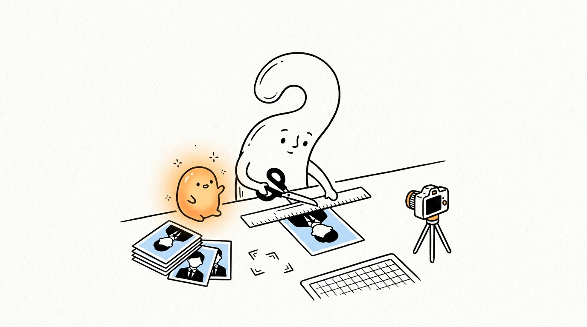
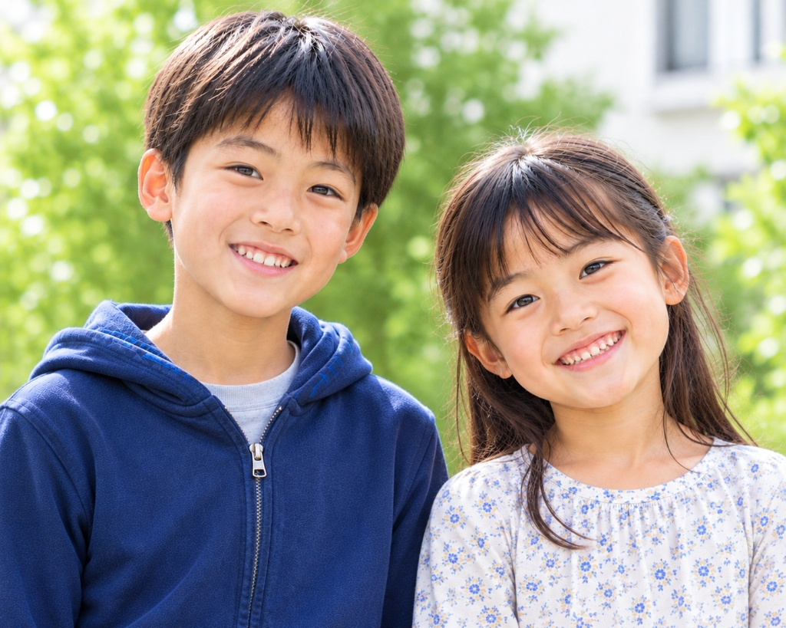
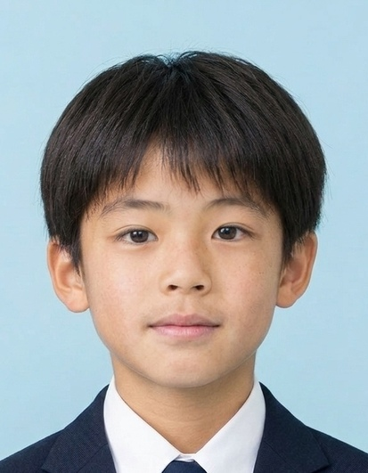
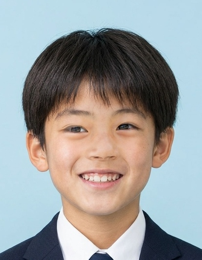
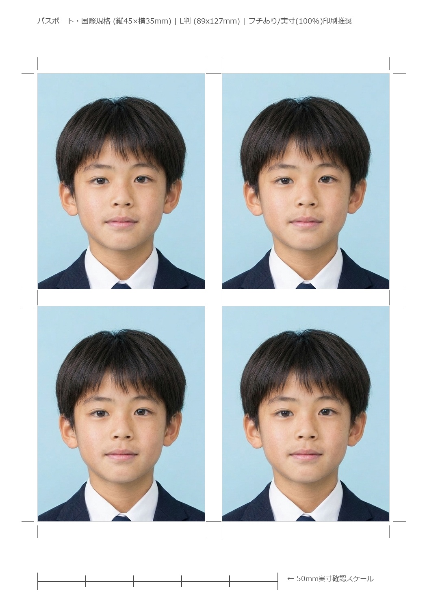
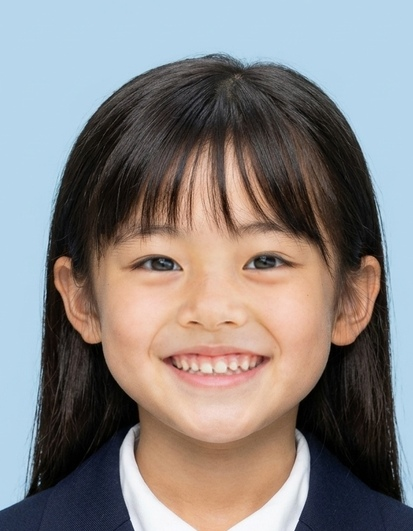
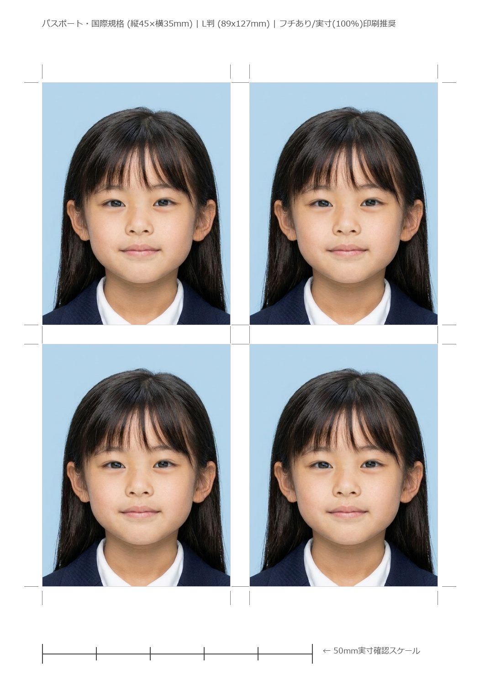

転職の履歴書、パスポートの更新、運転免許証、マイナンバーカード——。

数年に一度、あるいは急な手続きで「証明写真」が必要になるたびに、街中の証明写真機（ボックス）や写真館を探し回った経験はないでしょうか。

「スマホのカメラも綺麗だし、家で自撮りして安く済ませよう」と思い立っても、いざ自力で撮ってみると壁の影が落ちる、部屋の照明で肌が暗い、目線や頭が微妙に傾く、そもそもスーツを着ていない……。さらに各申請ごとの「頭頂余白3mm」「顔の長さ34mm」といった厳密なミリ単位のトリミングや、L判写真用紙への面付け（4分割配置）に手作業で挑んで、PhotoshopやWordと格闘した末に半日溶かした方も多いはずです。

そこで、普段使っているAIエージェントに「この写真からパスポート用と履歴書用の証明写真を作って」と頼むだけで、**日常のスナップ写真からスーツへの自然な着せ替え・姿勢の水平補正・公的ミリ規格トリミング・コンビニ300DPI印刷用シート作成まで一気通貫で行うスキル**（Agent Skill）をオープンソースで公開しました。

> [!NOTE]
> 📁 **GitHub リポジトリ**
>
> **[https://github.com/lumichy/skills/tree/main/skills/id-photo-studio](https://github.com/lumichy/skills/tree/main/skills/id-photo-studio)**
>
> ※プロンプト集、ミリ単位トリミング＆面付けスクリプト、サンプル画像一式を完全収録しています。

この記事では、本スキルの設計思想、屋外スナップ写真を使った実際の変換ステップとプロンプト、エージェントでの使い方、そして「なぜ画像生成AI単体ではなくハイブリッド処理にしたのか」という技術的な工夫と注意点を詳しく解説します。

---

## 基本情報クイックリファレンス

| 項目 | 内容 |
|---|---|
| **スキル名** | `id-photo-studio`（ID Photo Studio / 証明写真スタジオ） |
| **ソースコード** | [github.com/lumichy/skills/tree/main/skills/id-photo-studio](https://github.com/lumichy/skills/tree/main/skills/id-photo-studio) |
| **ライセンス** | MIT License |
| **対応規格** | 履歴書（**40×30mm**）、マイナンバー・パスポート（**45×35mm**）、運転免許証（**30×24mm**）、米国ビザ（**51×51mm**）、TOEIC（**40×30mm**）、カスタムサイズ |
| **出力フォーマット** | デジタル提出用単体JPEG ＋ コンビニ印刷用面付けシート（**L判 89×127mm** / **2L判 127×178mm**、**300 DPI**、トンボ・実寸確認用50mm定規スケール付き） |
| **コア技術** | AI画像生成・編集 ＋ Python精密画像処理（傾き水平補正・周波数分離顔ロック合成・規格トリミング） |
| **必要ライブラリ** | `pillow`, `numpy`, `scipy` |

---

## 1. 実際の変換プロセス：屋外2ショットスナップからの証明写真化

百聞は一見に如かずということで、リポジトリに収録しているサンプルをもとに、入力写真から証明写真が完成するまでの過程を実際のプロンプトと合わせて見ていきましょう。

### 元写真：屋外スナップ写真（2ショット）

元画像は、天気の良い屋外でカジュアルな服装を着て並んで撮影された、頭が左右に傾いた2人組のスナップ写真です。


*元写真：頭の傾き、カジュアルな私服、屋外の自然光・木々の背景、2人が並んだスナップ写真*

ここからエージェントが、幾何補正・AI編集・周波数分離合成・ミリ規格トリミングのステップを自律的に進めていきます。

---

### Step 1：頭の傾きの自動水平補正（Python幾何計算）

まず、エージェントがスクリプトを実行して両目の瞳孔座標を読み取り、傾き角度 $\theta = \text{atan2}(\Delta y, \Delta x)$ を計算して回転補正します。

- **お兄ちゃん**: 右肩上がりに **+17.93度** 傾いていた頭を水平に回転補正
- **妹さん**: 左肩下がりに **-25.02度** 傾いていた頭を水平に回転補正

これにより、両目を結ぶ直線が完全な水平になった標準3:4ポートレートが切り出されます。

---

### Step 2：AIによるスーツ着せ替えとスタジオ照明化（実際のプロンプト）

水平になったポートレート画像を入力として、画像生成・編集AIへスタジオ証明写真化を指示します。

本スキルでは、用途に合わせて3つのプロンプトパターンを用意しています。

#### パターンA（スーツ着せ替え ＋ 閉口証明写真表情）のプロンプト
公的機関のパスポートやマイナンバー、就活の履歴書など「歯を見せない真面目な表情」が必須の用途向けです。

```text
Edit the reference photo at <INPUT_IMAGE_PATH> to create a professional Japanese official ID photo (証明写真) and save it to <OUTPUT_PATH>.

Strict Requirements:
1. Identity Preservation: Keep the exact same facial features, eye shape, nose, mouth, skin tone, facial structure, and age of the person in the input photo. Do NOT alter their identity or make them look like a different person.
2. Posture & Gaze: Adjust the body posture so the shoulders are square, level, and facing straight forward. The head must be straight and centered, looking directly at the camera with a natural, polite, closed-mouth expression.
3. Attire: Replace the clothing with a neat, professional dark navy or charcoal business suit, a crisp white collared dress shirt, and a conservative tie.
4. Lighting & Background: Apply soft, even studio portrait lighting with no harsh shadows. Use a completely solid, uniform light blue background.
5. Framing: Frame as a head-and-shoulders portrait with ample margin above the head and below the chest.
```

#### パターンB（服装はそのまま維持 ＋ 背景・照明・姿勢のみ証明写真化）のプロンプト
学生証やお気に入りの私服・制服をそのまま活かしたい場合のプロンプトです。

```text
Edit the reference photo at <INPUT_IMAGE_PATH> to create an official ID photo (証明写真) and save it to <OUTPUT_PATH>.

Strict Requirements:
1. Identity & Clothing Preservation: Keep the exact same person's facial features, expression, and current clothing. Tidy up minor wrinkles if needed.
2. Posture & Alignment: Center the head and level the shoulders so the subject faces straight forward toward the camera.
3. Lighting & Background: Remove uneven lighting or shadows on the face, and replace the background with a completely flat, solid, shadow-free light blue background.
4. Framing: Include enough headroom above the hair and chest area below the chin for subsequent exact millimeter cropping.
```

#### パターンC（元写真の表情・顔立ち100%維持 ＋ スーツ着せ替え・背景変更）のプロンプト
社員証やプロフィール写真など、元の自然な笑顔や歯並びを1ミリも崩さずスーツを着せたい場合のプロンプトです。

```text
Edit the reference photo at <INPUT_IMAGE_PATH> to create an ID photo (証明写真) and save it to <OUTPUT_PATH>.

Strict Requirements:
1. Strict Face & Expression Lock (DO NOT MODIFY THE FACE): Keep the person's head, facial features, eyes, gaze, mouth, and exact facial expression 100% untouched and identical to the input photo. Do NOT alter, retouch, or regenerate their expression or facial structure in any way.
2. Lighting & Shadow Removal: Remove any uneven shadows or harsh lighting casts on the face and neck so the illumination looks clean and balanced, without changing the facial pixels or expression.
3. Attire Replacement Only: Replace only the clothing below the neck with a neat dark business suit and crisp white shirt, naturally aligned with the neck.
4. Background Replacement: Replace the background with a completely flat, solid, uniform, shadow-free light blue background.
5. Framing: Frame as a centered head-and-shoulders bust portrait with ample headroom above the head.
```

---

### Step 3：本人パーツの周波数分離ロック合成（Python）

AI単体で出力すると、どうしても目鼻立ちや歯並びが微妙に再描画されてしまいます。

そこでスクリプト（`composite_original_head.py`）により、元写真から顔の内側（眉・目・鼻・口・ほくろ）を高周波成分ロック＋ガウシアン低通色味補正で抽出し、AIが生成したスーツ・首元画像へシームレスにブレンドします。

- **パターンCの場合**: 顔全体（目・鼻・口・笑顔・歯並び）を元写真から完全ロック
- **パターンAの場合**: 口元はAIの閉口表情を採用しつつ、目元〜眉エリアは元写真のピクセルを完全ロック

---

### Step 4：ミリ規格トリミング ＆ コンビニ印刷用シート生成

最後にスクリプト（`process_id_photo.py`）が公的規格に合わせてミリ単位のピクセル計算を行い、単体写真とコンビニ印刷用の面付けシートを出力します。

スマートフォンでの閲覧を考慮し、完成した各サンプルの詳細を縦スクロールで順番にご紹介します。

#### ① お兄ちゃん：パターンA（閉口証明写真表情 ＋ スーツ）
目元は本人のピクセルを100%保ったまま、口元を自然な閉口状態へ補正し、スーツを着用させた公的証明写真です。


*パスポート・マイナンバー規格（45×35mm）/ 傾き水平補正（+17.93°）＋目元100%本人ロック＋閉口補正*

#### ② お兄ちゃん：パターンC（元写真の笑顔100%維持 ＋ スーツ）
元写真の笑顔、目線、歯並びを1ピクセルも変えずに、スーツへの着せ替えと青背景のスタジオライティング化を実現したポートレートです。


*パスポート・マイナンバー規格（45×35mm）/ 傾き水平補正（+17.93°）＋顔・笑顔・歯並び100%維持*

#### ③ お兄ちゃん：コンビニ印刷用 L判プリントシート
セブン-イレブンやローソンなどのマルチコピー機ですぐに印刷できる、4面付けのL判シートです。


*L判（89×127mm）300 DPI / カッター用トンボ（裁断線）・実寸確認用50mm定規スケール付き*

---

#### ④ 妹さん：パターンA（閉口証明写真表情 ＋ フォーマル）
-25.02度傾いていた頭を水平に補正し、目元の本人性を保ちながら落ち着いたフォーマル証明写真に仕立てています。


*パスポート・マイナンバー規格（45×35mm）/ 傾き水平補正（-25.02°）＋目元100%本人ロック＋閉口補正*

#### ⑤ 妹さん：パターンC（元写真の笑顔100%維持 ＋ フォーマル）
妹さんの元の可愛らしい笑顔の表情を完全にキープしたまま、フォーマルウェアと証明写真背景へ変換しています。


*パスポート・マイナンバー規格（45×35mm）/ 傾き水平補正（-25.02°）＋顔・笑顔・歯並び100%維持*

#### ⑥ 妹さん：コンビニ印刷用 L判プリントシート
妹さんの証明写真4面付けシートです。下部に50mmの定規スケールが付いており、印刷後の実寸チェックが可能です。


*L判（89×127mm）300 DPI / カッター用トンボ（裁断線）・実寸確認用50mm定規スケール付き*

---

## 2. なぜ「AI生成単体」でも「Python単体」でもダメなのか？

実はこのスキルを作る前、私は2つのアプローチで失敗しました。

最初は「画像生成AIのプロンプトで『この人の顔のままスーツを着せて証明写真にして』と頼めば一発だろう」と考えていました。しかし、最新鋭の画像生成モデルであっても、AIの画像エンコーダ・デコーダを通過する過程で、**目の大きさ、二重の幅、歯並び、鼻筋の形、ホクロの位置が微妙に変化して別人になってしまう**という致命的な問題にぶつかりました。公的証明写真において「本人と顔が違う」のは即却下（審査落ち）の対象です。

次に「じゃあ元写真の顔をPythonのOpenCVやPillowで楕円にくり抜いて、スーツのフリー素材に合成すればいいのでは？」と試しました。ところが、人間の顔の輪郭や顎下、首元には複雑な影が落ちています。切り貼り合成だと、首と襟の境界線が浮き彫りになり、まるでコラ画像のような強烈な違和感が残ってしまいました。

そこで採用したのが、**AI画像生成とPython精密画像処理の強みを分担させるハイブリッド設計**です。

```
[ 入力写真（傾き・カジュアル服・背景雑多） ]
                 │
                 ▼
【Step 1: 傾きの幾何補正（Python）】
  両目の瞳孔座標から角度 θ を算出 → 水平回転 ＆ 標準ポートレート切り出し
                 │
                 ▼
【Step 2: 服装・首元・背景の調和（画像編集AI）】
  スーツ着せ替え・背景無地化・首元と襟の影のなじませをAIが担当
                 │
                 ▼
【Step 3: 本人性の完全復元（Python周波数ブレンド）】
  顔の内側（目・鼻・口・ほくろ）を元写真から高周波成分ロックで無縫合ブレンド
                 │
                 ▼
【Step 4: 厳密な公的ミリ規格配置 ＆ L判面付け（Python）】
  頭頂余白・顔比率のピクセル計算 ＋ トンボ・50mm定規スケール付きシート出力
```

### 3つの補正パターンの選び方まとめ

- **パターンA**（スーツ着せ替え ＋ 閉口証明写真表情）：
  パスポート、マイナンバー、就職活動など、公的規格で「笑顔不可・スーツ着用」が定められている場面に最適。
- **パターンB**（服装そのまま ＋ 背景・照明・姿勢補正）：
  学生証、資格証、お気に入りの私服やオフィスカジュアルをそのまま活かしたい場面に最適。
- **パターンC**（元の笑顔・表情100%維持 ＋ スーツ着せ替え）：
  社員証、ビジネスSNSのアイコン、講演用プロフィールなど、本人の自然な笑顔とスーツ姿を両立させたい場面に最適。

---

## 3. スキルの使い方と推奨実行環境

本スキルは、AIエージェントのスキルディレクトリに配置するだけで利用可能です。

### 推奨エージェント環境：Codex や Antigravity がベスト

本スキルを動かすエージェント環境としては、**テキスト推論と高度な画像生成・マルチモーダル処理の両方を得意とする Codex や Google Antigravity の利用を強くおすすめします。**

これらの環境では、エージェント自身が高性能な画像生成・視覚ツールを標準で備えているため、追加の設定なしで最も自然なスーツ着せ替えや首元の調和が完了します。

### Claude Code で動かす場合の注意点：無料の「AGNES」連携がおすすめ

一方、CLI型コーディングエージェントとして大人気の **Claude Code** で本スキルを利用する場合、標準では画像生成ツールが組み込まれていません。

そのため、Claude Code をお使いの方は、画像生成を行える外部ツールやスキルを事前に用意しておく必要があります。

もし手元に画像生成の有料APIや環境がない場合は、ローカル環境で完全無料で動くマルチモーダルAIツール「**AGNES**」の活用をおすすめします。以下のスキルを Claude Code に組み込むことで、無料かつ高精度な画像編集・生成パイプラインを即座に構築できます。

- AGNESスキル（GitHub）: [skills/agnes-local-generation on GitHub](https://github.com/lumichy/skills/tree/main/skills/agnes-local-generation)
- 詳しい解説記事: [AGNES-2: 完全無料・ローカルで動くマルチモーダルAI画像生成ガイド](https://qiita.com/lumichy/items/d243184dcb54f80bfeda)

### エージェントへの指示例

エージェントのチャット欄で、元写真のパスと「誰の証明写真を作成するか」を指定して自然言語で話しかけます。複数人が写っている写真でも、対象の人物を指定すれば個別に切り出して処理してくれます。

```text
この2ショット写真（./samples/original_two_shot.jpg）から、向かって左側のお兄ちゃんのパスポート用証明写真を作成してください。
コンビニのL判写真用紙で印刷したいので、プリントシートもお願いします。
服装はダークスーツで、背景はライトブルー、表情は口を閉じたパターンAでお願いします。
```

もし向かって右側の妹さんの証明写真を作りたい場合は、以下のように対象を変えて指示します。

```text
この写真から、向かって右側の妹さんの証明写真を作成してください。
用途はマイナンバー用（45×35mm）、L判プリントシート付きで、フォーマルウェア着用のパターンA、背景はライトブルーでお願いします。
```

指示を受け取ったエージェントは、以下の流れを自律的に進めます。

1. **要件確認と対象人物の特定**: 対象人物（兄／妹など）、用途（パスポート／履歴書など）、印刷用紙（L判／2L判／単体データのみ）、背景色、補正パターン（A / B / C）を確認。
2. **傾き水平補正**: `--draw-grid` で対象人物の両目座標を測定し、`--level-and-crop` で頭の傾きを水平回転補正して単身ポートレートを切り出し。
3. **AIスタジオ化**: 環境内の画像生成ツールを呼び出し、スタジオライティングとスーツのベース画像を生成。
4. **本人性ブレンド**: `composite_original_head.py` で元写真の目元・顔パーツを復元合成。
5. **ミリ規格トリミング＆シート生成**: `process_id_photo.py` でパスポート規格（**45×35mm**）に正確に切り出し、トンボと50mm実寸スケールを配置したL判シートを出力。

### コンビニでの印刷手順（超重要）

生成された `*_sheet_L.jpg` をスマホに保存し、セブン-イレブンやローソン、ファミリーマート等のマルチコピー機（写真プリント）で印刷します。

ここで1点だけ注意があります。印刷時は必ず「**フチあり印刷**（用紙全体に収める）」を選択してください。

「フチなし（全面印刷）」を選んでしまうと、機械側で自動的に数%拡大されてしまい、せっかくミリ単位で計算した顔の比率が狂ってしまいます。シートの下部に印刷された「**50mm実寸確認スケール**」に定規を当てて、ちょうど50mmになっていれば規格通りのサイズで仕上がっている証拠です。

---

## 4. 使う上での注意点と限界

非常に便利なスキルですが、実際に運用するにあたって把握しておくべき重要な注意点が2つあります。

### 注意点①：エージェント側に「画像生成・編集ツール」が必須

本スキルはハイブリッド構成のため、Python環境だけでなく「**画像を読み込んで編集・生成できるツールやスキル**」がエージェント環境に備わっている必要があります。

- Codex や Antigravity のように標準で画像生成機能を持つ環境を使うか、Claude Code 等では前述の **AGNESスキル** などを連携させてください。
- もし画像編集ツールが全く使えない環境の場合、AIによるスーツ着せ替えや首元の補正は行えません。その場合は「元写真の私服のまま、Pythonスクリプトによる背景色置換（`--replace-bg`）と規格トリミング・面付けのみ」を行うモードで動作させることになります。

### 注意点②：推論能力や生成モデルが弱いと不自然になる（特にパターンC）

もっとも注意が必要なのが、**エージェントの推論能力や使用する画像生成モデルの品質**です。

特に「パターンC（元写真の顔・表情を100%維持するモード）」では、Stage 1で元頭部の首元や輪郭、スーツの襟、背景のライティングをAIに違和感なく馴染ませてもらう必要があります。

推論能力の低い小型LLMや、指示追従性の弱い画像生成モデルを使うと、以下のような破綻が起きやすくなります：

- 首とスーツの襟の角度が合わず、首が異様に長く見えてしまう
- 元写真の顔の輪郭をAIが勝手に描き直してしまい、境界線に二重アゴのような不自然な段差ができる
- 背景の色とスーツの輪郭の間に境界ノイズが残る

もし生成結果に違和感がある場合は、より賢いモデル（フロンティアモデル）に切り替えるか、元写真の頭部切り出し範囲を広めに調整してエージェントに再指示を出してください。

---

## 5. まとめ

AIエージェントの強みは、「プロンプトで画像を出すだけ」「スクリプトを実行するだけ」の単一ツールでは手が届かない複雑なタスクを、適材適所で組み合わせて自動完走できる点にあります。

- **AIの役割**: 服装の着せ替え、首元や背景の自然な調和、スタジオライティングの再現
- **Pythonの役割**: 角度計算による両目水平補正、周波数分離による本人パーツの100%ロック、ミリ単位の規格トリミングと300DPI印刷用面付け

急に証明写真が必要になったとき、何千円も払って撮りに行ったり、Photoshopで悪戦苦闘したりする前に、ぜひ手元のAIエージェントに本スキルを組み込んで試してみてください。

> [!TIP]
> 📁 **関連リンク集**
>
> - ID Photo Studio スキル（GitHub）:
>   [https://github.com/lumichy/skills/tree/main/skills/id-photo-studio](https://github.com/lumichy/skills/tree/main/skills/id-photo-studio)
> - AGNES ローカル画像生成スキル（GitHub）:
>   [https://github.com/lumichy/skills/tree/main/skills/agnes-local-generation](https://github.com/lumichy/skills/tree/main/skills/agnes-local-generation)
> - AGNES 解説記事:
>   [https://qiita.com/lumichy/items/d243184dcb54f80bfeda](https://qiita.com/lumichy/items/d243184dcb54f80bfeda)

皆さんは普段、証明写真が必要になったときどうしていますか？また「こんな規格サイズや機能も欲しい」というアイデアがあれば、ぜひコメント欄で教えてください！
