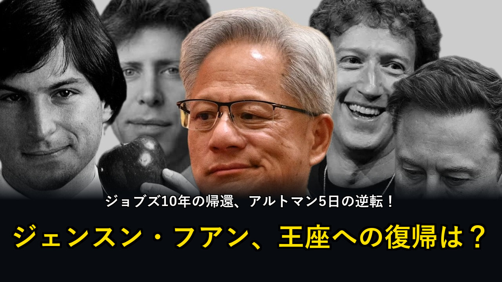

時価総額数兆ドル、世界のAIコンピューティング基盤の8割以上を牛耳る「AI帝国の皇帝」が、突如として玉座を追われました。

2026年11月12日、NVIDIAの共同創業者であり33年間にわたりトップに君臨し続けてきたジェンスン・フアン（Jensen Huang）CEOが、社長、CEO、および取締役を即日辞任すると発表されました。

世界中のテック業界と金融市場に走った激震のなか、多くの人々を最も驚かせたのは、ニュースの片隅に小さく記されたある客観的な数字でした。

「**ジェンスン・フアンのNVIDIA保有株式比率は、わずか 3.58%**」

これほどのカリスマ創業者でありながら、なぜ取締役会の一存で解任・辞任に追い込まれてしまったのか？
Metaのマーク・ザッカーバーグやテスラのイーロン・マスクが持つような「強固な防御壁」は、なぜNVIDIAには存在しなかったのか？
そして、かつてAppleを追われて12年後に劇的な復活を遂げたスティーブ・ジョブズや、追放劇からわずか5日で返り咲いたOpenAIのサム・アルトマンのように、フアンが「王座へ帰還」する可能性はあるのか——？

この記事では、シリコンバレーのコーポレートガバナンスの構造、NVIDIAが抱えるサプライチェーンと独自エコシステムの未来、そしてジェンスン・フアンという稀代のエンジニア経営者が次に描くシナリオを多角的に解き明かします。

---

## 基本情報クイックリファレンス

| 項目 | 内容 |
|---|---|
| **対象出来事** | NVIDIA創業者兼CEO ジェンスン・フアンの辞任表明（2026年11月12日付で即日退任） |
| **後任体制** | コレット・クレス（Colette Kress / 現CFO）が暫定CEOに就任。取締役会が後継者選定を開始 |
| **核心的な数字** | **持株比率 3.58%**（普通株 約8.71億株）。デュアルクラス（種類株式 / スーパー議決権）なし |
| **市場の反応** | 発表直後にNVIDIA株価が一時14%超急落、時価総額4兆ドルを割り込むパニック売り |
| **歴史の類似事例** | ① スティーブ・ジョブズ（1985年Apple追放 → 12年後の1997年NeXT買収経由で復帰）<br>② サム・アルトマン（2023年OpenAI電撃解任 → 従業員・Microsoftの支援で5日後に復帰） |
| **今後の焦点** | ① CUDAおよび巨大GPUエコシステムの求心力維持<br>② 巨大テック各社（SpaceX, OpenAI, Meta）とのメガディール契約の行方<br>③ フアン個人による新ベンチャー設立か「王者帰還」か |

---

## 1. なぜ「AIの皇帝」は辞任に追い込まれたのか？——「3.58%」とガバナンスの罠

NVIDIAといえば、GPUアーキテクチャの圧倒的な計算能力だけでなく、CUDAによる分厚いソフトウェアエコシステムを築き上げ、競合他社を寄せ付けない独走を続けてきました。その陣頭指揮を執ってきたのが、黒いレザージャケットでおなじみのジェンスン・フアンです。

彼が事実上の「全権」を握っているように見えていたため、今回の辞任劇に対して「なぜ取締役会が創業者を辞めさせられるのか？」と首を傾げたエンジニアも少なくないはずです。

その理由は、シリコンバレーの企業統治における「**株式の議決権構造**」にありました。

### メタやテスラとの決定的な違い：「スーパー議決権」を持たなかったNVIDIA

近年上場した多くのメガテック企業は、創業者が少数株主になっても支配権を失わないよう、「**デュアルクラス株式構造**（種類株式 / AB株制度）」を採用しています。

- **Meta**（マーク・ザッカーバーグ）:
  1株につき10票の議決権を持つ「Class B株式」を握っており、株式全体の過半数を超える議決権を独占。「取締役会が全員で反対してもザッカーバーグはクビにできない」仕組みです。
- **テスラ**（イーロン・マスク）:
  定期的に巨額のストックオプションや議決権拡大を要求し、取締役会を強固な味方で固めています。

しかし、NVIDIAがNASDAQに上場したのは **1999年** です。
ドットコムバブル期の伝統的な上場企業であるNVIDIAは、古き良き「**1株1議決権**（同株同権）」の原則を貫いていました。

```
【議決権構造の対比】

■ Meta / アルファベット型（創業者絶対防壁）
  普通株主（1株＝1票） vs 創業者（1株＝10票の特権株）
  → 創業者が過半数の議決権を握り、取締役会の反乱は原理的に不可能。

■ NVIDIA型（伝統的一股一票制）
  全株主が一律「1株＝1票」
  → ジェンスン・フアンの持株比率は約 3.58%。
  → 残り96%以上はインデックスファンドや機関投資家が保有。
  → 取締役会（社外独立取締役が過半数）の過半数一致で、CEOの解任が法的に可能。
```

ジェンスン・フアン個人の持株比率は約 **3.58%**。資産額としては数百億〜1,000億ドル規模に達する天文学的数字ですが、会社の所有権という観点では「全体の4%弱」に過ぎません。

社内でのコンプライアンス調査や対外的なプレッシャーが表面化した際、外部の機関投資家（ブラックロックやバンガード等）の意向を背負った取締役会が動けば、法的にはあっさりと多数決でトップ交代を決議できる構造になっていたのです。

---

## 2. ジョブズの「10年」とアルトマンの「5日」：歴史は繰り返すか？

ジェンスン・フアンの電撃辞任を受け、テック界隈では即座に2つの歴史的事件が引き合いに出されました。
**スティーブ・ジョブズの追放と復活**、そして **サム・アルトマンの5日間クーデター劇** です。


### ① スティーブ・ジョブズ：1985年の追放と12年後の「NeXT」経由の帰還

1985年、自ら引き抜いたジョン・スカリーCEOと対立したジョブズは、取締役会によってすべての業務権限を剥奪され、Appleを去りました。

当時ジョブズが持っていたApple株もごく一部であり、防衛策はありませんでした。失意のジョブズは、新会社 **NeXT** を立ち上げて高度なオブジェクト指向OS（現在のmacOS / iOSの母体）を開発し、さらにアニメーションスタジオの **Pixar** を買収して大成功を収めます。

そして1996年末、OSの近代化に行き詰まり倒死寸前だったAppleがNeXTを4億ドル超で買収。1997年、ジョブズは「暫定CEO」として古巣に奇跡の生還を果たし、その後のiMac、iPod、iPhoneへと続く伝説を作りました。

### ② サム・アルトマン：2023年の5日間電撃クーデターと社員の蜂起

記憶に新しいのが、2023年11月に起きたOpenAIのサム・アルトマン解任騒動です。

非営利法人の取締役会によって突如解任されたアルトマンでしたが、直後に筆頭株主であるMicrosoft（サティア・ナデラ）がアルトマン受け入れを表明。さらに全従業員の9割以上（700人超）が「サムを復帰させなければ全員辞任してMicrosoftに移籍する」という署名状を提出しました。

わずか5日間で取締役会は白旗をあげ、旧取締役が退任してアルトマンがCEOに返り咲きました。

### では、ジェンスン・フアンは「5日」で戻れるのか？

イーロン・マスクはSNS上で「もしジェンスンを呼び戻す署名運動があるなら、私が真っ先にサインする」と発言し、NVIDIA社員の間でも復帰を望む声が上がっています。

しかし、業界のアナリストたちは「アルトマンのような即時復帰は極めて困難」と冷静に見ています。

1. **上場企業としての重いコンプライアンス責任**:
   OpenAIは非公開の非営利傘下スタートアップでしたが、NVIDIAは時価総額4兆ドルの公開企業です。法的な調査や証券取引委員会（SEC）の監視、機関投資家への受託者責任が絡む以上、感情や勢いだけで決定を覆すことはできません。
2. **制度としての取締役会の独立性**:
   新しく独立取締役会議長にハーベイ・ジョーンズ（Harvey C. Jones）が就任したことからも分かる通り、コーポレートガバナンスの厳格化をアピールする体制へ移行しています。

もしフアンが戻るとすれば、数日でひっくり返すアルトマン型ではなく、「**NVIDIAがフアン不在の間に戦略的失速を経験し、数年後に請われて復帰するジョブズ型**」 のシナリオしかあり得ないのが現実です。

---

## 3. ジェンスン不在のNVIDIA帝国：何が揺らぎ、何が残るか？

ジェンスン・フアンが抜けたことで、NVIDIAの優位性は崩壊するのでしょうか？
エンジニアリングの視点から「フアン個人に依存していた領域」と「すでに自走している仕組み」を切り分ける必要があります。

### 揺らがないもの：CUDAエコシステムとハードウェア設計パイプライン

短期的（今後1〜2年）に見れば、NVIDIAの技術的堀（Moat）はそう簡単に埋まりません。

- **BlackwellからRubinへのロードマップ**:
  次世代アーキテクチャ「Rubin」の開発はすでに完了フェーズにあり、ファウンドリであるTSMCとのパイプラインも強固に固定されています。
- **CUDAという開発者の共通言語**:
  世界中のAI研究者、フレームワーク（PyTorch等）、オープンソースライブラリがCUDAに最適化されています。ハードウェアが変わっても、ソフトウェアスタックを乗り換えるコストは天文学的です。
- **堅実な財務基盤**:
  暫定CEOに就任したコレット・クレスは、2013年からNVIDIAのCFOを務め、GPUバブルとデータセンター事業の急成長を財務面で支え切った超実力派です。事業の現場が明日から混乱することはありません。

### 揺らぐもの：「国家元首クラス」のトップ外交とメガディール

一方で、フアンという人物の喪失が直撃するのは、「**超巨額ディールを取りまとめるカリスマ性**（メガディール）」 です。

ここ数年、フアン自身が世界中を飛び回り、各国の首相や大統領と直接会談して「国家主権AI（Sovereign AI）」を売り込み、シリコンバレーのトップたちと億ドル単位の約束を取り付けてきました。

- SpaceXへの「**DGX Spark**」直配:
  2016年にOpenAIへ世界初のDGX-1を自ら手渡しで届けたように、フアンはイーロン・マスクのSpaceXへ超小型スーパーコンピュータ「DGX Spark」を直接納品するなど、トップ同士の人間関係で巨大な商流を切り拓いてきました。
- **OpenAIとの10GWデータセンター・1000億ドル規模の協業**:
  OpenAIと進める10GW規模の次世代AIデータセンター構築など、前代未聞の規模のプロジェクトは、フアンの強烈なビジョンと即断即決があってこそ成立したものです。

こうした「数兆円を動かすトップ同士の阿吽の呼吸」は、いかに優秀なプロ経営者やCFOであっても代替が効きません。Big Tech各社（Google、Amazon、Microsoft、Meta）が内製AIチップ（TPU、Trainium、Maia等）の配備を急ぐなか、NVIDIAの営業推進力に陰りが生じるリスクは無視できません。

---

## 4. ジェンスン・フアンのネクストステップ：手元に残された最強のカード

現在60代前半のジェンスン・フアン。数兆円規模の個人資産、TSMCトップやシリコンバレー要人との直接のホットライン、そして33年間GPUとAIの最前線を駆け抜けてきた比類なき洞察力を持っています。彼がこのまま静かに隠居するとは、テック界の誰も考えていません。

彼の手元には、次のような可能性が広がっています。

1. **次世代AIインフラの新会社設立**（Physical AI / 宇宙AI）:
   かつてのジョブズがNeXTやPixarを作ったように、まったく新しいアプローチでAIコンピューティングの未踏領域（ロボティクス、核融合連携データセンター、宇宙展開など）を開拓するスタートアップを創業する道。
2. **AIスーパースター連合への電撃参画**:
   イーロン・マスク率いるxAIや、サム・アルトマン率いるOpenAI、あるいは独立系のフロンティアAI研究所とタッグを組み、スーパーインテリジェンス（ASI）実現のためのチップ設計・インフラ構築を指揮する黒幕となる道。
3. NVIDIAの危機を待つ「**待機フェーズ**」:
   後継CEO体制が激化する競合（AMD、自社製ASIC）との戦いで躓いたとき、唯一の救世主として株主と取締役会から熱烈なラブコールを受けて返り咲く日を静かに待つ道。

---

## 5. まとめ

今回の事件は、単なる一企業のトップ交代劇ではありません。
それは 「**カリスマ創業者の直感と情熱で突っ走ってきたAIブームの第1章**」が終わり、「**巨大資本と厳格なガバナンス、そしてシステマチックな運用が支配する第2章**」へと移行した象徴的な転換点 です。

- **教訓**: いくら天才創業者であっても、伝統的な1株1票の株式市場に上場している限り、取締役会と資本の論理には抗えない。
- **NVIDIAの現在地**: ハードウェアとCUDAの堀は数年間は盤石だが、フアンが牽引してきた「国家規模のディールと未来を掴み取る嗅覚」の穴埋めは容易ではない。
- **これからの視点**: 王座を降りたジェンスン・フアンが、解き放たれた巨額の資本と人脈を使って「外側からAI業界をどう再定義するか」に注目すべきである。

かつてジョブズがAppleを去ったとき、世界は一度「Appleの終焉」を予感しました。しかしその空白の10年が、ジョブズをより成熟したビジョナリーへと育て、後のiPhone誕生へと繋がりました。

ジェンスン・フアンという巨星がNVIDIAの枠を飛び出した今、世界のコンピューティングの歴史は、私たちが想像もしなかった新たなドラマの幕を開けようとしています。

皆さんは、ジェンスン・フアンのいないNVIDIAと、自由の身となったフアンの未来についてどう思いますか？ぜひご意見をコメント欄で教えてください！
