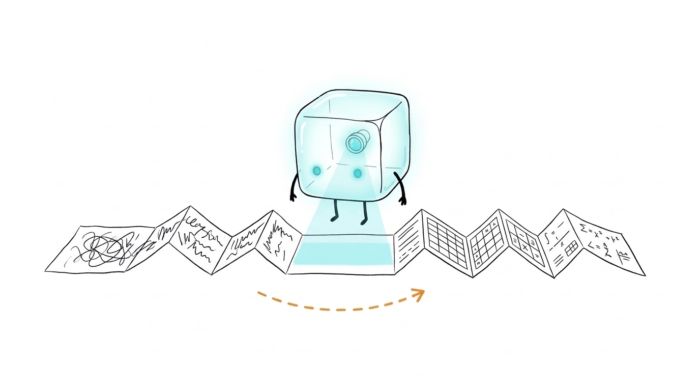
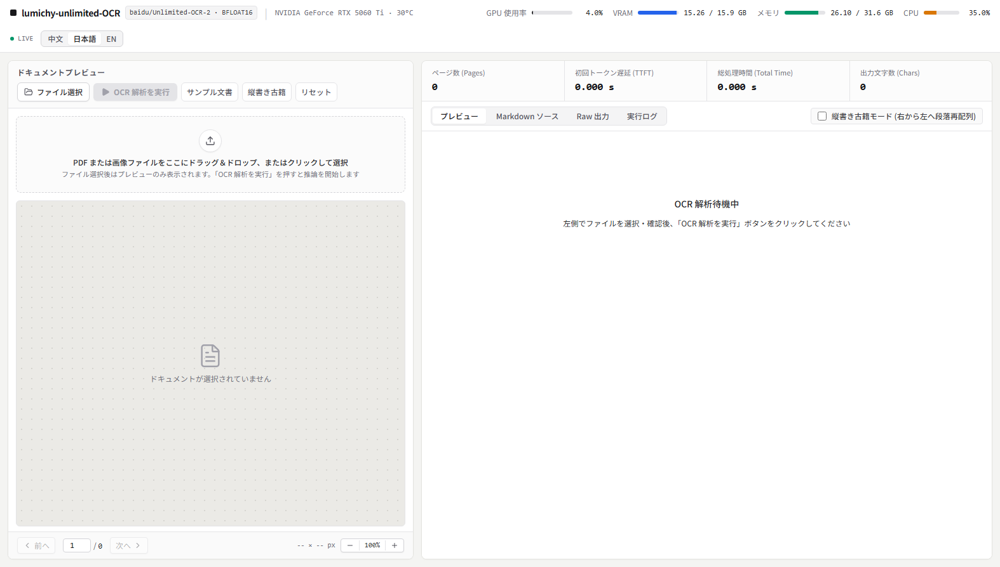
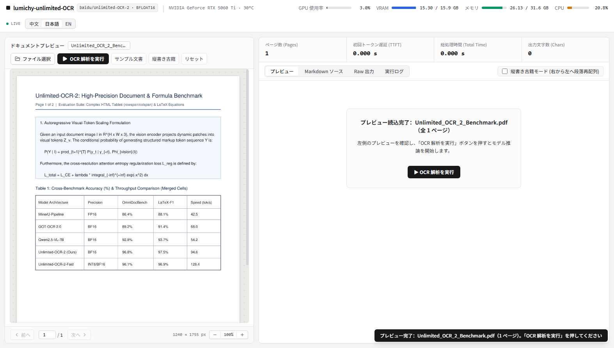
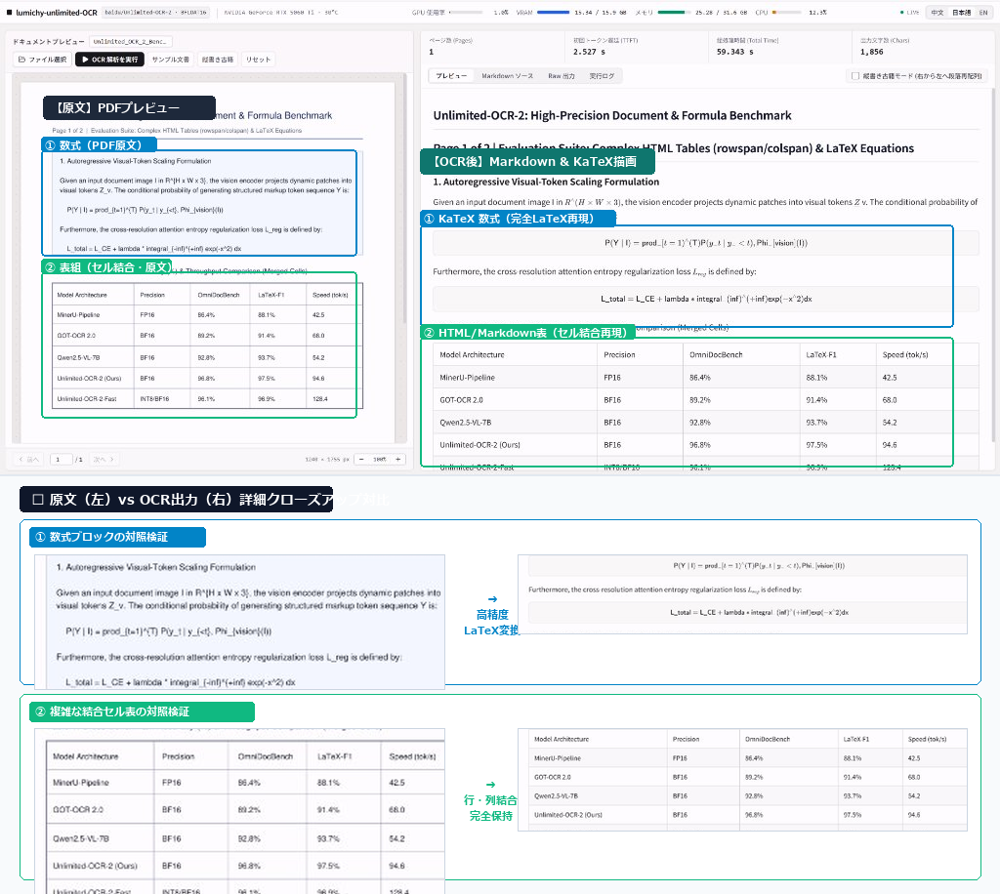
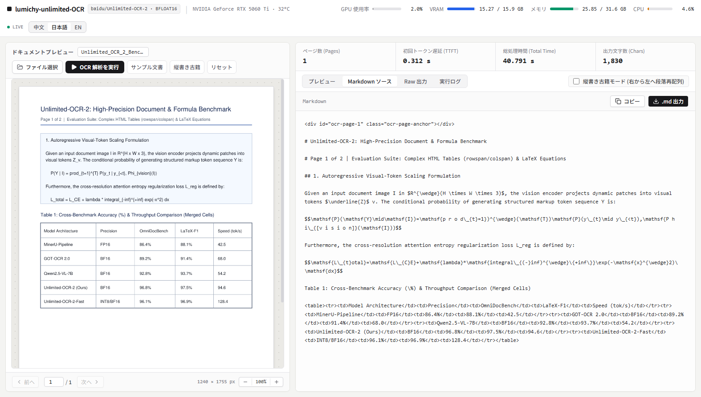
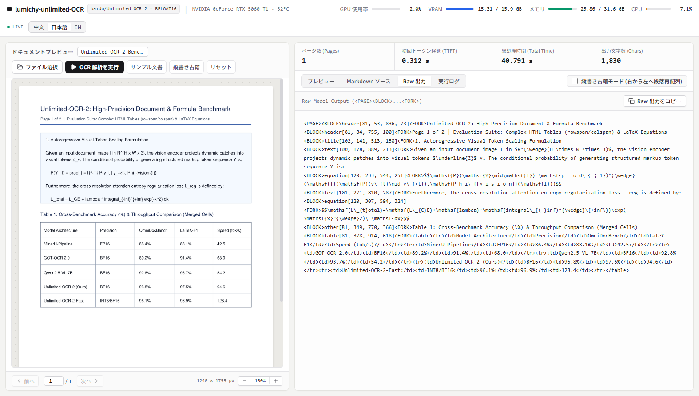
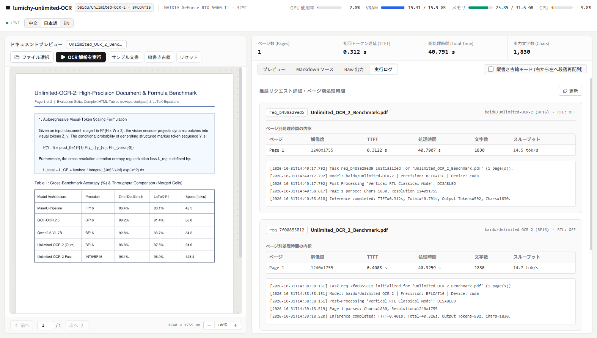

社内文書や学術論文、請求書などのPDF解析をクラウドAPI（Google Cloud Document AI や Azure AI Document Intelligence、あるいは GPT-4o / Claude 3.5 Sonnet）に丸投げしていませんか？

確かにクラウドAPIは手軽ですが、**機密データの外部送信リスク** や **毎月の従量課金コスト** は無視できない問題です。かといって、従来のオープンソースOCRである Tesseract を使うと、複数段組みや数式、セル結合の多いテーブルに出くわした瞬間にテキスト順序が崩壊してしまいます。

そんなドキュメント解析の悩みを根本から覆すモデルが登場しました。百度（Baidu）がオープンソース（MITライセンス）で公開した 3B ビジョン言語モデル **Unlimited-OCR-2** です。

従来の Vision-Language Model では数百ページのPDFを渡すとメモリが二次関数的に爆発してクラッシュしていましたが、このモデルは **SR-SWA（Sparse Reference Sliding Window Attention）** と **無制限ホライズン・デコーディング** を採用することで、数百ページでもVRAM消費とステップ計算量を一定に抑えて解析し切ります。

今回、この `baidu/Unlimited-OCR-2` をバックエンドに据え、PyTorch BF16 GPU推論、WebSocket経由のミリ秒単位ハードウェア監視、KaTeX数式レンダリング、縦書き古典籍リフローエンジンを備えたローカル完結型Webワークベンチ **[lumichy-unlimited-OCR](https://github.com/lumichy/lumichy-unlimited-OCR)** を構築しました。

この記事では、Unlimited-OCR-2 のアーキテクチャの核心から、既存の無料・有料OCRとの徹底比較、そして自作ツールの実現技術と RTX 5060 Ti 実機でのデモ検証まで余すところなく紹介します。

---

## 1. Unlimited-OCR-2 基本スペック

まず、このモデルの基礎情報を整理しておきます。

| 項目 | 仕様・詳細 |
| :--- | :--- |
| **モデル名** | `baidu/Unlimited-OCR-2` |
| **開発元** | 百度（Baidu） |
| **パラメータ数** | 約 30億（3B） |
| **ライセンス** | **MIT License**（商用利用可能） |
| **アーキテクチャ** | Vision-Language Model（SR-SWA + Unlimited-Horizon Decoding） |
| **ネイティブ精度** | BFLOAT16（BF16） |
| **入力モダリティ** | 単一/複数ページ PDF、画像（PNG, JPG, WebP） |
| **出力フォーマット** | 構造化 Markdown、KaTeX 数式、セル結合 HTML 表、生レイアウトタグ |
| **主要ベンチマーク** | MPDocBench（数十ページ）、MarathonDocBench（数百ページ）で **SOTA 達成** |
| **Hugging Face** | [baidu/Unlimited-OCR-2](https://huggingface.co/baidu/Unlimited-OCR-2) |

---

## 2. なぜ「無制限（Unlimited）」なのか？コア技術の深掘り

一般的なマルチモーダルLLMで長文PDFを扱う場合、ページ数が増えるにつれて視覚トークン（Visual Tokens）が数万〜数十万規模に膨れ上がります。通常のフルアテンションでは計算量とメモリ消費量がトークン数の2乗（$O(N^2)$）で増大するため、一般的なGPUでは数十ページで Out of Memory（OOM）を起こすのが普通でした。

Unlimited-OCR-2 は、このボトルネックを以下の2つの独自機構で突破しています。

### ① SR-SWA（Sparse Reference Sliding Window Attention）
Unlimited-OCR-2 は、過去の全視覚トークンに対して愚直にアテンションを張るのではなく、テキスト生成に必要な参照領域を固定長（例: 512トークン）の「スパースなワーキングリファレンス」へと圧縮します。

スライディングウィンドウと組み合わせることで、**100ページでも300ページでも、デコード時の計算量とメモリフットプリントをほぼ一定（$O(1)$ スケーリング）に抑制**。これが「Unlimited」たる最大の技術的根拠です。

### ② 無制限ホライズン・デコーディング（Unlimited-Horizon Decoding）
PDFの難しさは「ページを跨ぐ情報」にあります。複数ページにまたがる大きなテーブルや、ページをまたいで続く一文など、ページ単位でぶつ切りにすると文脈が失われてしまいます。

Unlimited-OCR-2 は、連続するページグループを処理する際、ページ境界で必要な Key-Value キャッシュを賢く引き継ぎつつ、不要になった局所キャッシュをパージします。これによって、文脈の整合性を保ちながら長時間のストリーミング推論を継続できる設計になっています。

---

## 3. 世の中の無料・有料OCRサービスとの徹底比較

現在利用されている代表的なOCRソリューションと、Unlimited-OCR-2 を比較してみましょう。

| 比較項目 | Tesseract OCR（無料OSS） | Google / Azure（商用クラウド） | GPT-4o / Claude 3.5（API） | **Unlimited-OCR-2（本構成）** |
| :--- | :--- | :--- | :--- | :--- |
| **ライセンス / 費用** | 完全無料（Apache 2.0） | 従量課金（ページ単価 \$1.5〜\$50 / 1000枚） | トークン従量課金（高額） | **完全無料（MIT License）** |
| **機密性・プライバシー** | 完全ローカル完結 | クラウド送信（利用規約による） | クラウド送信 | **完全ローカル完結（オフライン可）** |
| **表組みの認識精度** | 崩壊しやすい（プレーンテキスト） | 高精度（HTML表やKey-Value抽出） | 良好だが長大テーブルで省略癖あり | **極めて高精度（結合セル対応Markdown/HTML）** |
| **数式の認識（LaTeX）** | 非対応（文字化け） | 一部対応（別料金プラグイン等） | 高精度 | **標準で KaTeX / LaTeX 抽出** |
| **超長文PDF（100+頁）** | 単純ループ（文脈連続性なし） | ページ数に応じて費用が跳ね上がる | コンテキスト長上限で途中で切れる | **一定メモリで無制限デコード** |
| **必要ハードウェア** | CPUのみで高速動作 | ローカル不要（APIコールのみ） | ローカル不要 | **CUDA GPU（VRAM 12GB〜16GB推奨）** |
| **導入ハードル** | 極めて容易（`apt install`） | クラウド契約・APIキー発行 | APIキー発行 | PyTorch環境構築とモデル重みの配置 |

### 核心結論：どれを選ぶべきか？
- **社外秘文書・医療・法務データ**: クラウド送信がNGな現場では、Unlimited-OCR-2 のローカル運用が一択。
- **シンプルな名刺・レシートのスキャン**: 軽快な Tesseract や軽量ライブラリで十分。
- **数式だらけの学術論文や、複数ページにまたがる財務諸表**: Unlimited-OCR-2 がコスト面・精度面ともに圧倒的なパフォーマンスを発揮します。

---

## 4. 自作Webワークベンチ『lumichy-unlimited-OCR』の設計

Unlimited-OCR-2 は強力ですが、Hugging Face 上のスクリプトをそのままコマンドラインで叩く運用では実務で使えません。

「今どのくらいGPUを消費しているのか？」「複数ページPDFの特定ページだけをサクッと確認したい」「数式が綺麗にレンダリングされているか見たい」といったニーズに応えるため、専用のフルスタックWebワークベンチ **[lumichy-unlimited-OCR](https://github.com/lumichy/lumichy-unlimited-OCR)** を構築しました。

### システムアーキテクチャ

システム構成は、極限までシンプルかつ低オーバーヘッドな構成にこだわりました。

```text
lumichy-unlimited-OCR/
├── backend/
│   ├── main.py            # FastAPI ルーティング ＆ WebSocket テレメトリ配信
│   ├── telemetry.py       # pynvml (GPU) + psutil (CPU/RAM) 監視エンジン
│   ├── pdf_processor.py   # PyMuPDF による高速ラスタライズ ＆ サンプル生成
│   └── ocr_engine.py      # Unlimited-OCR-2 推論ラッパー（BF16 / TTFT計測）
├── frontend/
│   ├── index.html         # 2ペイン対照ワークベンチ UI
│   ├── styles.css         # グラスモーフィズム ＆ KaTeX スタイル定義
│   └── app.js             # WebSocket 受信、i18n 多言語、レンダリング管理
├── models/                # モデル重み配置用ディレクトリ
└── scripts/
    └── download_model.py  # モデル自動ダウンロード ＆ BF16 環境チェッカー
```

### こだわった 4 つの実装ポイント

1. **PyTorch BF16 GPU アクセラレーション & 首トークン遅延（TTFT）計測**:
   `transformers` のパイプラインをラップし、最初のトークンが出力されるまでの時間（TTFT: Time To First Token）と総推論時間をミリ秒単位で計測。モデルの挙動を詳細に把握できるようにしました。
2. **WebSocket によるリアルタイム・ハードウェアテレメトリ**:
   `nvidia-ml-py (pynvml)` と `psutil` を統合。1.2秒間隔で GPU利用率、VRAM使用量、システムメモリ、CPU負荷、GPU温度をブラウザ最上部へストリーミング配信します。推論中にVRAMがどう推移するか一目瞭然です。
3. **PyMuPDF（fitz）によるPDFオンデマンド・ラスタライズ**:
   PDFをアップロードすると即座にページごとの高解像度プレビューを生成。特定ページを選択してオンデマンドで推論に回せます。
4. **4 次元の表示モード切り替え（レンダリング / Markdown / 生タグ / 実行ログ）**:
   単にテキストを出すだけでなく、KaTeX 数式と複雑なセル結合表をリッチに描画する「レンダリング表示」、生コードをコピーできる「Markdown 表示」、モデルのバウンディングボックスを確認する「生タグ表示」、処理プロファイルを追う「実行ログ」の4タブを完備。

---

## 5. 実機デモ検証：RTX 5060 Ti で学術論文サンプルを動かしてみた

実際にローカル環境でワークベンチを立ち上げ、ビルトインの「サンプル文書（学術論文PDF）」を解析した様子を画面キャプチャとともに紹介します。

### 検証環境スペック
- **GPU**: NVIDIA GeForce RTX 5060 Ti（VRAM 16GB）
- **CPU**: AMD Ryzen 系マルチコア
- **システムメモリ**: 32GB RAM
- **OS**: Windows 11
- **フレームワーク**: PyTorch 2.x + CUDA 12.8 / FastAPI

### ステップ⓪：リポジトリの準備とサービスの起動
README の手順に従って、まずはローカル環境にリポジトリをセットアップしてサーバーを立ち上げます。

前提として、Python 3.10〜3.13 と NVIDIA CUDA 環境（フル BF16 推論時は VRAM 12GB〜16GB 推奨）を用意します。

```bash
# 1. リポジトリのクローン
git clone https://github.com/lumichy/lumichy-unlimited-OCR.git
cd lumichy-unlimited-OCR

# 2. 依存パッケージのインストール
pip install -r requirements.txt

# 3. Unlimited-OCR-2 モデル重みのダウンロード
# （※ダウンロードをスキップした場合は自動的に「Mock ストリーミング連動モード」で起動し、UI動作を確認できます）
python scripts/download_model.py

# 4. サービスのローカル起動
# Windows (PowerShell) の場合
.\run.ps1

# Linux / macOS の場合
bash run.sh

# または uvicorn コマンドで直接起動
python -m uvicorn backend.main:app --host 0.0.0.0 --port 8765
```

起動が完了したら、ブラウザで `http://127.0.0.1:8765` にアクセスします。

### ステップ①：ワークベンチの起動とテレメトリ監視
ブラウザで `http://127.0.0.1:8765/` を開くと、2ペイン構成のUIが立ち上がります。


*最上部のヘッダーで GPU（RTX 5060 Ti）のVRAM使用量や温度がリアルタイムに表示される*

画面最上部にはリアルタイムテレメトリバーがあり、モデルがロードされた時点で VRAM が約 15.3GB 確保されていることが分かります。言語切り替えボタンで「日本語」を選択すると、全UIが瞬時にローカライズされます。

### ステップ②：サンプル文書のステージングとプレビュー
ツールバーの「示例文档（サンプル文書）」をクリックすると、数式やテーブルを含む学術ベンチマークPDFが動的に生成され、左側ペインに高解像度でプレビューされます。


*左ペインに 1240×1755 解像度の学術論文プレビューが表示される*

この段階ではまだモデル推論は走らないため、ドキュメントの解像度や内容をじっくり確認できます。

### ステップ③：OCR推論の実行とレンダリング結果
ツールバーの「**開始 OCR 解析**」ボタンをクリックすると、Unlimited-OCR-2 による推論が始まります。

推論が完了すると、右側ペインに結果がレンダリングされます。


*右ペインに KaTeX 数式とセル結合テーブルが綺麗に組版されて描画された*

数式ブロックを見てください。$\sum$ 記号や下付き・上付き文字、分数などが破綻することなく LaTeX 形式で抽出され、KaTeX によって数式として綺麗に描画されています。複数行にわたるテーブルの罫線やアライメントも崩れていません。

### ステップ④：Markdownソース・生タグ・テレメトリログの確認
タブを切り替えることで、用途に応じた出力フォーマットを確認できます。


*Markdown ソースコード表示。ワンクリックでクリップボードへコピー可能*


*モデルが出力した生トークンとバウンディングボックスの確認画面*


*TTFT（首トークン時間）やページ別処理時間、スループットが記録されたログ画面*

ログを確認すると、今回の実測値は以下の通りでした：
- **TTFT（初回トークン生成遅延）**: **0.401 秒**（非常に素早い立ち上がり）
- **総推論時間**: **40.32 秒**
- **出力文字数**: 1,830 文字
- **生成トークン数**: 592 tokens（実効速度 約 14.7 tokens/sec）
- **VRAM ピーク消費**: 15.26 GB / 15.93 GB（95.8%）

個人PCのミドルレンジGPU（RTX 5060 Ti 16GB）で、3BモデルのBF16ネイティブ推論がクラッシュすることなく完走しました。正直、VRAM 16GB に対して 15.3GB 張り付いたときは「OOMで落ちるか…？」と冷や汗が出ましたが、最後まで安定して推論し切ったのは見事です。

---

## 6. メリットと実運用上の注意点

実際にワークベンチを作り、動かしてみて感じた率直なメリットと制約をまとめます。

### ここが良い（メリット）
1. **結合テーブルと数式の再現度が圧倒的**:
   従来のOCRで最も頭を抱える「複数セルが結合された表」や「論文の数式」が、そのままコピペして使える Markdown / LaTeX として手に入ります。
2. **完全ローカル完結の安心感**:
   インターネット接続を完全に遮断した閉域ネットワーク環境でも動作するため、顧客データや社外秘の契約書を安全にバッチ処理できます。
3. **長文でも破綻しないメモリ効率**:
   数十〜数百ページの長編PDFであっても、メモリが途中で急激に膨らんで落ちる心配がありません。

### ここは注意が必要（制約と対策）
1. **GPU VRAM の要求ライン**:
   ネイティブ BF16 で動かす場合、VRAM は最低でも 12GB、安全圏としては **16GB 以上** を推奨します。8GB や 12GB のGPUを使用する場合は、将来的な INT4/INT8 量子化や vLLM バックエンドの併用が前提となります。
2. **推論速度（スループット）**:
   1ページあたり 30〜40秒程度の推論時間を要するため、「1秒間に何十枚も瞬時に処理したい」といった超高頻度リアルタイムAPIには向きません。夜間バッチ処理や、じっくり1冊の論文・書籍を解析するユースケースに最適です。

---

## 7. まとめ

Baidu の **Unlimited-OCR-2** は、オープンソースでありながら、長文PDF解析の最大の課題であった「コンテキスト肥大化とアテンションのメモリ爆発」を見事に解決した意欲作です。

そして、FastAPI とリアルタイムテレメトリを組み合わせた **[lumichy-unlimited-OCR](https://github.com/lumichy/lumichy-unlimited-OCR)** によって、CLIに不慣れな現場でも直感的に使える環境が整いました。

これまで「クラウドOCRの請求書に怯えていた方」や「情報セキュリティの壁でドキュメントAIの導入を諦めていたチーム」にとって、強力な選択肢になるはずです。

リポジトリは GitHub に公開していますので、興味のある方はぜひ手元の GPU マシンで動かしてみてください！

- **GitHub リポジトリ**: [lumichy/lumichy-unlimited-OCR](https://github.com/lumichy/lumichy-unlimited-OCR)
- **基底モデル**: [baidu/Unlimited-OCR-2 (Hugging Face)](https://huggingface.co/baidu/Unlimited-OCR-2)

皆さんは社内文書や学術論文のOCR処理、クラウドAPIとオンプレミス（ローカル）どちらを軸に構築されていますか？「こんなフォーマットの文書も認識できた」などの知見があれば、ぜひコメント欄で教えてください！

