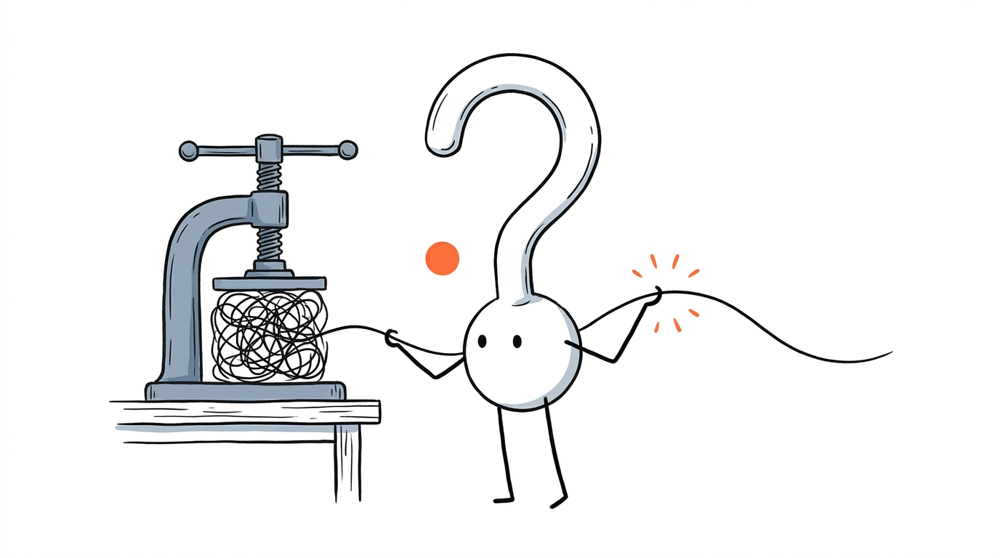
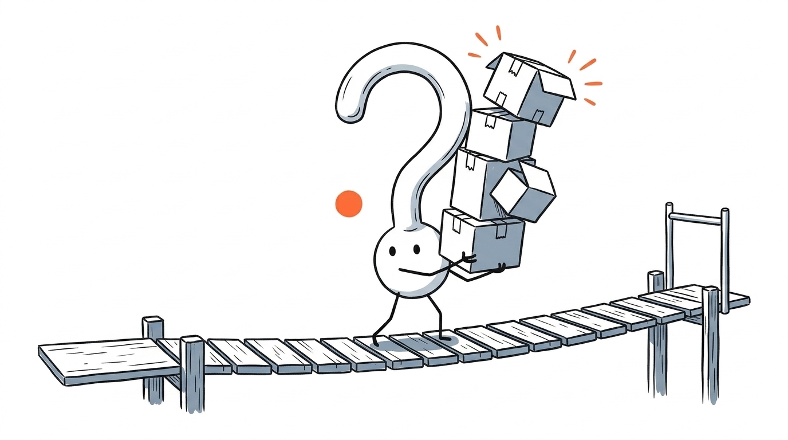
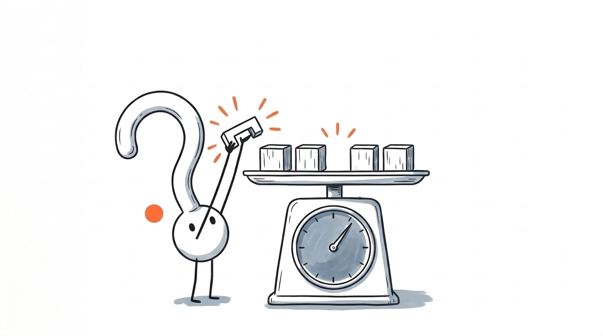

> 「これは単なるアップグレードではなく、深遠な変革です。あなたを代替するのではなく、エンパワーするツールなのです——」

SNSや技術ブログ、あるいは社内ドキュメントでこうしたAI生成文（いわゆる「**AI臭**」「**AI味**」のある文章）を目にした瞬間、なんとも言えない脳の疲労感を覚えたことはないでしょうか。

文法ミスはひとつもありません。論理も破綻していません。それなのに、人間が書いた多少荒削りで誤字が混じった文章よりも、**なぜか圧倒的に頭に入ってこない**のです。

なぜ、人間の文章を学習して作られたはずのAIが、人間にとってこれほど読みづらい文章を量産してしまうのか？

2026年10月、この現象に心理言語学（Psycholinguistics）とLLMの学習プロセスの両面からメスを入れた興味深い論文 **"Why is AI-generated language so hard to understand?"**（Thomas Hikaru Clark, Matias B. Martin, Kyle Mahowald）が発表されました。

この記事では、本論文の検証データをもとに、AIの文章が私たちの脳を疲れさせる **2つの認知メカニズム** と、その悪癖を生み出した **事後学習**（Post-training）の**構造的な罠** を解き明かします。

- **対象論文**: *Why is AI-generated language so hard to understand?* (Clark et al., 2026)

---

## 基本情報クイックリファレンス

まず、本研究の全体像と主要な結論を整理します。

| 項目 | 内容 |
|---|---|
| **研究対象** | フロンティアLLMが生成する文章の「読みづらさ（認知負荷）」の定量分析と原因特定 |
| **検証モデル**（計14種） | 大型モデル9種（Claude、GPT、Kimi 等）＋ 小型モデル5種 |
| **比較タスク**（3領域） | ①雑談（vs 映画のセリフ）、②バグ修正（vs Stack Exchange Q&A）、③エッセイ（vs 中学生の作文） |
| **脳が疲れる2大原因** | **① 予測の裏切り**（読みながら次を予測する処理の破綻）<br>**② 短期記憶のパンク**（主語と動詞が遠すぎて保持しきれない） |
| **検証手法** | 小型翻訳モデル（`NLLB-3B` / `TranslateGemma-4B`）を用いた日英往復翻訳テスト |
| **根本原因**（犯人） | 事前学習（Pre-training）ではなく、**事後学習**（Post-training / 強化学習）における「**情報圧縮バイアス**」 |

---

## 1. 人間の脳はどう文章を読んでいるか？——2つの認知ボトルネック

なぜAIの文章を読むと脳が疲れるのか。それを理解するには、まず私たち人間が文章を読むときに無意識に行っている **2つの脳内処理** を知る必要があります。



### 1.1 「読みながら予測する」と予測の裏切り

ネット上でよく見かける有名なコピペに、「**こんちには みさなん おんげき ですか？**」のようにひらがなの順番が多少入れ替わっていても、違和感なくスラスラ読めてしまう文章があります。

なぜ文字が狂っているのに一瞬で読めるのか？
それは、人間が1文字ずつ受動的に文字を拾っているのではなく、「**次に来る言葉を無意識に予測しながら読んでいる**（先読み処理）」 からです。

たとえば「漢字の……」と読めば、私たちの脳は無意識のうちに、次は「書き順」「読み方」「成り立ち」といった漢字の属性が来るだろうと予測します。だから続く文字が多少崩れていても、脳が勝手に補正して高速に処理してくれます。文脈が予測と一致している限り、読書スピードは落ちません。

逆に言えば、「**脳の予測を裏切る言葉**」が突然現れると、脳は急ブレーキをかけて**最初から文を再処理しなければならなくなります**（Re-process）。

論文が発見したのは、AIがまさにこの「人間の予測を裏切る構文」を好んで多用しているという事実です。その最たる例が、「**生き物ではないモノや抽象概念を主語にして、生き物しかやらない動作を組み合わせる**」という不自然な擬人化パターンです。

たとえば、論文中で紹介されている Claude が書いた次の英文を見てみましょう。

> **"The whole conversation is eating its own tail."**
> （直訳：会話全体が、自分の尻尾を食べている。）

人間がこの文を左から順番に読むとき、脳内ではこんな処理が起きます。

```
1. "The whole conversation is..."（会話全体が……）を読む
   └─ 脳の予測：会話だから「長引く」「脱線する」「白熱する」かな？
2. "...eating its own tail."（自分の尻尾を食べている）が来る
   └─ 脳がフリーズ：「えっ、会話が『食べる』？ 会話は生き物じゃないぞ？」
3. 立ち止まって再解釈：
   └─ 「ああ、ウロボロス（悪循環・堂々巡り）の比喩か！」と後から納得する
```

もうひとつ、GPT が生成した例文も見てみましょう。

> **"Sometimes chaos expects you to remember it independently."**
> （直訳：時にカオスは、あなたがそれを独自に覚えていることを期待する。）

「カオス（混乱）」は人間ではないので、誰かに何かを「期待する（expect）」ことはありません。日本語のAI出力でも、「このアーキテクチャがあなたの開発体験を約束します」「不確実性がプロジェクトに判断を迫ります」といった表現がよく出てきますよね。

一見すると文学的でカッコよさそうに見えますが、脳の言語処理システムからすると 「**抽象概念・モノの主語＋生き物の動作**」のミスマッチは**予測エラーの塊** です。1文ごとに小さな一時停止と再解釈を強いられるため、読めば読むほど脳のライフが削られていくのです。

---

### 1.2 「読みながら記憶する」と短期記憶のパンク

もうひとつのボトルネックは **短期記憶**（ワーキングメモリ） です。

人間が文を読むときは、文頭に出てきた言葉を脳のメモリに一時保存しながら読み進める必要があります。しかし、人間の短期記憶の容量は驚くほど小さく、保持できる時間にも限りがあります。

論文で引用されている、Claude が書いた別の1文を見てみましょう。

> **"The guitar sitting in the corner because you are still deciding teaches you zero chords."**
> （部屋の隅に置かれたまま、あなたがまだ迷っているせいで放置されているギターは、コードをひとつも教えてくれない。）

この文を頭から順番に処理するとどうなるでしょうか。

```
[メモリ格納 1] "The guitar"（ギターは…… → どうした？）
[メモリ格納 2] "sitting in the corner"（隅に置かれている…… → まだ動詞が来ない）
[メモリ格納 3] "because you are still deciding"（あなたがまだ迷っているから…… → まだ動詞が来ない！）
[ようやく結合] "teaches you zero chords."（コードを0個教える ＝ 何も上達しない）
```

主語の **`guitar`** から、対応する述語動詞の **`teaches`** が現れるまでに、なんと **8単語**（2つの修飾節） も挟まっています。

読み手は `teaches` に辿り着くまでの間、3つの未確定な情報ブロックを脳内メモリに宙吊りのまま保持し続けなければなりません。途中でメモリからこぼれ落ちれば、「あれ、何の話だっけ？」と文頭へ目を戻すことになります。

このように「**予測が外れて再解釈させられる**（Misinterpreting）」ことと、「**主語と動詞が遠すぎて記憶がパンクする**（Forgetting）」こと。この2つが、AIの文章が頭に入ってこない直接の原因です。

### 論文が特定した「AIが好む6つの難読パターン」

論文では、上記2つの認知負荷を引き起こす代表的な構文パターンとして以下の6つを挙げています。

| パターン | 概要と具体例 | 脳への負荷 |
|---|---|---|
| **① モノ・概念の不自然な擬人化** | 生き物ではないモノや概念に人間のような行動をとらせる（例：`chaos expects...`） | 予測エラーによる一時停止・再解釈 |
| **② 長い依存距離**（Long dependencies） | 主語と動詞など、結びつく2語の間に大量の修飾語を挟む | 短期記憶の保持限界オーバー |
| **③ 名詞の過剰連結**（Stacked nouns） | 名詞を3つも4つも隙間なく並べる（例：`system state transition validation logic`） | どこが修飾でどこが核か即座に判別不能 |
| **④ 関係詞・接続詞 `that` の省略** | 文を短くするため `that` を省き、一時的な誤読（Garden-path現象）を誘発する | 読み進めてから構文を取り直させる |
| **⑤ 低頻度な語結合**（Low-frequency n-grams） | 日常ではまず並ばない単語の組み合わせをひねり出す | 予測が効かず処理速度が低下 |
| **⑥ 深い構文木**（Deep syntax trees） | 入れ子構造（ネスト）が深い複雑な文構造 | 脳内スタックの圧迫 |

---

## 2. 人間との比較＆「往復翻訳」による決定的な証明

「でも、人間だってそういう難しい書き方をすることはあるのでは？」と思いますよね。

そこで研究チームは、大型モデル9種（Claude、GPT、Kimi など）と小型モデル5種の **計14モデル** を対象に、以下の3つの実務・日常シナリオで人間が書いた文章と徹底比較を行いました。

1. **雑談**（Chat）：モデルの出力 vs **映画のセリフ**
2. **バグ修正**（Bug fixing）：モデルの出力 vs **Stack Exchange のQ&A回答**
3. **エッセイ執筆**（Essay writing）：モデルの出力 vs **同じテーマで中学生が書いた作文**

結果は明白でした。**9つすべての大型モデル**が、中学生の作文よりも高い頻度で「**モノや概念に生き物の動作をさせる構文**」を使用しており、雑談においても**映画のセリフより主語と動詞を大きく引き離していた**のです。

---

### 「往復翻訳テスト」という鮮やかな実験

しかし、ここでひとつの反論が考えられます。
「AIが語っている内容自体が高度で複雑だから、仕方なくそういう複雑な構文になっているだけではないのか？」という疑問です。

この反論を検証するため、著者たちは非常にユニークで賢い実験を行いました。それが 「**小型の翻訳専用モデルを使った往復翻訳**（Round-trip Translation）」 です。

使ったモデルは、Meta の **`NLLB-3B`** と Google の **`TranslateGemma-4B`** です。どちらもパラメータ数が30億〜40億程度の、昔ながらの小さな翻訳特化モデルです。パラメータが小さいため、気の利いた文学的表現やカッコつけた言い回しを作る余裕はなく、「**意味だけを正確に直訳する**」という特徴を持っています。

研究チームは、フロンティアLLMが書いた英語の文章を、この小型翻訳モデルで 「**英語 → 日本語 → 英語**」 と2回翻訳して元の英語に戻させました。

すると、驚くべきことが起きました。

```
【元のGPTの文（難読）】
"Sometimes chaos expects you to remember it independently."
（時にカオスは、あなたがそれを独自に覚えていることを期待する。）
        │
        ▼  ① 小型翻訳モデルで「日本語」へ翻訳
        ▼  ② もう一度「英語」へ逆翻訳
        │
【往復翻訳後の文（平易・自然）】
"Sometimes you have to remember messy things on your own."
（時には、ゴチャゴチャしたことを自分で覚えなければならない。）
```

いかがでしょうか。意味はまったく同じなのに、「カオスが期待する」という奇妙な擬人化が綺麗に消え去り、「あなたが自分で覚える必要がある」という **人間にとって極めて自然で読みやすい文** に生まれ変わりました！

研究チームがAIの全回答に対してこの往復翻訳をかけたところ、不自然な擬人化構文の割合も、主語と動詞の距離も、どちらも劇的に減少しました。

要するにこういうことです。「**AIが伝えたかった内容は、本当はもっとシンプルで分かりやすい言葉で書けた。しかし、AIはわざわざ読みづらい言い回しを選んで出力していた**」 のです。

---

## 3. なぜAIはそんな悪癖を身につけたのか？

ここからが本論文の最もスリリングなパートです。

そもそも、LLMの学習データ（インターネット上のテキストや書籍）はすべて「人間が書いた文章」です。人間の文章を真似して学習したはずなのに、なぜ人間より読みづらい文章を書くようになるのでしょうか？

その謎を解くため、研究チームはLLMの学習プロセスの2つの段階に注目しました。

1. **事前学習**（Pre-training）：大量のテキストを読み、前の言葉から次の言葉を予測する「しりとり（次トークン予測）」を学ぶ段階。
2. **事後学習**（Post-training）：指示に従う訓練（SFT）や、良い回答にプラスの報酬・悪い回答にマイナスの罰を与える強化学習（RLHF / RLVR）を行い、問題解決能力を高める段階。

研究チームは、あるオープンウェイトモデル（Qwen系モデル）の **3つの異なる学習段階のバージョン** を用意し、それぞれの出力に対して先ほどの「往復翻訳テスト」を実施しました。

- **バージョン①**：事前学習（Pre-training）のみを行ったベースモデル
- **バージョン②**：通常の事後学習（Instruct）まで行ったモデル
- **バージョン③**：事後学習の後に、さらに **推論強化**（Reasoning） の訓練を重ねたモデル

「往復翻訳の前後で文章が大きく変わるほど、元の文章に『読みづらいAI構文』が多く含まれていた」と判定できます。実験の結果はどうだったでしょうか？

```
読みづらい構文の多さ（往復翻訳での変化量）

 ① 事前学習のみ (Base)         : ■■░░░░░░░░ （ほぼ変化なし＝人間並みに自然）
 ② 通常の事後学習 (Instruct)   : ■■■■■░░░░░ （難読構文が目立ち始める）
 ③ 推論強化モデル (Reasoning)  : ■■■■■■■■■■ （大型商用モデル並みに難読化！）
```

なんと、**事前学習だけのモデルは人間と同じくらい自然な文を書いていた**のに、事後学習（Post-training）を重ねれば重ねるほど、あの独特の「**AI臭**」（難読構文）が**激増していた**のです！

---

### 犯人は「採点プログラム」と「トークン圧縮圧力」

なぜ事後学習を行うと、文章が読みづらくなるのでしょうか？

事後学習（特にコーディング、数学、論理推論の強化学習）では、モデルの回答を自動プログラムが採点します。この採点プログラムが見ているのは 「**最終的な答えが合っているか**」（正解か不正解か）だけ です。「途中の文章が人間にとって読みやすいか」などは1ミリも評価していません。

そして、モデルには常に 「**コンテキスト長の上限**（出力トークン制限）」 という厳しい制約がつきまといます。

もし長いタスクの序盤で丁寧すぎる説明をダラダラ書いてしまうと、途中でトークン上限に達して処理が打ち切られ、最終回答に辿り着けず「0点（不正解）」を食らってしまいます。つまり、事後学習の環境では 「**同じ意味を1トークンでも短く詰め込んで書いたほうが、完走して高得点を取れる確率が上がる**」 のです。

先ほどの例文で単語数を比べてみましょう。

- **人間の自然な表現**：*"You have to remember the messy stuff yourself."*（**8単語**）
- **AIの圧縮表現**：*"Chaos expects you to remember it."*（**6単語**）

抽象概念である「カオス」を主語にして「期待する（expects）」という動詞1個に無理やり意味を背負わせれば、2単語（数トークン）節約できます！

一方、私たち人間の言語はまったく逆の方向に進化してきました。世界37言語を対象とした言語学の研究では、人間は常に「**聞き手の記憶負荷を下げるため、主語と動詞など関連の強い言葉をなるべく近くに配置する**」ように話すことが分かっています。

- **人間の言語の目的**：「**伝達**（Communication）」—— 相手の脳に負担をかけず、誤解なく理解してもらうこと。
- **事後学習されたAIの目的**：「**圧縮**（Compression）」—— 限られたトークン枠に最大量の情報を詰め込み、採点プログラムで高得点を取ること。

AIが難解な比喩や詰め込みすぎた構文を連発するのは、文学家を気取っているからではありません。**減点を恐れて情報をギチギチに圧縮した結果**、人間の脳の処理限界を無視した「**超高密度な暗号**」になってしまっていたのです。

---

## 4. 実証実験：モデルに「文字数ペナルティ」を課してみた



「事後学習での長さに対するペナルティが、AIの文章を読みづらくしている」——この仮説が本当に正しいのかを確かめるため、研究チームは自ら **`Qwen 2.5-1.5B`** を使って再現実験を行いました。

実験の内容は、小学校の英語の授業でやるような「単語並べ替え・英作文」です。
たとえば、モデルに次の4つの単語を与えて、正しい英文を1つ作らせます。

- 与える単語：`she` / `knew` / `answer` / `wrong`

この4語から作れる正しい英文には、大きく分けて次の2パターンがあります。

1. **パターンA**（7単語・読みやすい）：
   **"She knew that the answer was wrong."**
2. **パターンB**（6単語・`that` を省略）：
   **"She knew the answer was wrong."**

文法としてはどちらも正解ですが、人間にとって圧倒的に読みやすいのは **パターンA**（`that` あり） です。

なぜなら、`that` があれば「これから彼女が知っていた『内容（節）』が始まるぞ」と脳が構えられるからです。逆に `that` を省いたパターンBでは、*"She knew the answer..."* まで読んだ時点で脳が一度「彼女は答えを知っていた」と解釈してしまい、直後の *"...was wrong."* を見て「あ、違う、『答えが間違っていたこと』を知っていたのか！」と構文を組み直す手戻り（言語学で言う **ガーデンパス現象 / Garden-path effect**）が発生します。

研究チームは、この英作文タスクの事後学習において、次のような採点プログラムを設定しました。

- 文の意味が正しければ **プラス点**
- ただし、**文が1単語長くなるごとにマイナス点**（長さペナルティ）

重要なのは、研究チームはモデルに対して 「**`that` を省略しろ**」とは**一言も教えていない** ということです。ただ純粋に「文字数（単語数）」に対してペナルティをかけ、そのペナルティの強さを変えながら複数回トレーニングを行いました。

結果はどうなったか？

**長さに対するペナルティを強くすればするほど、モデルは自発的に `that` を削ぎ落とすようになり**、人間にとって誤読しやすい「**省略構文**」を猛烈な勢いで連発するようになったのです。

実際の商用LLMの事後学習では、ここまで露骨に「1単語マイナス何点」と設定しているわけではないでしょう。しかし、トークン上限や推論効率の制約によって「短く詰め込むことが有利になる環境」に置かれると、モデルは「**人間の読みやすさ**」を真っ先に切り捨てて、**接続詞や補助語を削るハックを自ら編み出してしまう**ことが、この実験によって鮮やかに実証されました。

---

## 5. 実務への応用：AIの「過圧縮グセ」を解除するプロンプト設計

この論文の知見は、私たちが日々の業務でChatGPTやClaudeに技術記事、仕様書、メールを書かせる際の「**AI臭抜き**（De-AI）」にそのまま応用できます。

これまで私たちは、AIの文章を自然にするために「もっと人間らしく書いて」「自然なトーンで」といった曖昧な指示を出しがちでした。しかし、原因が「**不自然な擬人化による圧縮**」と「**主語・述語の遠距離分離**」にあると分かれば、対策は極めて具体的になります。

システムプロンプトや執筆スキル（`AGENTS.md` 等）に、以下の **3つの構文ルール** を明記してみてください。

```markdown
<!-- AIの「過圧縮構文」を解除する執筆指示テンプレート -->
文章を作成する際は、情報の圧縮よりも「人間の脳が1回で引っかからずに読めること」を最優先し、以下の構文ルールを厳守してください。

1. モノや抽象概念の不自然な擬人化を禁止：
   「システムが〜を約束する」「カオスが〜を要求する」「設計が〜を解決する」のように、モノや抽象概念に人間の動作をさせないでください。「開発者が〜できる」「この設計により〜が解決する」のように、人間を主語にするか自然な因果表現に書き換えてください。

2. 主語と述語（動詞）を近づける：
   主語の直後に長い修飾節をいくつも挟まないでください。主語と述語の間に読点や修飾が長くなりそうな場合は、文を2つに分けるか、修飾節を文頭に出してください。

3. 1文1情報・つなぎ言葉（接続詞・関係詞）をケチらない：
   トークンを節約するために複数の主張を1文に詰め込んだり、文脈の切り替えを示す接続詞を省略したりしないでください。
```

この3点を指定するだけで、AI特有の「翻訳調の気取った比喩」や「最後まで読まないと結論が分からない長い1文」が劇的に減り、スッと頭に入ってくる文章に変わります。なお、本論文の著者らも、最新の Claude では旧バージョンに比べてこうした難読構文が減少傾向にあり、AI開発企業側でも徐々に改善が進められていると指摘しています。

---

## 6. まとめ：高得点の答案ではなく「伝わる言葉」を

本記事の要点を整理します。

1. **AI文が読みづらい2大原因**：人間の脳が行う「先読み予測」を不自然な擬人化構文で裏切り、「短期記憶」を主語・動詞の遠距離分離でパンクさせるため。
2. **往復翻訳が暴いた真実**：小型翻訳モデルで日英を往復させると難読構文が消えて平易になることから、AIは「簡単な言葉で書ける内容」をわざわざ難解な構文で出力している。
3. **真犯人は事後学習**（Post-training）：事前学習段階では自然だった文体が、正答率とトークン効率を競う事後学習・推論訓練を経ることで、「人間の読みやすさを犠牲にしてでも情報を短く圧縮する」方向に歪められた。

人間が書いた文章が、たとえ少し文法が乱れていても一目でスッと理解できるのは、それが「**目の前の誰かに伝えるため**」に書かれているからです。一方、AIの文章がどれほど論理的に完璧でも読んでいて疲れるのは、AIの頭の中には「採点プログラムで高得点を取ること」しかなく、「**読み手である人間**」が**最初から評価基準に入っていない**からです。

そして、ふと私たち自身の日常を振り返ってみると、どこかドキッとさせられます。
学生時代はテストの点数、社会人になればKPIや評価シート、帰省すれば年収や肩書き——。世の中の巨大な「採点プログラム」に適応するうちに、私たち自身もまた、スコアにならない感情や無駄話、人間らしい余白を「不要なトークン」として自分から削ぎ落とし、減点されない無難な優等生になってはいないでしょうか。

文章が「圧縮」のためではなく「表現と伝達」のためにあるように、私たちの言葉や仕事も、採点器のためではなく「生身の相手」に向けて紡いでいきたいものです。

皆さんは、AIが生成した文章やコードを読んでいて「ここがどうにもAI臭くて疲れる！」と感じるのはどんな瞬間ですか？ぜひコメント欄で教えてください！
